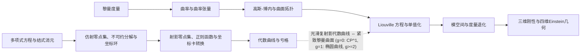

# 2026 浙大暑期学校课程总结

> [!abstract] 课程主线综述
> 本专题课程笔记系统记录了 2026 年浙江大学数学暑期学校的核心学习内容，由**代数几何**与**黎曼几何（及几何分析/偏微分方程文献研读）**两条主线构成：代数几何从多项式方程组与平面曲线出发，围绕仿射代数集与理想对应、射影空间嵌入、结式消元、不可约分解及坐标环/函数环计算展开，并配套整理了三份课程作业与 Miles Reid *Undergraduate Algebraic Geometry* 教材讲义；黎曼几何则从微分流形上的黎曼度量与 Levi-Civita 联络出发，围绕高斯曲率、截面曲率与 Ricci 曲率，依次展开二维曲面的高斯-博内定理、Liouville 型偏微分方程与单值化定理、高亏格曲面的 Teichmüller 模空间与度量退化、三维双曲流形的 Mostow 刚性定理以及四维流形上的几何化与爱因斯坦度量问题，同时配套整理了微分方程方向关于高阶椭圆方程爆破分析与球面 Nirenberg 问题证明框架的文献研读笔记。

## 1. 讲义体系与专题材料导引

| 课程方向 | 专题讲义与习题构成 | 核心入口链接 |
| --- | --- | --- |
| **代数几何** | 第一讲课程讲义、配套作业 1--3，以及 Miles Reid *Undergraduate Algebraic Geometry* 全本教材讲义 | [[2026浙大暑期学校/代数几何课程记录/课程记录/第一讲：仿射簇与平面曲线|第一讲：仿射簇与平面曲线]]、[[2026浙大暑期学校/代数几何课程记录/作业/作业1|作业1]]--[[2026浙大暑期学校/代数几何课程记录/作业/作业3|作业3]]、[[2026浙大暑期学校/代数几何课程记录/Undergraduate Algebraic Geometry/Undergraduate Algebraic Geometry|Undergraduate Algebraic Geometry]] |
| **黎曼几何与几何分析** | 单值化定理总览、8 篇核心专题讲义、配套作业 1--4 以及微分方程方向两篇文献证明框架笔记 | [[2026浙大暑期学校/黎曼几何课程记录/单值化定理|单值化定理总览]]、[[2026浙大暑期学校/黎曼几何课程记录/课程笔记管理.base|黎曼几何课程 Base]]、[[2026浙大暑期学校/黎曼几何课程记录/作业/作业1|作业1]]--[[2026浙大暑期学校/黎曼几何课程记录/作业/作业4|作业4]] |

> [!info] 研读说明
> 本课程总结严格区分仓库中已保存的真实课程记录、作业题面与教材延伸阅读：代数几何部分以第一讲的仿射簇与平面曲线为起点，结合三份真实课程作业（Veronese 嵌入与结式消元、仿射零点集不可约分解与坐标环、射影零点集与仿射坐标卡转换）及 Miles Reid 教材构成递进学习阶梯；黎曼几何与偏微分方程部分则完整汇总了二维单值化、三维刚性、四维爱因斯坦几何专题讲义以及高阶椭圆方程爆破分析与球面 Nirenberg 问题的证明框架笔记。

## 2. 代数几何：从平面曲线、仿射簇到射影簇与教材延伸

### 2.1 课程讲义与延伸理论脉络

代数几何模块结合课堂讲授、三次课程作业与 Miles Reid 经典教材 *Undergraduate Algebraic Geometry*，按以下三个层次展开：

1. **平面曲线参数化、Veronese 嵌入与结式消元**：从二次曲线的有理参数化与射影直线的二次 Veronese 嵌入出发，利用多元多项式的结式（resultant）消元法定位两条平面曲线的交点坐标，并通过多项式带余除法与次数整除性分析证明光滑（或非退化）三次曲线如 $x^3+y^3=1$ 不存在非常数有理函数参数化。
2. **仿射代数集、不可约分解与函数环计算**：在仿射空间 $\mathbb A^n$ 中建立多项式理想 $I$ 与仿射零点集 $V(I)$ 的反序对应关系，掌握利用因式分解与素理想判别将具体仿射代数集拆解为不可约分支（irreducible components）之并的标准算法，并通过商环 $k[x_1,\ldots,x_n]/I(V)$ 具体计算仿射簇上的多项式坐标环（函数环）。
3. **射影代数集、正则函数与仿射坐标卡转换（及教材延伸阅读）**：引入射影空间 $\mathbb P^n$ 的齐次坐标与齐次理想生成元，掌握通过标准仿射开覆盖 $U_i=\{X_i\neq 0\}$ 在齐次多项式与去齐次化仿射方程之间自由转换，理解有理函数在一点处正则（regular）的局部环判据；在此基础上，可进一步沿 Miles Reid 教材延伸阅读光滑三次曲线的拐点与群律、Noether 正规化、爆破奇点消解以及三次曲面上的 $27$ 条直线。

### 2.2 专题讲义、三次真实作业题面与教材内容分布

#### 1. 核心课程讲义
- [[2026浙大暑期学校/代数几何课程记录/课程记录/第一讲：仿射簇与平面曲线|第一讲：仿射簇与平面曲线]]：系统阐述仿射空间 $\mathbb{A}^n$、代数集 $V(I)$ 与理想 $I(V)$ 的对应关系、Noether 环的 Hilbert 基定理、二次曲线的有理参数化、平面代数曲线的奇点与交点消元计算。

#### 2. 三次课程作业的真实题目内容
- [[2026浙大暑期学校/代数几何课程记录/作业/作业1|作业1（Veronese 整除判据、结式 Bézout 恒等式次数界与三次曲线 $y^2=x(x-a)(x-b)$ 无有理参数化）]]：
  - **二次 Veronese 代入恒零与 $XZ - Y^2$ 整除性**：证明若将 $(X, Y, Z) = (u^2, u v, v^2)$ 代入齐次多项式 $F(X, Y, Z)$ 恒等于零，则二次多项式 $X Z - Y^2$ 必整除 $F(X, Y, Z)$；
  - **结式（Resultant）型 Bézout 恒等式、乘子多项式与结果式次数界**：针对多元多项式消元，构造结式型 Bézout 恒等式 $A f + B g = R$，严格证明乘子多项式 $A, B$ 以及消元结果式 $R$ 的次数上界；
  - **指定平面三次曲线 $y^2 = x(x - a)(x - b)$ 无有理参数化证明**：在复数域 $k = \mathbb{C}$（或一般满足 **$\operatorname{char} k \neq 2$** 的域 $k$，此特征条件为原题成立所必需的前提补充：若 $\operatorname{char} k = 2$，在 $\overline{\mathbb{F}}_2$ 上取 $a=1, b=\omega$ 即存在非常数多项式参数化 $x(t)=t^2, y(t)=t(t+1)(t+\omega^2)$）上，对互异非零参数 $a \neq b$（$a, b \neq 0$），通过多项式整除性与次数奇偶分析，严格证明非奇异三次曲线 $y^2 = x(x - a)(x - b)$ 不存在非常数有理函数参数化 $(x(t), y(t)) \in k(t)^2$。
- [[2026浙大暑期学校/代数几何课程记录/作业/作业2|作业2（单多项式非空零点初等证明与不可约分解存在唯一性）]]：
  - **对任意单个非常数多元多项式不借用零点定理证明零点存在性**：在代数闭域 $k$ 上，对任意单个非常数多项式 $f \in k[x_1, \dots, x_n] \setminus k$，不借用 Hilbert 零点定理，直接利用一元代数基本定理与变元归纳法证明 $V(f) \neq \varnothing$（并分析仿射零点集的基本性质）；
  - **仿射代数集不可约分解的存在性与唯一性定理**：基于 Noether 环的理想升链条件（对应仿射代数集的降链条件），严格证明任意仿射代数集均可表为有限个不可约闭集的并集 $V = V_1 \cup \cdots \cup V_r$，且在不可约分支互不包含（$V_i \not\subseteq V_j, \, i \neq j$）的条件下该分解唯一（注：关于尖点曲线坐标环与 UFD 判别等具体算例作为课外延伸练习）。
- [[2026浙大暑期学校/代数几何课程记录/作业/作业3|作业3（射影零点定理、$\mathbb P^n$ 及射影子簇的仿射图与全局正则函数常值性）]]：
  - **射影零点定理（Projective Nullstellensatz）**：在代数闭域 $k$ 上，对齐次理想 $J \subset k[X_0, \dots, X_n]$，严格证明当其射影零点集非空 **$V_{\mathbb{P}}(J) \neq \varnothing$** 时，其齐次消失理想满足 **$I\bigl(V_{\mathbb{P}}(J)\bigr) = \sqrt{J}$**；同时补充射影空集边界判据：$V_{\mathbb{P}}(J) = \varnothing$ 当且仅当 $\sqrt{J}$ 包含无关极大理想 $\mathfrak{m}_+ = (X_0, \dots, X_n)$（注意原题仅写 $J \neq \mathfrak{m}_+$ 不足以排除空集，例如 $J = \mathfrak{m}_+^2$ 同样导致 $V_{\mathbb{P}}(J) = \varnothing$，故必须以 $V_{\mathbb{P}}(J) \neq \varnothing$ 或 $\sqrt{J} \not\supseteq \mathfrak{m}_+$ 为准确前提）；
  - **射影空间 $\mathbb{P}^n$ 上全局正则函数的常值性**：利用齐次分式表示证明 $\mathbb{P}^n$ 上处处正则的函数必为常数（$\mathcal{O}_{\mathbb{P}^n}(\mathbb{P}^n) = k$）；
  - **射影子簇的仿射图（Affine Charts）与全局正则函数常值性**：刻画射影子簇 $V \subset \mathbb{P}^n$ 与标准仿射开覆盖 $U_i = \{X_i \neq 0\}$ 的交集 $V \cap U_i$ 的仿射簇结构，并证明不可约射影子簇上的全局正则函数必为常数（具体的坐标转换算例作为延伸阅读）。

#### 3. Miles Reid 教材全文与微分方程方向文献框架笔记
1. **Miles Reid *Undergraduate Algebraic Geometry* 全本教材**：讲义库完整收录了 [[2026浙大暑期学校/代数几何课程记录/Undergraduate Algebraic Geometry/Undergraduate Algebraic Geometry|Undergraduate Algebraic Geometry]] 的全书章节（Chapter I `Playing with plane curves`：二次曲线、三次曲线拐点与群律、Bézout 定理；Chapter II `Affine varieties`：Hilbert 基定理与零点定理、不可约分解、坐标环与有理函数域、Noether 正规化；Chapter III `Applications`：射影簇、双有理映射、奇点爆破消解与三次曲面上的 $27$ 条直线），供在完成上述三次课程作业后作系统延伸研读。
2. **微分方程与几何分析方向两篇文献笔记的定位**：在微分方程与几何分析模块中，同步整理了两篇前沿文献导读笔记，其内容定位为**整理了高阶椭圆方程爆破分析（blow-up analysis）与球面 Nirenberg 问题的证明框架**（梳理想法脉络、核心先验估计步骤、集中紧性/爆破标度化归与 Kazdan–Warner 型阻塞条件的技术路线，作为研读原始论文的框架导引，而非替代原论文的逐行细节复刻）。

## 3. 黎曼几何：从黎曼度量、曲率张量到单值化与刚性理论

### 3.1 理论演进脉络

黎曼几何课程沿着“局部微分几何（度量与曲率） $\to$ 二维整体几何（高斯-博内与单值化） $\to$ 曲面模空间理论 $\to$ 三维双曲刚性与四维爱因斯坦几何”的脉络展开，分为四个递进阶段：

1. **黎曼流形与曲率张量基础**：在光滑流形上引入黎曼度量 $g$，通过无挠与度量相容条件唯一确定 Levi-Civita 联络 $\nabla$；由协变导数的不对易性定义 Riemann 曲率张量 $R(X,Y)Z$，并引入截面曲率 $K(\sigma)$、Ricci 曲率 $\operatorname{Ric}$ 与数量曲率 $S$，结合弧长第一、第二变分公式揭示曲率对测地线汇聚与发散的几何控制。
2. **二维曲面的拓扑、复结构与单值化定理**：建立连接局部高斯曲率 $K$ 与整体 Euler 示性数 $\chi(\Sigma)=2-2g$ 的**高斯-博内定理** $\int_\Sigma K\,\mathrm{d}A=2\pi\chi(\Sigma)$；在二维流形上证明定向保角结构（共形类）与复结构（黎曼曲面）的一一对应，并将寻找常曲率共形度量的问题归结为求解非线性椭圆偏微分方程——**Liouville 方程** $-\Delta_{g_0} u + K_{g_0} = \Lambda e^{2u}$，从而完成将闭可定向曲面按亏格 $g=0,1,g\ge 2$ 统一赋予常曲率 $+1,0,-1$ 度量（其万有覆盖分别为黎曼球面 $\mathbb{CP}^1\cong\mathbb{S}^2$、复平面 $\mathbb{C}\cong\mathbb{E}^2$ 与上半平面/双曲平面 $\mathbb{H}^2$）的**单值化定理**（Uniformization Theorem）。
3. **高亏格曲面的模空间与度量退化**：对亏格 $g\ge 2$ 的闭曲面，虽然单值化定理保证了每个共形类中有唯一的常曲率 $K=-1$ 双曲度量，但不同双曲度量（即不同复结构）之间存在连续的形变自由度；通过裤子分解（pants decomposition）与 Fenchel-Nielsen 扭转-长度坐标证明 Teichmüller 空间 $\mathcal{T}_g$ 是维数为 $6g-6$ 的实解析流形，并探讨短闭测地线夹断（pinching）时的尖点（cusp）退化与 Deligne-Mumford 紧化边界。
4. **三维双曲流形的 Mostow 刚性与四维爱因斯坦几何**：当流形维数从 $n=2$ 跨入 $n\ge 3$ 时，几何性质发生戏剧性转折——**Mostow 刚性定理**表明，维数 $n\ge 3$ 的有限体积完备双曲流形不存在任何非平凡形变，其拓扑基本群 $\pi_1(M)$ 的同构直接唯一决定了等距双曲度量（可通过拟共形映射延拓至无穷远球面 $\partial_\infty\mathbb{H}^n$ 并结合测地流遍历性予以证明）；最后进一步展望 Thurston 三维几何化定理以及四维流形上自对偶/反自对偶 Weyl 曲率分解、Hitchin-Thorpe 拓扑障碍与四维爱因斯坦度量的前沿问题。

### 3.2 专题讲义结构导览

- [[2026浙大暑期学校/黎曼几何课程记录/单值化定理|单值化定理]]：单值化定理的总览讲义，系统梳理复分析（Riemann 映射定理）与微分几何（常曲率共形度量）两条路径的汇合，阐明任意单连通黎曼曲面必双全纯等价于黎曼球面 $\mathbb{C}\mathbb{P}^1\cong\mathbb{S}^2$、复平面 $\mathbb{C}$ 或上半平面 $\mathbb{H}$ 之一。
- [[2026浙大暑期学校/黎曼几何课程记录/黎曼流形与曲率|黎曼流形与曲率]]：系统建立切丛与张量场、黎曼度量、Levi-Civita 联络的 Koszul 公式、测地线方程与指数映射、Riemann 曲率张量的对称性与 Bianchi 恒等式，以及截面曲率、Ricci 曲率与数量曲率在不同维数下的代数分解。
- [[2026浙大暑期学校/黎曼几何课程记录/二维曲面的拓扑与复结构|二维曲面的拓扑与复结构]]：剖析闭可定向曲面的连通和分类与亏格 $g$、等温坐标系（isothermal coordinates）的存在性，严格证明二维定向黎曼度量共形类、近复结构 $J^2=-\operatorname{id}$（在二维自动可积）与一维复流形结构三者之间的完全等价。
- [[2026浙大暑期学校/黎曼几何课程记录/高斯-博内定理|高斯-博内定理]]：从局部活动标架与测地曲率出发，通过曲面三角剖分证明局部与整体高斯-博内公式 $\int_\Sigma K\,\mathrm{d}A + \int_{\partial\Sigma}k_g\,\mathrm{d}s + \sum_i\theta_i = 2\pi\chi(\Sigma)$，并运用它给出闭曲面常曲率符号受拓扑亏格严格支配的几何推论。
- [[2026浙大暑期学校/黎曼几何课程记录/单值化定理的PDE证明|单值化定理的PDE证明]]：推导共形变换 $g=e^{2u}g_0$ 下的高斯曲率变换方程 $-\Delta_{g_0} u + K_{g_0} = K_g e^{2u}$，并针对闭黎曼面 $g=0$（紧致标准模型为**黎曼球面 $\mathbb{CP}^1\cong\mathbb{S}^2$**，可通过删去一点后的球极投影坐标图或在球面上求解共形曲率方程处理；注意非紧的开复平面 $\mathbb{C}$ 不能与紧致闭曲面双全纯等同）、$g=1$（求解常系数线性散度型 Poisson 方程 $\Delta_{g_0}u=K_{g_0}$，万有覆盖为 $\mathbb{C}$）以及 $g\ge 2$（利用泛函变分直接法或上下解方法求解含指数非线性项的椭圆方程 $-\Delta_{g_0}u+K_{g_0}=-e^{2u}$，万有覆盖为 $\mathbb{H}^2$）梳理单值化定理的 PDE 证明框架。
- [[2026浙大暑期学校/黎曼几何课程记录/模空间与度量退化|模空间与度量退化]]：研究亏格 $g\ge 2$ 曲面的双曲结构形变，通过 $3g-3$ 条不相交简单闭测地线将曲面分解为 $2g-2$ 条双曲裤子（pairs of pants），利用 Fenchel-Nielsen 长度与扭转坐标导出 $\dim_{\mathbb{R}}\mathcal{T}_g=6g-6$，并结合领圈引理（Collar Lemma）与 Mumford 紧性定理刻画闭测地线长度趋于零时的双曲尖点退化。
- [[2026浙大暑期学校/黎曼几何课程记录/三维双曲流形与Mostow刚性定理|三维双曲流形与 Mostow 刚性定理]]：对比二维曲面的 $6g-6$ 维连续模空间与三维双曲流形的完全刚性，阐述双曲空间 $\mathbb{H}^n$ 的无穷远理想边界 $\partial_\infty\mathbb{H}^n\cong\mathbb{S}^{n-1}$、拟等距（quasi-isometry）向边界拟共形同胚的延拓，以及 $n\ge 3$ 时边界共形几何刚性如何迫使同伦等价必同构于等距同胚。
- [[2026浙大暑期学校/黎曼几何课程记录/Mostow刚性定理的动力学证明|Mostow 刚性定理的动力学证明]]：深入展开以几何群论与遍历理论（ergodic theory）为核心的刚性证明机制，包括 Gromov 双曲群的 Morse 引理（拟测地线稳定性）、单位切丛上测地流的 Hopf 遍历性定理，以及在无穷远球面上结合绝对连续性与 Rademacher 可微性定理完成共形线性化。
- [[2026浙大暑期学校/黎曼几何课程记录/几何化与四维爱因斯坦度量|几何化与四维爱因斯坦度量]]：在更高维度的视野下对比二维单值化、三维 Thurston 八种几何模型与 Hamilton-Perelman Ricci 流几何化定理，并重点剖析四维黎曼流形上曲率张量的正交不可约分解与 Hodge 星算子自对偶分解：在标准 Kulkarni–Nomizu 乘积约定 $(h\owedge k)_{ijkl}=h_{ik}k_{jl}+h_{jl}k_{ik}-h_{il}k_{jk}-h_{jk}k_{il}$ 下（一般 $n$ 维无迹 Ricci 项系数为 $\frac{1}{n-2}$，数量曲率项系数为 $\frac{S}{2n(n-1)}$），当 $n=4$ 时四维曲率张量分解为
  $$
  Rm = W^+ + W^- + \frac{1}{2}\mathring{\operatorname{Ric}}\owedge g + \frac{S}{24}g\owedge g;
  $$
  结合四维 Gauss-Bonnet-Chern 公式与 Hirzebruch 符号差公式，在**四维闭（紧致无边）、定向流形容许 Einstein 度量（$\mathring{\operatorname{Ric}}=0$）**的前提下，由被积函数非负性导出著名的 **Hitchin–Thorpe 拓扑不等式** $2\chi(M)\ge 3|\tau(M)|$（即 $\chi(M)\ge\frac{3}{2}|\tau(M)|$）。
- [[2026浙大暑期学校/黎曼几何课程记录/课程笔记管理.base|课程笔记管理.base]]：汇总管理黎曼几何模块全部专题讲义与习题的 Obsidian 索引视图。

### 3.3 核心几何公式与维数转折

在二维曲面上，连接微分几何曲率与代数拓扑示性数的根本桥梁是**高斯-博内公式**：

$$
\int_\Sigma K \, \mathrm{d}A = 2\pi \chi(\Sigma) = 2\pi(2 - 2g).
$$

在等温坐标或共形度量形变 $g=e^{2u}g_0$ 下，寻找常高斯曲率 $\Lambda\in\{+1,0,-1\}$ 的度量等价于求解 **Liouville 型非线性椭圆偏微分方程**：

$$
-\Delta_{g_0} u + K_{g_0} = \Lambda e^{2u}.
$$

对于亏格 $g=0,\ g=1,\ g\ge 2$ 的闭曲面，其常曲率标准模型分别为球面 $\mathbb{S}^2\cong\mathbb{CP}^1$、平坦环面 $\mathbb{C}/\Lambda$ 与双曲曲面 $\mathbb{H}^2/\Gamma$。当 $g\ge 2$ 时，Fenchel-Nielsen 坐标精确给出了 Teichmüller 模空间的实维数：

$$
\dim_{\mathbb{R}} \mathcal{T}_g = 6g - 6\qquad(\text{对应复维数 }\dim_{\mathbb{C}}\mathcal{M}_g=3g-3);
$$

而一旦进入维数 $n\ge 3$ 的双曲几何，Mostow 刚性定理则将连续的形变模空间彻底压缩为零维单点（即拓扑基本群唯一决定双曲度量）。

### 3.4 配套习题所涵盖的专题训练

[[2026浙大暑期学校/黎曼几何课程记录/作业/作业1|作业 1]] 至 [[2026浙大暑期学校/黎曼几何课程记录/作业/作业4|作业 4]] 紧密配合上述理论主线，依次训练了：二维曲面上定向保角结构与复结构的等价性证明、平坦环面 $\mathbb{C}/(\mathbb{Z}+\tau\mathbb{Z})$ 上不同复模参数 $\tau\in\mathbb{H}$ 的共形分类、Liouville 能量泛函的 Euler-Lagrange 变分导数与二阶变分正定性（严格凸性）证明、裤子分解中 $3g-3$ 条曲线数目的拓扑欧拉示性数计算、Poincaré 上半平面模型中双曲测地线趋向理想边界的无穷弧长性质、平坦三维流形的有限覆盖、环面上的双曲自同构（Anosov 微分同胚）动力学性质，以及三维流形的 Heegaard 分解与连通和拓扑构造。

## 4. 代数几何与黎曼几何两条主线的深度交汇

纵览两门课程的全部内容，我们可以提炼出贯穿现代几何学的五条核心思想方法：

1. **从局部代数/分析数据构造全局几何空间**：代数几何通过标准仿射坐标卡 $U_i=\{X_i\neq 0\}$ 上去齐次化多项式坐标环与局部正则函数的粘合构造射影簇；黎曼几何则通过局部坐标卡上的度量张量与等温坐标构造带有整体曲率与复结构的流形。
2. **用不变量（Invariants）统领分类问题**：在代数几何中，曲线的有理参数化存否（如作业一中二次曲线有理参数化与三次曲线无有理参数化的对比）以及坐标环的代数性质刻画了簇的双有理与同构分类；在黎曼几何中，Euler 示性数 $\chi(\Sigma)=2-2g$ 通过高斯-博内定理直接决定闭曲面常曲率度量的符号（$g=0\Leftrightarrow K>0$ 对应 $\mathbb{CP}^1\cong\mathbb{S}^2$，$g=1\Leftrightarrow K=0$，$g\ge 2\Leftrightarrow K<0$），Teichmüller 维数 $6g-6$ 度量复结构的形变自由度，而四维闭定向流形上的 $\chi(M)$ 与 $\tau(M)$ 则通过 Hitchin–Thorpe 不等式制约 Einstein 度量的存在性。
3. **空间维数对几何性格的决定性影响**：在实二维（复一维）情形，Riemann 曲率张量完全由单个标量函数（高斯曲率 $K$）决定，既拥有丰富的连续模空间 $\mathcal{M}_g$，又能借助复分析与椭圆 PDE 实现单值化分类；在实三维情形，Weyl 共形曲率张量恒为零，Einstein 度量等价于常截面曲率度量，且双曲结构呈现出高度的 Mostow 刚性；而到了实四维情形，曲率张量分解为 $Rm=W^++W^-+\frac{1}{2}\mathring{\operatorname{Ric}}\owedge g+\frac{S}{24}g\owedge g$，Einstein 条件（$\mathring{\operatorname{Ric}}=0$）仅消去无迹 Ricci 项而保留自对偶与反自对偶 Weyl 曲率 $W^\pm$，涌现出深刻的拓扑障碍与分析爆破现象。
4. **存在性、唯一性与模空间的三重奏**：几何分类问题总是分三个层次推进——首先回答“标准几何结构（如不可约分解、光滑模型或常曲率/预订曲率度量）是否存在”（单值化定理与球面 Nirenberg 问题），其次回答“在固定共形类或双有理类内是否唯一”（椭圆 PDE 解的唯一性、高阶椭圆方程爆破分析与紧性控制），最后回答“不等价的标准结构全体构成怎样的参数空间”（模空间 $\mathcal{M}_g$、Teichmüller 空间 $\mathcal{T}_g$ 以及高维的刚性定理）。
5. **代数、分析、拓扑与动力系统的交叉融合**：本系列讲义生动展示了现代数学不同分支的协同威力——Veronese 嵌入、结式消元与坐标环商环提供精确的代数计算，等温坐标与全纯微分架起通往复分析的桥梁，椭圆偏微分方程、变分法与爆破分析攻克曲率方程存在性难关，而测地流的遍历性理论则将动力系统方法引入高维几何刚性的核心证明。

> [!important] 核心方法论总结
> 2026 浙大暑期学校各方向课程的核心收获，在于建立起一条从**“局部方程与度量计算”**通往**“整体拓扑不变量、模空间形变、刚性定理与非线性 PDE 证明框架”**的现代几何思维范式：面对一个几何对象，首先用恰当的局部语言（仿射坐标环、射影坐标卡或曲率张量）将其严格定义，继而寻找在变换下保持不变的整体不变量（亏格、示性数、基本群），最终弄清这些不变量在多大程度上唯一锁定了几何结构，又在哪些方向上允许连续形变或产生分析爆破障碍。

## 5. 深入研读与交叉复习路线建议

1. **代数几何研读路线**：建议先精读 [[2026浙大暑期学校/代数几何课程记录/课程记录/第一讲：仿射簇与平面曲线|代数几何第一讲]]，并按顺序独立完成三份核心作业：[[2026浙大暑期学校/代数几何课程记录/作业/作业1|作业 1]]（Veronese 代入整除性、结式型 Bézout 恒等式次数界与 $y^2=x(x-a)(x-b)$ 无有理参数化证明）、[[2026浙大暑期学校/代数几何课程记录/作业/作业2|作业 2]]（任意非常数单多项式不借零点定理证有零点、仿射代数集不可约分解存在唯一性）与 [[2026浙大暑期学校/代数几何课程记录/作业/作业3|作业 3]]（射影零点定理、$\mathbb P^n$ 与射影子簇的仿射图及全局正则函数常值性）；在此基础上通读 [[2026浙大暑期学校/代数几何课程记录/Undergraduate Algebraic Geometry/Undergraduate Algebraic Geometry|Miles Reid 教材全文]]。
2. **黎曼几何与几何分析研读路线**：建议先按“[[2026浙大暑期学校/黎曼几何课程记录/黎曼流形与曲率|黎曼流形与曲率]] $\to$ [[2026浙大暑期学校/黎曼几何课程记录/二维曲面的拓扑与复结构|二维曲面的拓扑与复结构]] $\to$ [[2026浙大暑期学校/黎曼几何课程记录/高斯-博内定理|高斯-博内定理]] $\to$ [[2026浙大暑期学校/黎曼几何课程记录/单值化定理|单值化定理]] & [[2026浙大暑期学校/黎曼几何课程记录/单值化定理的PDE证明|单值化定理的 PDE 证明]]”的顺序吃透二维曲面几何，并对照研读微分方程方向关于球面 Nirenberg 问题与高阶椭圆方程爆破分析的证明框架笔记；随后进入高亏格曲面的 [[2026浙大暑期学校/黎曼几何课程记录/模空间与度量退化|模空间与度量退化]]，再研读 [[2026浙大暑期学校/黎曼几何课程记录/三维双曲流形与Mostow刚性定理|三维双曲流形与 Mostow 刚性定理]]（及其 [[2026浙大暑期学校/黎曼几何课程记录/Mostow刚性定理的动力学证明|动力学证明]]）与 [[2026浙大暑期学校/黎曼几何课程记录/几何化与四维爱因斯坦度量|几何化与四维爱因斯坦度量]]。
3. **跨方向对比专题**：在复习过程中，可重点围绕以下三个交叉专题将两门课融会贯通：
   - **亏格 $g=0$ 与 $g=1$ 的代数-几何对照**：对比作业一中二次曲线有理参数化（对应闭黎曼面 $g=0$ 的标准紧致模型 $\mathbb{CP}^1\cong\mathbb{S}^2$）与三次曲线无有理参数化（对应 $g=1$ 椭圆曲线 $\mathbb{C}/\Lambda$）；
   - **不可约分解与几何退化（Degeneration）**：对比作业二中仿射代数集的不可约分支分解（及延伸阅读中代数曲线奇点退化）与双曲曲面模空间边界上短闭测地线夹断（pinching）所产生的双曲尖点（cusp）；
   - **形变、刚性与曲率 PDE 障碍**：对比高亏格曲面（$g\ge 2$）的 $3g-3$ 维复模空间、三维双曲流形在 Mostow 刚性定理下模空间缩为单点，以及四维闭定向 Einstein 流形的 Hitchin–Thorpe 拓扑障碍与球面预定曲率 Nirenberg 问题中的 Kazdan–Warner 障碍。

## 相关笔记

- Reid 专题讲义：[[2026浙大暑期学校/代数几何课程记录/Undergraduate Algebraic Geometry/Undergraduate Algebraic Geometry_专题重编与习题解析|专题重编与习题解析]]；[[2026浙大暑期学校/代数几何课程记录/Undergraduate Algebraic Geometry/Undergraduate Algebraic Geometry|原书原文]]保留独立入口。
- [[2026浙大暑期学校/代数几何课程记录/课程记录/第一讲：仿射簇与平面曲线|代数几何第一讲]]
- [[2026浙大暑期学校/代数几何课程记录/Undergraduate Algebraic Geometry/Undergraduate Algebraic Geometry|Miles Reid 教材]]
- [[2026浙大暑期学校/黎曼几何课程记录/单值化定理|单值化定理总览]]
- [[2026浙大暑期学校/黎曼几何课程记录/单值化定理的PDE证明|单值化定理的PDE证明]]
- [[2026浙大暑期学校/黎曼几何课程记录/黎曼流形与曲率|黎曼流形与曲率]]
- [[2026浙大暑期学校/黎曼几何课程记录/二维曲面的拓扑与复结构|二维曲面的拓扑与复结构]]
- [[2026浙大暑期学校/黎曼几何课程记录/高斯-博内定理|高斯-博内定理]]
- [[2026浙大暑期学校/黎曼几何课程记录/模空间与度量退化|模空间与度量退化]]
- [[2026浙大暑期学校/黎曼几何课程记录/三维双曲流形与Mostow刚性定理|三维双曲流形与 Mostow 刚性定理]]
- [[2026浙大暑期学校/黎曼几何课程记录/Mostow刚性定理的动力学证明|Mostow 刚性定理的动力学证明]]
- [[2026浙大暑期学校/黎曼几何课程记录/几何化与四维爱因斯坦度量|几何化与四维爱因斯坦度量]]
- [[代数几何初步/Undergraduate Algebraic Geometry/Undergraduate Algebraic Geometry|代数几何独立修缮讲义]]
