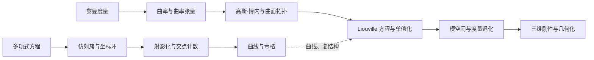

# 2026 浙大暑期学校课程总结

> [!abstract] 一句话概括
> 本文件夹的学习材料由两条主线组成：代数几何从多项式方程出发，研究仿射簇、射影曲线、交点和亏格；黎曼几何从度量与曲率出发，走向二维曲面的单值化、模空间、三维双曲流形的刚性以及四维几何的开放问题。两条主线在曲线与曲面、亏格、复结构和模空间等概念处汇合。

## 1. 记录范围与资料边界

| 方向 | 当前文件夹中的记录 | 主要资料 |
| --- | --- | --- |
| 代数几何 | 第一讲课程记录、作业 1--3，以及 Miles Reid 教材全文 | [[2026浙大暑期学校/代数几何课程记录/课程记录/第一讲：仿射簇与平面曲线|第一讲：仿射簇与平面曲线]]、[[2026浙大暑期学校/代数几何课程记录/Undergraduate Algebraic Geometry/Undergraduate Algebraic Geometry|Undergraduate Algebraic Geometry]] |
| 黎曼几何 | 总览、8 篇主题笔记和作业 1--4 | [[2026浙大暑期学校/黎曼几何课程记录/单值化定理|单值化定理总览]]、[[2026浙大暑期学校/黎曼几何课程记录/课程笔记管理.base|黎曼几何课程 Base]] |

> [!warning] 记录边界
> 本总结依据当前文件夹中已经保存的笔记、作业和教材目录整理，不等同于官方课程大纲或课堂逐字稿。代数几何目前明确保存的是第一讲和三份作业，教材目录中列出的后续章节应视为阅读路线，不能据此断言每一章都已在课堂完成。黎曼几何笔记包含整理后的证明框架和拓展性说明，若要作为严格证明材料使用，还需要对照原始讲义或标准文献复核细节。

## 2. 代数几何：从方程到曲线的几何结构

### 2.1 课程主线

代数几何的入口是把多项式方程的公共零点看成几何对象：

$$
V(f_1,\ldots,f_m)=\{x\in k^n\mid f_i(x)=0,\ 1\leq i\leq m\}.
$$

第一讲围绕以下几步展开：

1. **仿射簇与函数环**：从零点集的定义出发，建立“几何对象与函数环”之间的对应视角，并说明底域 $\mathbb{Q}$、$\mathbb{R}$、$\mathbb{C}$ 会带来不同的研究问题。
2. **二次曲线与参数化**：通过过定点作割线的方法参数化圆，理解有理参数化为何能把几何问题转化为有理函数计算；同时用仿射变换分类实平面中的二次曲线。
3. **射影化**：在射影平面中加入无穷远直线，使平行线的交点和曲线的无穷远行为能够统一处理。非退化二次曲线可以用齐次方程和矩阵语言描述。
4. **Bézout 定理与线性系统**：通过齐次化和消元理解交点计数；两条次数分别为 $d_1,d_2$ 的射影曲线在无公共分支时交于 $d_1d_2$ 个点（计重数）。四点确定一个一般的二次曲线束，五个一般位置的点确定一条二次曲线。
5. **三次曲线与亏格**：尖点或结点使三次曲线可以有理参数化，而光滑三次曲线不能有理参数化；这把“能否参数化”的问题连接到亏格这一更稳定的几何不变量。

### 2.2 作业所形成的训练链

现有三份作业把第一讲的主题推进到代数操作和基本理论：

| 作业 | 主要训练内容 |
| --- | --- |
| [[2026浙大暑期学校/代数几何课程记录/作业/作业1|代数几何作业 1]] | Veronese 参数化像的方程、Sylvester 结式消元、光滑三次曲线无非常数有理参数化 |
| [[2026浙大暑期学校/代数几何课程记录/作业/作业2|代数几何作业 2]] | 代数闭域上的零点、代数集的不可约分解及其唯一性 |
| [[2026浙大暑期学校/代数几何课程记录/作业/作业3|代数几何作业 3]] | 射影零点定理、射影图册中的正则函数及射影子簇的仿射图 |

### 2.3 教材显示的后续路线

[[2026浙大暑期学校/代数几何课程记录/Undergraduate Algebraic Geometry/Undergraduate Algebraic Geometry|Miles Reid 的教材]]把上述入门继续组织为三部分：平面曲线与三次曲线群结构、仿射簇与 Nullstellensatz、射影和双有理几何的应用。后续还包括切空间与非奇异性、维数、三次曲面上的 27 条直线，以及对簇、层和 scheme 的概念性回望。

这条路线的核心变化是：研究对象不再只是某条曲线的方程，而是逐步转向坐标环、态射、函数域、切空间和双有理不变量。

## 3. 黎曼几何：从曲率到分类与刚性

### 3.1 从局部几何进入全局结构

黎曼几何笔记先建立光滑流形、黎曼度量、Levi-Civita 联络和黎曼曲率张量，再从曲率张量提取截面曲率、里奇曲率和标量曲率。爱因斯坦条件

$$
\operatorname{Ric}=\Lambda g
$$

提供了从曲率测量走向特殊度量和几何分类的入口。

二维曲面具有特殊性：每个黎曼度量都自动满足二维的爱因斯坦条件，曲率主要由高斯曲率 $K$ 描述。于是拓扑、复分析和偏微分方程可以在二维汇合。

### 3.2 课程知识链

| 模块 | 关键内容 | 核心问题 |
| --- | --- | --- |
| 基础语言 | [[2026浙大暑期学校/黎曼几何课程记录/黎曼流形与曲率|黎曼流形与曲率]] | 如何在弯曲空间中定义长度、平行移动和曲率？ |
| 曲面与复结构 | [[2026浙大暑期学校/黎曼几何课程记录/二维曲面的拓扑与复结构|二维曲面的拓扑与复结构]] | 亏格、欧拉示性数、等温坐标、保角结构和复结构如何相互联系？ |
| 曲率与拓扑 | [[2026浙大暑期学校/黎曼几何课程记录/高斯-博内定理|高斯-博内定理]] | 为什么局部曲率的积分会等于 $2\pi\chi(\Sigma)$？ |
| 单值化 | [[2026浙大暑期学校/黎曼几何课程记录/单值化定理的PDE证明|单值化定理的 PDE 证明]] | 如何把常曲率度量问题化为 Liouville 方程？ |
| 模空间与退化 | [[2026浙大暑期学校/黎曼几何课程记录/模空间与度量退化|模空间与度量退化]] | 同一拓扑曲面上有多少种几何结构，它们如何趋于退化？ |
| 三维双曲几何 | [[2026浙大暑期学校/黎曼几何课程记录/三维双曲流形与Mostow刚性定理|三维双曲流形与 Mostow 刚性定理]] | 为什么三维 Einstein 条件会导出常截面曲率，并进一步出现刚性？ |
| 动力学证明 | [[2026浙大暑期学校/黎曼几何课程记录/Mostow刚性定理的动力学证明|Mostow 刚性定理的动力学证明]] | 如何由无穷远边界的拟保角映射和遍历性反推内部等距？ |
| 几何化与四维展望 | [[2026浙大暑期学校/黎曼几何课程记录/几何化与四维爱因斯坦度量|几何化与四维爱因斯坦度量]] | 三维几何如何分解为标准模型，四维为何不再具有同样的简单性？ |

### 3.3 三个核心公式

曲率与拓扑的桥梁是高斯-博内公式：

$$
\int_\Sigma K\,dA=2\pi\chi(\Sigma)=2\pi(2-2g).
$$

在等温坐标或共形变换下，寻找常曲率度量归结为 Liouville 型方程：

$$
-\Delta_{g_0}u+K_{g_0}=\Lambda e^{2u}.
$$

对亏格 $g=0,1,g\geq2$ 的曲面，课程记录分别强调复分析、线性 Poisson 方程以及变分法等不同工具。进入高亏格后，Fenchel--Nielsen 坐标给出

$$
\dim_{\mathbb{R}}\mathcal{T}_g=6g-6,
$$

而进入三维双曲几何后，Mostow 刚性把连续的形变自由度压缩为刚性现象。

### 3.4 作业所覆盖的应用

[[2026浙大暑期学校/黎曼几何课程记录/作业/作业1|作业 1]] 至 [[2026浙大暑期学校/黎曼几何课程记录/作业/作业4|作业 4]] 依次练习了复结构与保角结构的等价、环面的不同复结构、能量泛函的 Euler--Lagrange 方程与凸性、裤子分解维数、双曲测地线的无限长度、平坦三流形的双覆盖、环面上的 Anosov 型微分同胚，以及 Heegaard 粘合和连通和等拓扑构造。

## 4. 两条课程主线的交汇

从学习结构看，两门课共同训练的是“局部数据如何决定全局对象”的思维：

1. **从方程或度量到空间**：代数几何把方程组织成簇和态射，黎曼几何把局部度量组织成带曲率的全局流形。
2. **用不变量控制分类**：次数控制交点，亏格和欧拉示性数控制曲面类型，曲率积分限制常曲率符号，Teichmüller 维数描述形变自由度，Mostow 刚性则说明三维双曲几何的形变可以完全消失。
3. **维数改变理论性格**：二维既有丰富的模空间又能通过复分析和 PDE 完成分类；三维出现 Einstein 与常截面曲率的特殊等价；四维则出现 Weyl 曲率自由度，分类问题明显复杂得多。
4. **存在性与分类是两层问题**：单值化回答“常曲率度量是否存在”，模空间回答“有多少种”，Mostow 刚性回答“三维双曲度量为何没有连续形变”。
5. **方法彼此补足**：参数化和消元对应代数计算，等温坐标和复结构提供二维语言，变分法与椭圆 PDE 处理存在性，覆叠空间和群作用处理全局结构，遍历性把动力系统引入刚性证明。

> [!important] 总结性认识
> 这次暑期学校材料最值得保留的不是若干孤立定理，而是一条从“方程和局部坐标”走向“全局不变量、模空间与刚性”的路线：先把对象描述清楚，再寻找不变量，最后判断它们允许多少形变。

## 5. 后续复习路线

1. **代数几何**：先复核二次曲线参数化、射影齐次坐标和 Bézout 交点计数，再继续教材中三次曲线群结构、Nullstellensatz、函数与态射、切空间和维数等章节。
2. **黎曼几何**：按“黎曼流形与曲率 → 二维曲面与复结构 → 高斯-博内 → 单值化”的顺序巩固二维主线，再阅读模空间、Mostow 刚性和几何化；四维内容作为研究方向导览，不宜与二维定理混同。
3. **交叉复习**：围绕“亏格”比较代数曲线、黎曼曲面和双曲曲面；围绕“退化”比较奇异曲线、模空间边界和四维曲率集中；围绕“刚性”比较光滑三次曲线的参数化障碍与三维双曲流形的 Mostow 刚性。

## 相关笔记

- [[2026浙大暑期学校/代数几何课程记录/课程记录/第一讲：仿射簇与平面曲线|代数几何第一讲]]
- [[2026浙大暑期学校/代数几何课程记录/Undergraduate Algebraic Geometry/Undergraduate Algebraic Geometry|Miles Reid 教材]]
- [[2026浙大暑期学校/黎曼几何课程记录/单值化定理|单值化定理总览]]
- [[2026浙大暑期学校/黎曼几何课程记录/黎曼流形与曲率|黎曼流形与曲率]]
- [[2026浙大暑期学校/黎曼几何课程记录/二维曲面的拓扑与复结构|二维曲面的拓扑与复结构]]
- [[2026浙大暑期学校/黎曼几何课程记录/模空间与度量退化|模空间与度量退化]]
- [[2026浙大暑期学校/黎曼几何课程记录/三维双曲流形与Mostow刚性定理|三维双曲流形与 Mostow 刚性定理]]
- [[2026浙大暑期学校/黎曼几何课程记录/几何化与四维爱因斯坦度量|几何化与四维爱因斯坦度量]]
