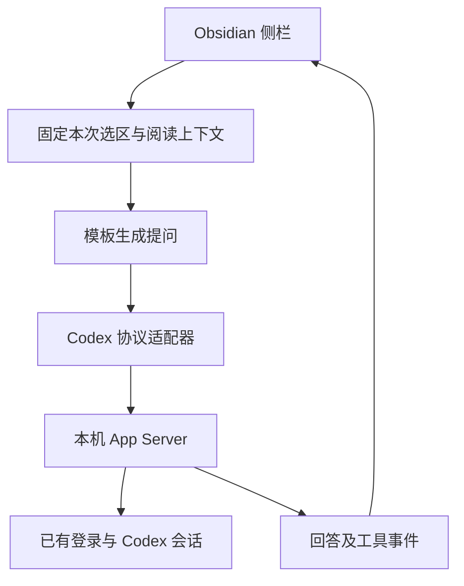

# Obsidian Codex 侧栏插件开发调研

> [!abstract] 调研结论
> 调研阶段结论：目标可以实现，而且已有接近目标的项目。优先评估 **YishenTu/Claudian 的 Codex 后端及选区机制**，再扩展数学阅读上下文，比从零复制聊天、工具审批和会话管理更有依据。Claudian 已有右侧视图、Codex app-server 接入、编辑态与阅读态选区捕获；当前所查阅读选区实现读取 DOM 文本，仍需专门验证 LaTeX 保真、源文定位与屏幕可见区域。[Claudian 源码](https://github.com/YishenTu/claudian/tree/5e9b17cf771b74ace3fdfc665ebfb5bf103c6e93/src)

> [!success] 0.1.0 初版已安装
> 点击左侧工具栏机器人图标打开/收起右侧 Codex 聊天. 使用本机登录, 支持选区自动 prompt 和阅读源块. 本次实现、操作方法及已验证/未验证范围见第 11 节.

## 1. 本次需求与证据范围

用户的目标是类似 VS Code Codex 侧栏的 Obsidian 插件：随时提问，选中文本后自动组织 prompt，并理解阅读界面。当前方向为真正的 Codex、复用本机登录与会话、首版 Windows 桌面。

本文件区分四层：官方公开 API、现有插件源码、据此提出的设计、仍待运行测试的行为。第一阶段调研没有安装或启用插件，没有修改 Obsidian 配置，也没有验证现有插件在本机的模型推理; 随后的 0.1.0 实现阶段见第 11 节。README 中的功能说明与源码入口，不等于本机验收。

“识别阅读界面”应拆成以下能力，分别验收：

| 能力 | 首版含义 | 对应证据或实现边界 |
| --- | --- | --- |
| 知道正在读哪篇笔记 | 文件路径、标题、阅读或编辑模式 | `MarkdownView.file`、`getMode()` 是公开 API |
| 知道选了什么 | 编辑态源文选区；阅读态 DOM 选区加来源定位 | 两种模式分别适配 |
| 知道当前章节 | 标题层级、所属定理、前后段落 | 源文与 `MetadataCache` 组织上下文 |
| 知道屏幕上看见什么 | 与当前视口相交的正文块 | DOM 几何与观察器，需要实测 |
| 看懂图片、PDF、图表 | 提供图片或截图、PDF 页面或提取文字 | 另做附件适配，不由 Markdown API 自动获得 |

上述 API 可在 [Obsidian 官方类型声明](https://github.com/obsidianmd/obsidian-api/blob/9abd9605ce081383674aae1ed111c456edde0688/obsidian.d.ts) 中核对；视口设计是本次建议，不是 Obsidian 提供的统一 AI 上下文接口。

## 2. 现有项目：先看 Claudian，再决定是否另做插件

所有版本均来自本次读取的默认分支快照，可能与社区目录的实际已发布包不同。未以 GitHub HEAD 代替发布包验收。

| 项目 | 与目标相关的已查证内容 | Codex 接入方式 | 复用判断 |
| --- | --- | --- | --- |
| [Claudian，YishenTu](https://github.com/YishenTu/claudian/tree/5e9b17cf771b74ace3fdfc665ebfb5bf103c6e93) | 快照 manifest 为 2.3.16、最低 Obsidian 1.13.0、桌面专用；已有聊天视图、选区、内联编辑及会话管理 | 直接使用 Codex app-server、stdio 与 JSON-RPC | 与本次 Windows 桌面目标最接近；MIT 许可，适合以其为基础扩展 |
| [Copilot，logancyang](https://github.com/logancyang/obsidian-copilot/tree/cd873037c357d6a4d60a90ddb9e33705b65f6865) | 快照 manifest 为 4.0.14、最低 1.11.4；Agent Chat 支持 Codex，并有上下文、项目和自定义命令 | 插件通过 `@agentclientprotocol/codex-acp` 适配器调用 Codex | 适合作为多后端聊天与 prompt 工作流参考；AGPL-3.0，复制或分发修改须按其 LICENSE 处理 |
| [Smart Connections，brianpetro](https://github.com/brianpetro/obsidian-smart-connections/tree/3bfe2b259fda93d7935ffb5d530fc8e99ba90c34) | 当前 README 主线为本地 embedding、语义相关笔记与 Lookup，并提到与 Smart Chat 配合 | 本次所查内容不支持把它当成已验证的原生 Codex 接入方案 | 可参考知识检索产品设计；当前为附有竞争性用途限制的 Smart Plugins License，不能按旧 MIT 印象直接复制 |

版本与平台字段见 [Claudian manifest](https://github.com/YishenTu/claudian/blob/5e9b17cf771b74ace3fdfc665ebfb5bf103c6e93/manifest.json)、[Copilot manifest](https://github.com/logancyang/obsidian-copilot/blob/cd873037c357d6a4d60a90ddb9e33705b65f6865/manifest.json)。许可分别见 [Claudian LICENSE](https://github.com/YishenTu/claudian/blob/5e9b17cf771b74ace3fdfc665ebfb5bf103c6e93/LICENSE)、[Copilot LICENSE](https://github.com/logancyang/obsidian-copilot/blob/cd873037c357d6a4d60a90ddb9e33705b65f6865/LICENSE)、[Smart Connections LICENSE](https://github.com/brianpetro/obsidian-smart-connections/blob/3bfe2b259fda93d7935ffb5d530fc8e99ba90c34/LICENSE)。这里仅登记原文许可及实现选择，不对许可证作法律结论。

### 2.1 Claudian 的具体源码入口

| 源码 | 本次核对到的职责 | 可用来评估什么 |
| --- | --- | --- |
| [ClaudianViews.ts](https://github.com/YishenTu/claudian/blob/5e9b17cf771b74ace3fdfc665ebfb5bf103c6e93/src/composition/ClaudianViews.ts) | 查询已有聊天 leaf，创建或展示对应视图，右侧使用 `getRightLeaf(false)` | 侧栏生命周期和焦点迁移 |
| [SelectionController.ts](https://github.com/YishenTu/claudian/blob/5e9b17cf771b74ace3fdfc665ebfb5bf103c6e93/src/features/chat/input/SelectionController.ts) | 编辑态使用 `editor.getSelection()` 与源文位置；`preview` 分支使用所属 document 的 DOM Selection，保存文本和克隆的 Range | 编辑与阅读模式分别捕获选区；切换到输入框时保留上下文 |
| [editorContext.ts](https://github.com/YishenTu/claudian/blob/5e9b17cf771b74ace3fdfc665ebfb5bf103c6e93/src/core/prompt/editorContext.ts) | 把选区路径、文本、可用的行号或光标附近内容编码到 prompt | 自动 prompt 的可复用结构 |
| [CodexAppServerRuntime.ts](https://github.com/YishenTu/claudian/blob/5e9b17cf771b74ace3fdfc665ebfb5bf103c6e93/src/providers/codex/runtime/CodexAppServerRuntime.ts) | 启动 app-server process 和 RPC transport，等待初始化、管理连接租用与关闭 | 本地运行时生命周期 |
| [codexAppServerSupport.ts](https://github.com/YishenTu/claudian/blob/5e9b17cf771b74ace3fdfc665ebfb5bf103c6e93/src/providers/codex/runtime/codexAppServerSupport.ts) | 合并进程环境与 provider 环境，解析 vault 工作目录，发送 `initialize` 和 `initialized`，声明 `experimentalApi` | 环境继承与协议兼容性 |
| [CodexThreadBinder.ts](https://github.com/YishenTu/claudian/blob/5e9b17cf771b74ace3fdfc665ebfb5bf103c6e93/src/providers/codex/execution/CodexThreadBinder.ts) | 可见 `thread/start`、`thread/resume`、`thread/fork` 调用及 thread 绑定 | 新建、恢复与分支会话；仍需验证本机版本 |
| [CodexConversationHistoryService.ts](https://github.com/YishenTu/claudian/blob/5e9b17cf771b74ace3fdfc665ebfb5bf103c6e93/src/providers/codex/history/CodexConversationHistoryService.ts) | 查找、解析 Codex transcript，恢复消息与模型信息 | 历史读取和本地格式漂移 |

阅读模式的已查实现是 `selection.toString()`。它保存的是浏览器选区文本，不能据此保证得到原始 `$...$`、`$$...$$`、链接别名、图片说明或块标识。**本次所查 SelectionController 与 editorContext 中，没有据此证明阅读态已实现公式源文保真或像素视口上下文**；其他模块仍可能具有相关机制，不能将有限检查表述成全项目“完全没有”。

此外，[obsidianCompat.ts](https://github.com/YishenTu/claudian/blob/5e9b17cf771b74ace3fdfc665ebfb5bf103c6e93/src/utils/obsidianCompat.ts) 明确通过类型转换访问未公开在 `Editor` 类型上的 `.cm`。扩展时应把此类兼容代码放在适配器内，避免让整个插件依赖内部对象结构。

### 2.2 Copilot 的几个容易混淆的边界

Copilot 的 [CodexBackend.ts](https://github.com/logancyang/obsidian-copilot/blob/cd873037c357d6a4d60a90ddb9e33705b65f6865/src/agentMode/backends/codex/CodexBackend.ts) 实现 `AcpBackend`，构造 Codex ACP 适配器进程描述，并使用调用环境中的 `CODEX_HOME` 或默认目录；其 [README](https://github.com/logancyang/obsidian-copilot/blob/cd873037c357d6a4d60a90ddb9e33705b65f6865/README.md) 声明使用现有 Codex 登录。[codexAuth.ts](https://github.com/logancyang/obsidian-copilot/blob/cd873037c357d6a4d60a90ddb9e33705b65f6865/src/agentMode/backends/codex/codexAuth.ts) 通过单独的 app-server `account/read` 探测身份，避免直接读取凭据文件。这是身份探测路径，不能误写成聊天主体直接绕过 ACP。

[Commands and Quick Ask 文档](https://github.com/logancyang/obsidian-copilot/blob/cd873037c357d6a4d60a90ddb9e33705b65f6865/docs/custom-commands.md) 明确：Quick Ask 使用 Quick Chat 的托管或 BYOK 模型，**不是 Agent Chat 当前选择的 Codex 模型**；Source mode 下不可用。它可以参考交互，但若目标为“所有提问都用真实 Codex”，需沿 Agent Chat 路径接入，不能只启用 Quick Ask 就认为满足目标。

Copilot manifest 的 `isDesktopOnly:false` 也不表示移动端能启动本地 Codex。它的 [Agent 文档](https://github.com/logancyang/obsidian-copilot/blob/cd873037c357d6a4d60a90ddb9e33705b65f6865/docs/agent-mode-and-tools.md) 与 CLI 后端实现须分别评估；Obsidian 官方说明移动端没有 Node.js 与 Electron API。[移动开发文档](https://github.com/obsidianmd/obsidian-developer-docs/blob/c56c7e770ba25dd0ea392aacf4588f9425970d36/en/Plugins/Getting%20started/Mobile%20development.md)

## 3. Codex 接入、本机登录与会话复用

### 已确定的目标与推荐路线

用户在本轮明确选择: **真正的 Codex, 复用本机登录与会话, 首版 Windows 桌面**。下列架构是助手建议, 尚未作出 fork 或从零实现的决定。

优先在独立测试库验证 Claudian 的 Codex 后端。若现有实现满足会话和选区需求, 扩展它的阅读上下文模块即可。若需要自有插件, 使用 TypeScript + Obsidian ItemView + 本机 `codex app-server --listen stdio://`; Codex App Server 正是官方为包括 VS Code 扩展在内的交互客户端提供的接口, 有认证、历史、审批和流式事件。Codex SDK 更适合程序化任务, 因此首版建议直接对接 App Server。[官方 App Server](https://learn.chatgpt.com/docs/app-server), [官方 Codex SDK](https://learn.chatgpt.com/docs/codex-sdk)

### 复用登录和会话的边界

| 需求 | 实施方法 | 当前证据 |
|---|---|---|
| 复用本机登录 | 子进程使用相同用户的 Codex 状态目录; 通过 `account/read` 检测, 未登录时走 Codex 自己的登录流程 | 本轮已读到 `chatgpt` 账号类型 |
| 多轮连续提问 | 同一 thread 使用 `turn/start`, 记录 thread ID | 官方协议及本机生成类型支持; 未发起推理 |
| 关掉 Obsidian 后恢复 | 保存 thread ID, 下次 `thread/resume` | 官方协议及本机生成类型支持; 未恢复现有会话 |
| 列出已有历史 | `thread/list`, 按库路径和来源筛选; 注意来源默认过滤可能隐藏 App Server 会话 | 本机生成类型支持 `cwd` 和 `sourceKinds`; 未读历史内容 |
| 与桌面 Codex 或 VS Code 同时控制同一活跃会话 | 需要相同服务实例、订阅和并发控制设计 | 本轮未验证, 不能把共享登录/磁盘历史当作实时接管的证明 |

上述方法名依据本轮从实际安装版本生成的 TypeScript 协议类型核对。不同安装的 Codex 状态目录、凭据存储和 CLI 版本可能不同, 接入时通过公开接口确认; 不复制凭据进 vault。关于 Codex 的登录方式与凭据管理, 参见[官方认证文档](https://developers.openai.com/codex/auth)。

本机 `ThreadResumeParams` 的生成注释描述了运行中 thread 的 rejoin 语义, CLI 也列出 `daemon` 和 `proxy` 命令。这是进一步研究共享服务的线索, 仍不能证明当前桌面应用已开放可供此插件连接的服务。首版先做插件自己的 Codex 会话, 再验证已有历史恢复, 最后研究跨客户端实时协同。

### 协议适配器需要处理的内容

下表是本机生成类型中的方法及开发建议, 不是已实现插件功能。

| 场景 | 接口或事件 | 客户端应做的事 |
|---|---|---|
| 建立连接 | `initialize` 后发送 `initialized` | 握手成功后才发业务请求 |
| 登录检测 | `account/read` | 显示连接/登录状态; 不显示凭据 |
| 新建/恢复 | `thread/start`, `thread/resume` | 记录 thread ID 和所属库 |
| 历史 | `thread/list`, `thread/read` | 分页读取, 避免打开就加载全部记录 |
| 提问 | `turn/start` | 把固定的上下文快照与用户问题一起送入 |
| 流式回答 | `item/agentMessage/delta` | 按 item ID 追加, 完成后以最终消息校正 |
| 停止 | `turn/interrupt` | 用户可随时中止; 区分完成、失败、中断 |
| 命令/文件审批 | `item/commandExecution/requestApproval`, `item/fileChange/requestApproval` | 提供明确选择并回传 RPC response |
| 补充提问 | `item/tool/requestUserInput` | 展示问题并回传答案, 不能只等聊天文本 |
| 掉线/进程退出 | transport 事件 | 标记当前 turn 状态不确定, 重连后读回状态再决定是否重试 |

首版可配置 `thread/start` 的 `sandbox: "read-only"`、`approvalPolicy: "on-request"`、`approvalsReviewer: "user"` 用于问答原型。这些值已经在本机生成类型中核对; Windows 上的实际权限与管理策略仍需在运行验收时确认。后续改笔记用 diff 预览和显式应用, 并遵守库内习题、草稿的修改边界。

实现 JSONL transport 时需要区分 response、notification 和 server request, 按 ID 匹配 pending requests。Node stream 的一个 chunk 可能只有半行或含多行, 不能每个 chunk 直接当一个 JSON。用参数数组启动明确的 `codex.exe`, 默认 `shell: false`, Windows 子进程隐藏窗口; 卸载插件时清理监听器及自己启动的进程。以上是工程设计建议。

若后来需要让 Codex 主动读取“我此刻看哪里”, 再提供 `get_active_note`、`get_selection_snapshot`、`get_visible_sections` 等受限上下文工具。首版每次提问直接附上下文足够。App Server 的动态工具属于实验能力, 需要固定版本和能力协商; 不应把它作为第一阶段必需依赖。[官方动态工具说明](https://learn.chatgpt.com/docs/app-server#dynamic-tool-calls-experimental)

### 调研阶段实际核查

- `Obsidian version`: **1.14.4**, installer **1.13.7**。
- `codex --version`: **codex-cli 0.162.0-alpha.17.2**。可执行文件由 `Get-Command codex` 定位, 不在插件中硬编码此次带版本哈希的安装目录。
- `codex app-server --help`: 本机支持默认 stdio, 列出 daemon/proxy 和协议类型生成命令。
- `codex app-server generate-ts --out <临时目录>/protocol`: exit code 0; 已检查新建/恢复/历史/输入/审批相关类型。
- 独立临时子进程执行 `initialize -> initialized -> account/read(refreshToken:false)`: **成功**, 只输出已脱敏的 `accountType=chatgpt` 等状态。
- 未调用 `thread/start` 或 `turn/start`, **没有创建会话、发送模型请求或验证额度/模型权限**; 该探测不证明完整 Codex 问答可用。
- 当前笔记视图的只读 DOM 探测返回 `type=markdown`, `mode=source`, 有 `ownerDocument` 和 window selection 方法; 未进行实际阅读模式选区实验。

证据目录为 `C:/Users/HuangZY/AppData/Local/Temp/obsidian-codex-research-20261011-61a51045fe3e4b9e92a10bd4dd6a3d44`, 保存官方文档 Markdown、生成协议、脱敏探测脚本与结果。没有读取或记录登录 token, 没有安装插件, 没有改 Obsidian/Codex 配置。

本机 alpha 类型与官网字段已有差异, 所以开发必须固定 CLI 版本, 用对应版本生成协议类型并处理 unsupported-method/field。当前官网也将 App Server 的部分能力标为实验性质。官方认证说明允许继续使用既有本地/开源应用的 App Server 认证, 建议迁移 Sign in with ChatGPT; 商业或托管产品需按其单独的接入规则设计。[官方认证范围](https://learn.chatgpt.com/docs/app-server#auth-endpoints)

## 4. Obsidian 插件的基本构成

官方开发入口为 [Developer Docs](https://docs.obsidian.md/)、[TypeScript API 声明](https://github.com/obsidianmd/obsidian-api)、[sample-plugin](https://github.com/obsidianmd/obsidian-sample-plugin/tree/07ceb81d1fb3384af611ebf665a1ec42a7e5926d)。官方模板使用 TypeScript 与 esbuild；`npm run dev` 将 `src/main.ts` 编译为 `main.js`，`npm run lint` 运行已配 ESLint。模板的 README 写明 Node.js 至少 18，实际开发仍应遵从选定仓库的依赖与锁文件。[模板 README](https://github.com/obsidianmd/obsidian-sample-plugin/blob/07ceb81d1fb3384af611ebf665a1ec42a7e5926d/README.md)

最小插件交付物是 `main.js`、`manifest.json`，有样式时加 `styles.css`；本地开发目录放在测试 vault 的 `.obsidian/plugins/<plugin-id>/`。`manifest.json` 必填 ID、名称、描述、作者、版本、最低应用版本与 `isDesktopOnly`；使用本地子进程的首版应设为桌面专用。[Manifest 文档](https://github.com/obsidianmd/obsidian-developer-docs/blob/c56c7e770ba25dd0ea392aacf4588f9425970d36/en/Reference/Manifest.md)

### 4.1 公开 API 与需求对照

下表 API 均按 [官方 obsidian.d.ts 快照](https://github.com/obsidianmd/obsidian-api/blob/9abd9605ce081383674aae1ed111c456edde0688/obsidian.d.ts) 核对；设计列是本次建议。

| 需求 | 公开入口 | 设计与边界 |
| --- | --- | --- |
| 独立聊天侧栏 | `ItemView`、`registerView()`、`contentEl` | 自定义聊天 UI；不限于 Modal |
| 打开或聚焦侧栏 | `getLeavesOfType()`、`getRightLeaf(false)`、`setViewState()`、`revealLeaf()` | 优先复用已有聊天 leaf，处理 `getRightLeaf()` 可能返回 null |
| 简化侧栏创建 | `ensureSideLeaf(type, 'right', options)` | 1.7.2 起公开；避免重复造侧栏开关逻辑 |
| 图标与快捷提问 | `addRibbonIcon()`、`addCommand()` | 一条打开聊天，一条解释选区；快捷键交给 Obsidian 配置 |
| 读取编辑器选区 | `Editor.getSelection()`、`getCursor()`、`getRange()`、`posToOffset()` | 原始 Markdown 与位置都可获得，最容易保留 LaTeX |
| 编辑器右键提问 | workspace `editor-menu` | 回调已有 editor/info，立即冻结选区，避免焦点进入聊天后丢失 |
| 当前 Markdown 内容 | `getActiveViewOfType(MarkdownView)`、`getViewData()`、`editor.getValue()` | 活跃聊天 leaf 时前者可能为 null，保存最近有效的笔记上下文 |
| 判断阅读模式 | `MarkdownView.getMode()` | 返回 `source` 或 `preview`；Live Preview 属于编辑模式，不能仅凭它分出 Source 与 Live Preview |
| 阅读模式源块映射 | `registerMarkdownPostProcessor()`、`ctx.sourcePath`、`ctx.getSectionInfo(el)` | 将渲染块与源路径、0 基行区间关联；getSectionInfo 可为 null，须临用时获取 |
| 标题与链接上下文 | `metadataCache.getFileCache()`、缓存 headings/links/blocks | 可为 null，或尚未跟上最新编辑；必要时以当前源文快照为准 |
| 笔记或窗口切换 | `active-leaf-change`、`file-open`、`layout-change`、`window-open`、`window-close` | 更新上下文与 document 绑定，不在每次事件时发起模型请求 |
| 文本改动 | `editor-change` | 这是内容修改事件，不能当作纯选区变化事件 |
| 精确编辑态选区观察 | `registerEditorExtension()` 与 CodeMirror 6 `ViewPlugin`/更新监听 | 观察 `selectionSet`、`docChanged`；无需依赖轮询或 `editor.cm` 私有访问 |
| 聊天回答渲染 | `MarkdownRenderer.render(app, markdown, el, sourcePath, component)` | 复用 Markdown/数学公式渲染，给定正确 sourcePath；管理渲染子组件 |
| 保存与编辑笔记 | Vault API、Editor API | 聊天默认不改笔记；需要写回时做差异预览并核对源快照 |
| 释放资源 | `registerEvent()`、`registerDomEvent()`、`registerInterval()`、`MarkdownRenderChild` | 清理事件、观察器、计时器和本地子进程 |

侧栏流程可直接对照官方 [Views](https://github.com/obsidianmd/obsidian-developer-docs/blob/c56c7e770ba25dd0ea392aacf4588f9425970d36/en/Plugins/User%20interface/Views.md)。编辑态扩展参照 [Editor extensions](https://github.com/obsidianmd/obsidian-developer-docs/blob/c56c7e770ba25dd0ea392aacf4588f9425970d36/en/Plugins/Editor/Editor%20extensions.md)；阅读态处理参照 [Markdown post processing](https://github.com/obsidianmd/obsidian-developer-docs/blob/c56c7e770ba25dd0ea392aacf4588f9425970d36/en/Plugins/Editor/Markdown%20post%20processing.md)。

## 5. 选区自动 prompt：适合数学笔记的实现建议

### 5.1 自动捕获、自动填充与自动发送分开实现

推荐默认流程：选择正文后显示“解释”“补全推导”“检查假设”“找证明缺口”等动作；点击动作或快捷键，生成 prompt 并附上上下文，继续在侧栏追问。仅拖动选区时本地更新上下文卡片，避免每次改变选择都产生一次请求。

若用户希望真正“选完就问”，可增加明确的自动解释开关：只监听数学正文中的有效选区，等待选区稳定后提交，按内容与来源去重，正在生成时保留一项最新候选，并有取消入口。去抖时间与最大选区长度是待交互测试确定的参数，不能预先视作已验收的体验。

自动 prompt 应由用户动作决定任务，笔记正文只是引用材料。例如“解释”附带：保留原记号、说明变量与假设、列出关键推导、标明使用的定理；“审查”则检查量词、边界情形与每步推论。不要让选区中的命令文本覆盖插件的控制指令。

上下文快照建议保存：文件路径与标题、view/leaf 标识、捕获时间与模式、源文版本或 hash、显示文本与原始 Markdown、源范围、标题路径与当前块、附近段落及符号约定、嵌入内容 sourcePath、捕获范围和匹配可靠度。未知源位置明确留空；用户可见“选区”“本节”“全文”，不把模糊匹配说成精准定位。Claudian 已有选区、路径与行号编码，可在其 [editorContext.ts](https://github.com/YishenTu/claudian/blob/5e9b17cf771b74ace3fdfc665ebfb5bf103c6e93/src/core/prompt/editorContext.ts) 周围扩展。

## 6. 阅读界面识别：重点是回到源文

### 6.1 编辑态与阅读态采用不同路径

**编辑态**：直接取 Editor 源文选区与位置。CodeMirror 6 扩展监听选择更新，可兼顾鼠标、键盘与多选区；发送时冻结源文快照。Live Preview 即使显示公式或图片，模型上下文仍优先从源文获取。

**阅读态**：在 Markdown postprocessor 中记录渲染块及其 `sourcePath`。用户选择文本或点击提问时，用实际所属 document 的 Selection/Range 确定涉及哪些正文块，再临时调用 `getSectionInfo()` 获取源行范围，从当前源文恢复对应块。先提供整个源块或当前小节，再考虑字符级映射；嵌套 callout、表格、列表和 MathJax 不能按 DOM 文本长度直接换算源文偏移。

`getSectionInfo()` 是公开 API，但任意 DOM Range 到 Markdown 字符区间的准确映射不是其承诺；null、重复文本、跨块选择和自定义渲染都要有降级结果。上述 API 的契约见 [MarkdownPostProcessorContext](https://github.com/obsidianmd/obsidian-api/blob/9abd9605ce081383674aae1ed111c456edde0688/obsidian.d.ts#L5875-L5913)。

### 6.2 公式、链接和嵌入内容

数学场景应把原始 `$...$`/`$$...$$`/`aligned` 代码作为模型上下文。DOM 文本选区适合作为用户看到的摘要，不能反向假定它就是原始 LaTeX。若只选到了公式的一部分，推荐附上完整所属公式块及附近说明，并标注范围；若源块无法唯一定位，显示“阅读文本，源文定位未确认”。

引用嵌入笔记时，需要以 postprocessor 的 `sourcePath` 判定来源；不能仅给活跃笔记的文件路径。图片、Mermaid、Excalidraw 等非文本渲染，按附件或截图能力另行接入，并保留来源链接。这些是设计要求，仍待本机原型验证。[阅读后处理官方说明](https://github.com/obsidianmd/obsidian-developer-docs/blob/c56c7e770ba25dd0ea392aacf4588f9425970d36/en/Plugins/Editor/Markdown%20post%20processing.md)

### 6.3 屏幕可见区域不等于全文

编辑器只渲染视口附近内容，是官方 [Viewport](https://github.com/obsidianmd/obsidian-developer-docs/blob/c56c7e770ba25dd0ea392aacf4588f9425970d36/en/Plugins/Editor/Viewport.md) 文档明确说明的机制。读取 DOM 全文不能当作完整笔记内容；`getViewData()` 得到的内容也不能当作“屏幕正在显示的范围”。

建议阅读态将已映射的正文块与 `IntersectionObserver` 或 `getBoundingClientRect()` 结合，只取与内容滚动区相交的块；折叠 callout、虚拟化、嵌入和滚动容器须实测。编辑态则通过 CM6 view extension 获得可见源区间。发送卡片展示捕获范围与源路径，便于用户发现误取上下文。这里使用标准 DOM/CM6 的设计推断，不是已验证的 Obsidian 统一 viewport API。

### 6.4 多窗口、PDF 与 Canvas

Obsidian 的弹出窗口有独立 Window、Document 与构造器。对指定 MarkdownView，应使用 `containerEl.ownerDocument` 或 Obsidian 提供的 `element.doc`/`element.win`；仅用全局 `document` 可能捕获错误窗口。`activeDocument` 指向当前焦点 document，点击聊天后它也可能已改变。事件与选择须绑定来源窗口，并在迁移或关闭时清理。[官方 pop-out 指南](https://github.com/obsidianmd/obsidian-developer-docs/blob/c56c7e770ba25dd0ea392aacf4588f9425970d36/en/Plugins/Guides/Support%20pop-out%20windows.md)

PDF 与 Canvas 不是 MarkdownView。公开类型中有 `loadPdfJs()`，但不能据此认为公开 API 已提供“当前 PDF 页、阅读器选区、OCR 与页级截图”的统一接口。本次对官方类型与开发文档的有限检查，也未证明存在稳定公开的 Canvas 当前节点选择 API。首版可将二者标为专门适配项：PDF 保留文件路径、页码和文本或图像证据；Canvas 保留节点内容与关联文件。Claudian 已有 [CanvasSelectionController.ts](https://github.com/YishenTu/claudian/blob/5e9b17cf771b74ace3fdfc665ebfb5bf103c6e93/src/features/chat/input/CanvasSelectionController.ts)，可进一步阅读其适配机制；本次不宣称其 Canvas 或 PDF 体验已运行验收。[官方 loadPdfJs](https://docs.obsidian.md/Reference/TypeScript+API/loadPdfJs)

## 7. 推荐开发路线与模块边界

### 7.1 首选：基于 Claudian 验证与扩展

1. 在独立测试 vault 中确认选定发布包，记录 release、插件版本与 SHA；使用本机 Codex 路径和既有登录，完成普通聊天、工具审批、取消与恢复会话的实测。
2. 单独测试 Claudian 的 Source、Live Preview、Reading 三种选择场景，检查焦点转入侧栏后选区是否保留、是否能用 Codex 发出提问。
3. 扩展“数学阅读上下文”：源块映射、标题路径、原始 LaTeX、附近定义与假设、来源卡片。先验收源块级可靠定位，再提升到精确选区。
4. 添加解释、补推导、审查证明的 prompt 模板与快捷动作，并保持模型/provider 路由为真实 Codex。
5. 对公式密集的笔记实测 viewport 捕获、双栏和弹出窗口。需要 PDF 后再增加专用适配器。

步骤属于建议，未在本轮执行。上游若有可复用的扩展入口，优先提交小范围改进；若产品方向差异很大，再决定维护 MIT fork 或独立插件。不能未测试现成方案就断定必须完整重写。

### 7.2 若另做轻量插件

| 模块 | 责任 | 首版避免的耦合 |
| --- | --- | --- |
| ChatView | 消息、流式输出、发送/取消、会话列表、上下文卡片 | 不直接扫描 DOM 或持有 CLI 细节 |
| ContextService | 编辑态、阅读态、最近笔记上下文及快照 | 不直接发起模型推理 |
| ReadingAdapter | postprocessor、源块映射、公式保真、多窗选区 | DOM/私有兼容逻辑局限在这里 |
| PromptService | 任务模板、来源编码、token 预算和截断提示 | 不把隐藏截断伪装成完整上下文 |
| CodexTransport | 子进程、协议、流式事件、审批、超时、关闭 | 不把 UI 生命周期等同于会话生命周期 |
| SessionStore | thread ID、聊天快照与文件上下文的关联 | 不把重新显示历史等同于恢复活跃运行 |
| NoteEditService | 可选的差异预览、源版本校核与写回 | 不在选区变化时直接改原笔记 |

插件关闭时撤销事件与观察器、清理进程；重开侧栏时复用正确会话，而不是重复启动多个后台实例。官方 [Views](https://github.com/obsidianmd/obsidian-developer-docs/blob/c56c7e770ba25dd0ea392aacf4588f9425970d36/en/Plugins/User%20interface/Views.md) 提醒不要在插件中长期管理 view 实例引用；使用 `getLeavesOfType()` 查找当前实例。写回笔记时遵守 [Plugin guidelines](https://github.com/obsidianmd/obsidian-developer-docs/blob/c56c7e770ba25dd0ea392aacf4588f9425970d36/en/Plugins/Releasing/Plugin%20guidelines.md) 对 Editor/Vault API、资源管理及避免不安全 HTML 的要求。

## 8. 实现后的验收场景

以下是调研阶段制定的完整验收表; 首版已执行的子集见第 11.3 节, 其余组合仍待验收：

| 场景 | 应验收的结果 |
| --- | --- |
| 编辑态选区与所有常见公式 | 文本、路径、源范围正确；原始 LaTeX 没有丢失 |
| 阅读态跨段、callout、重复文本 | 来源可核对；不能用首次字符串匹配假造精准行号 |
| 双栏、切换笔记、弹出窗口、修改源文 | pane/document 正确，选区移交与过期检测正确 |
| 折叠块、嵌入与滚动长文 | 可见范围、源路径与实际画面一致 |
| Codex 登录、模型请求、取消与恢复 | 分别验收；错误可见，无重复后台进程 |
| 自动解释与回答写回 | 选区去重；差异确认后写回，原题、留白与无关段落完整 |

## 9. 发布流程与目前的文档差异

先完成测试 vault 的本地验收，再准备发布。GitHub release tag 应与 manifest 的 `x.y.z` 完全一致，并上传 `main.js`、`manifest.json`、可选 `styles.css`；最低 Obsidian 版本应来自实际使用的 API。[官方提交指南](https://github.com/obsidianmd/obsidian-developer-docs/blob/c56c7e770ba25dd0ea392aacf4588f9425970d36/en/Plugins/Releasing/Submit%20your%20plugin.md)

本次发现官方来源存在流程差异：sample-plugin README 仍提向 `obsidian-releases` 提交 PR；较新的专门提交文档要求在 `community.obsidian.md` 登录 Obsidian 账户、关联 GitHub、添加插件，并处理目录自动审核反馈。实施发布时以专门提交文档和目录当前流程为准，不直接照搬旧教程。[模板旧说明](https://github.com/obsidianmd/obsidian-sample-plugin/blob/07ceb81d1fb3384af611ebf665a1ec42a7e5926d/README.md#adding-your-plugin-to-the-community-plugin-list)、[专门提交文档](https://github.com/obsidianmd/obsidian-developer-docs/blob/c56c7e770ba25dd0ea392aacf4588f9425970d36/en/Plugins/Releasing/Submit%20your%20plugin.md)

## 10. 证据保存

所有关键链接已绑定本次读取的完整提交 SHA。临时下载的类型、官方文档、README、manifest、LICENSE 和所查源码位于仓库外 `C:/Users/HuangZY/AppData/Local/Temp/obsidian-plugin-research-20261011`。第一阶段未下载模型、安装插件、运行所查插件测试或验证发布包. 随后按用户明确要求实施的初版及运行证据见第 11 节. 笔记仓库只保存文档, 插件源码与配置留在仓库外。

## 11. 0.1.0 初版实现与使用 (2026-10-11)

用户在调研后明确要求先做初版, 并将调用开关放在 Obsidian 左侧工具栏. 本阶段选择独立轻量插件, 聚焦本机 Codex、聊天和 Markdown 阅读上下文. 第 7 节的 Claudian 评估路线保留为调研阶段的建议, 不是本次实际安装的实现.

### 11.1 安装位置与操作

- 已在当前数学库安装并启用 **Codex Sidebar 0.1.0**, id 为 `codex-sidebar`. 点击左侧工具栏机器人图标, 打开或收起右侧 Codex 聊天栏.
- 源码项目: `F:/Obsidian Plugins/codex-sidebar`. 安装文件: `F:/Obsidian Storage/数学/.obsidian/plugins/codex-sidebar`. 配置和聊天快照存在该插件的 `data.json`, 不纳入笔记仓库.
- 直接输入问题, Enter 发送, Shift+Enter 换行. 支持流式回复、公式渲染、停止、复制、新会话及本插件历史会话切换.
- 在编辑/实时预览/阅读模式选中文字, 自动更新来源卡片. 点击 **解释选区** 或 **检查证明** 自动构造 prompt 并提问. 单纯拖选只捕获上下文, 不发起模型请求.
- **捕获当前位置** 取编辑光标附近文本或当前阅读视口的源块. 卡片可展开查看原始 Markdown; 复选框决定普通问题是否附带该快照, 也可清除.
- 插件设置可指定 `codex.exe` 路径及模型. 本机已配置当前可执行文件, 复用现有 ChatGPT 登录; 没有读取或复制私有认证文件. 模型留空沿用 Codex 配置, 本次实际模型为 `gpt-6.1-sol`.
- 为加载插件已打开当前库原先关闭的社区插件总开关, 启用列表新增此插件. 先前无社区插件, 没有改写其他插件、主题或快捷键. 工作区修改前副本保存在本阶段证据目录.

### 11.2 实现边界

使用独立、隐藏的 `codex app-server --listen stdio://` 子进程, 实现初始化、登录状态读取、thread 创建/恢复、turn 提交/中断和流式事件. 收起面板保留连接, 禁用/重载插件关闭本插件的进程. 历史列表为本插件创建的 Codex 会话, 并非直接接管桌面应用当前运行的聊天.

阅读模式通过 Markdown postprocessor 的 `getSectionInfo()` 定位源块, 携带原始 LaTeX、路径、行范围与标题路径. 映射结果明确标为完整源块, 不声称精确到渲染字符. 无法映射时, 选区退化为明确标注的渲染文本; 无可见源块时不假造阅读位置. 默认源文本上限 24,000 字符, 选区显示文本上限 12,000 字符, 截断有提示.

问答线程采用只读沙箱. 命令/文件审批请求有批准或拒绝窗口, 补充信息请求有输入窗口, 未支持的服务端请求返回明确错误. 请求超时或断连不自动重发 turn, 避免结果未知时重复提交. 初版没有回答写回、PDF 页码/OCR、截图识别或移动端支持.

### 11.3 实际验收与待验收范围

在 Obsidian 1.14.4、codex-cli 0.162.0-alpha.17.2 上实际执行:

| 检查 | 本次结果 |
| --- | --- |
| TypeScript 与 esbuild | `npm run build` 通过 |
| JSONL 和 prompt 测试 | `npm test` 8 项通过: UTF-8 分帧、合并帧、乱序响应、错误/断连/超时及公式和标题路径 |
| 左侧开关 | 真实 ribbon 点击令聊天 leaf 从 1 变 0, 再恢复为 1; 会话保留 |
| 登录和真实推理 | 本机 ChatGPT 登录可用, Codex 返回“Codex侧栏已连接”, 行内公式由原生 MathJax 渲染 |
| 会话恢复 | 重载保留 thread ID; 下一轮准确回忆上一轮的连接确认, 没有把本地聊天记录重新拼进提问 |
| 停止 | 实际中断进行中的选区解释; 公开 `thread/read` 回读最后 turn 为 `interrupted`, UI 为已停止 |
| 编辑选区 | 原生 Editor 选区与捕获的精确选区字符串相等, 未修改原笔记 |
| 阅读选区 | 行间公式映射到源块, 完整保留 LaTeX; 公开 `thread/read` 核对已发送原公式与“源块”标签 |
| 自动捕获 | 原生阅读 DOM 选区变化自动更新卡片, 保留球坐标面积元/体积元的 LaTeX 和标题路径 |
| 附带上下文回答 | 通过聊天发送按钮提问, 真实 Codex 正确解释球面面积元与体积元, 回复公式正常显示 |
| 阅读视口 | 按钮捕获实际视口对应第 359-419 行, 约 1,041 字符; 不将整篇笔记冒充可见范围 |
| 生命周期 | 重载后旧的本插件 app-server PID 已退出; 新连接与保存会话正常 |
| 界面 | 将数学库窗口置前、最大化后复核真实画面与当前 DOM; 发送/停止按钮位于状态栏上方 |

原生 `dev:errors` 和 error 级 console 无错误. 后台全量阅读 rerender 曾清空当前 DOM, 截图仍保留旧绘制画面; 置前后 DOM 重新填充, 此后才验证自动选区与阅读视口. 旧后台截图不能作为重载后视觉验收证据.

尚未穷尽双栏/弹出窗口、跨笔记嵌入、跨段重复文本、源文即时变化与折叠块的组合; 没有实际批准特权命令, 没有验证社区目录发布或其他 Obsidian/CLI 版本. 原有第 8 节完整验收表仍保留未覆盖项目. 这属于首版功能验收, 不代表对回答内容的数学认证.

### 11.4 复现与证据

源码含 `package-lock.json`, `src/`, `tests/`, `README.md` 和项目 `AGENTS.md`. 开发命令为 `npm ci`, `npm run build`, `npm test`. 安装复制 `manifest.json`, `main.js`, `main.js.map`, `styles.css`, 保留已有 `data.json`; 用 `G:/Obsidian/Obsidian.com vault=数学 plugin:reload id=codex-sidebar` 重载.

本阶段快照、工作区备份及运行证据在 `C:/Users/HuangZY/AppData/Local/Temp/obsidian-codex-build-20261011-a05f4689675b415cb655fee005018521`. 本地安装 ZIP 位于源码项目 `dist/codex-sidebar-0.1.0.zip`, 不含认证或聊天数据. 源码、构建物和 Obsidian 配置保留在仓库外; 数学笔记仓库只登记调研、使用方法与真实验收边界. 暂未公开发布插件.

## 相关链接

- [[README|仓库导航与笔记登记]]
- [[Obsidian技能与Agent调用指南|Obsidian 技能与 Agent 调用指南]]
