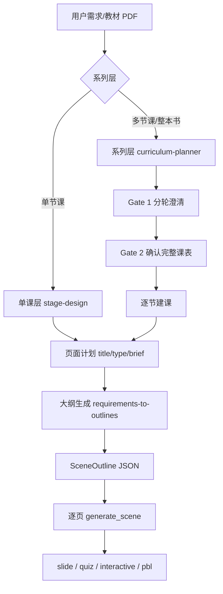

# OpenMAIC 课程与教材规划调研

> [!abstract] 一句话结论
> OpenMAIC 的课程规划不是“一次 prompt 直接生成课堂”，而是分成三层：
> **系列层（多节课/教材章节）→ 单课层（一节课的页面计划）→ 生成层（每页大纲转成幻灯片/测验/交互/PBL）**。
> 它把教学法写成 Agent Skill，把结构约束写成机器可检查的 JSON，再用“用户确认过的页面计划”驱动逐页生成。

## 1. 项目与安装状态

- 官方仓库：[THU-MAIC/OpenMAIC](https://github.com/THU-MAIC/OpenMAIC)
- 本地路径：`F:\tools\OpenMAIC`
- 当前 checkout：`main`，commit `ebf665f316372d6ee875bd50dac1e04662d5a519`（2026-09-11）
- 版本：`package.json` 中 `1.0.1`
- 技术栈：Next.js 16 + React 19 + TypeScript 5 + LangGraph 1.1
- License：MIT
- 依赖安装：已执行 `pnpm install --frozen-lockfile`，exit code 0，包含 `postinstall` 的 SDK 构建（dsl / generation / storage / importer / renderer / editor）
- 尚未创建 `.env.local`，因此尚未启动服务；要真正生成课堂还需至少配置一个 LLM provider key

> [!todo] 后续启动步骤
> 1. 在 `F:\tools\OpenMAIC` 中执行 `cp .env.example .env.local`
> 2. 至少填写一个 LLM API Key
> 3. `pnpm dev`
> 4. 验证 `curl http://localhost:3000/api/health`

## 2. 三层规划模型



| 层级 | 负责 Skill | 解决的问题 | 产物 |
|---|---|---|---|
| 系列层 | `curriculum-planner` | 多节课的先后顺序、范围、衔接 | 系列文件夹 + 每节课的 `create_stage` |
| 单课层 | `stage-design` | 一节课的页面计划、角色、生成顺序 | 页面列表 + roster + scenes |
| 生成层 | `requirements-to-outlines` | 把需求或教材转成结构化大纲 | `languageDirective` + `courseTitle` + `outlines` |
| 教学法层 | `understanding-by-design` / `spiral-curriculum` / `k12-core-literacy-planning` 等 | 决定“为什么这样教” | 大概念、基本问题、表现性任务、概念重访表 |

## 3. 系列课/教材层：`curriculum-planner`

`curriculum-planner` 是 OpenMAIC 里最接近“教材规划”的 Skill。它的描述中明确写了支持：

- 「7 天学 Python」
- 四周 onboarding track
- 学期单元拆成多节课
- **turn this book into a lesson per chapter（把一本书拆成一章一课）**

### 3.1 Gate 1：分轮澄清

系列请求通常信息不足，Skill 要求在 **2–3 轮 `ask_user`** 中逐步澄清：

| 轮次 | 要问的核心问题 |
|---|---|
| 第 1 轮 | 学习者是谁；学完能做到什么 |
| 第 2 轮 | 每节时长、节奏、授课语言、动手比例 |
| 第 3 轮 | 边缘问题：是否已有教材/大纲/PPT；要多少测验 |

规则：

- 每轮最多 3 个“大问题”；
- 每轮开头先复述上一轮答案，显示“你的回答被用上了”；
- 不重复问已知信息，能默认的就默认并说明可由用户推翻；
- 轮次之间是承接关系，不是一张大问卷。

### 3.2 Gate 2：完整课表确认

在创建任何课堂之前，必须让用户看到并确认：

- 系列标题与课次数量；
- **每一节课一行**：标题 + 这节课教什么 + 学完能做什么；
- 所有可能被用户反对的默认决定：难度、顺序、刻意省略的内容。

然后用 `ask_user` 给出明确确认选项（开始 / 改数量 / 重排 / 增删课 / 调难度）。没有确认就不能开始生成。

### 3.3 系列设计原则

- **递进**：后一节从前一节结束的地方开始；
- **每节自包含**：单独看第 4 天也像一节完整课，有开场、收获和足够铺垫；
- **复习钩子**：从第 2 节起，用“应用旧概念解决新问题”的方式激活前置知识，而不是复述；
- **难度曲线**：持续上升，不允许“三节很水 + 一节爆炸”；
- **标题指向行动**：如「第 3 天：把重复的活写成函数」，而不是「Python 基础（三）」。

### 3.4 执行循环

1. `create_folder` 创建系列文件夹；
2. 每节课 `create_stage` 时传入 `folderId`；
3. 每节课按 `stage-design` 顺序生成；
4. 生成后 `list_folder_stages` 检查是否归档正确；
5. 下一节课开始前 `read_stage_outline` 回读上一节真实落盘内容，而不是只看原计划；
6. 每节结束写 3–4 句复盘，作为系列记忆。

> [!important] “教材 -> 课程”的实际路径
> OpenMAIC 不会把书直接生成一门课，而是：
> 1. 上传 PDF；
> 2. `parse-pdf` 抽取内容与图片；
> 3. 把 `pdfContent` + requirement 送进大纲生成器；
> 4. 在系列层用 `curriculum-planner` 把“一本书”拆成“一章一课”的课表；
> 5. 每节课再按单课层生成页面。
> 所以真正决定“教材怎么变成课程”的，是系列层澄清 + 课表确认 + 逐节生成，而不是一次性的全文摘要。

## 4. 单课层：`stage-design`

单节课的构建顺序被固定为：

1. **在对话里规划页面**：每页给出 `title`、`type`、`brief`，并先通过 `ask_user` 与用户确认；
2. `create_stage`；
3. `set_roster`：必须恰好一位教师、至少两位 agent，每位有具体 persona 和 voice；
4. `generate_scene`：按顺序**一页一次调用**，绝不并发多页；
5. `list_scenes`：确认每一页都真的持久化；
6. 检查语音：每个 speech action 都要有 `audioId`，改过旁白必须重新 `generate_tts`。

页面类型只有四种：

| 类型 | 作用 |
|---|---|
| `slide` | 讲解、展示证据、建立概念 |
| `quiz` | 诊断误区、检查理解、迁移 |
| `interactive` | 模拟、可视化、代码、游戏等动手操作 |
| `pbl` | 多步骤项目/公开表现性任务 |

> [!warning] 计划不等于完成
> 只把页面计划说出来、或只创建了 stage，不算完成。必须逐页 `generate_scene` 落盘，并用 `list_scenes` 核对。

## 5. 生成层：`requirements-to-outlines`

### 5.1 输入

- 自由文本 requirement；
- 可选：PDF 解析内容；
- 可选：web search 结果；
- 可选：学生昵称/背景；
- 可选：教师上下文（例如当前激活的教学法 Skill）。

### 5.2 输出 JSON

```json
{
  "languageDirective": "...",
  "courseTitle": "≤30 字的课程名",
  "outlines": [
    {
      "id": "scene_1",
      "type": "slide",
      "title": "标题",
      "description": "1-2 句教学目的",
      "keyPoints": ["要点1", "要点2", "要点3"],
      "order": 1
    }
  ]
}
```

每个 `SceneOutline` 可带：

- `quizConfig`：题量、难度、题型；
- `widgetType` + `widgetOutline`：interactive 场景的模拟/图示/代码/游戏/3D 配置；
- `pblConfig`：项目主题、描述、目标技能、问题数；角色扮演型 PBL 再加 `scenarioRoleplay` 与 `scenarioBrief`；
- `suggestedImageIds` / `mediaGenerations`：来自 PDF 或 AI 生成的图片/视频。

### 5.3 默认假设

| 信息 | 默认值 |
|---|---|
| 课程时长 | 15–20 分钟 |
| 目标受众 | 普通学习者 |
| 教学风格 | 互动式 |
| 视觉风格 | 专业 |
| 互动程度 | 中等 |

其它硬约束：

- 场景通常 **1–2 个/分钟**；
- 每 3–5 张 slide 插一个 quiz；
- interactive 最多 1–2 个/课；
- PBL 最多 1 个/课；
- slide 标题与 keyPoints 不能出现教师姓名或角色。

## 6. 教学法 Skill 层

OpenMAIC 把教学方法写成可被 Agent 读取、可被机器检查的 Skill，而不是把教学法硬编码进主流程。

### 6.1 基线 Skill

- `stage-design`：所有单课生成必须遵守的底层顺序。

### 6.2 风格/主题 Skill

| Skill | 用途 |
|---|---|
| `lecture-style` | 大师讲授：slide 主导、连续讲解 |
| `workshop-style` | 工作坊：概念后马上动手 |
| `deep-interactive` | 深度交互：大部分页面都在操作 |
| `vocational` | 职业实训：操作流程、工具、安全 |
| `deep-research` | 需要查证外部事实的课程 |
| `k12-core-literacy-planning` | 中国 K-12 核心素养/真实情境/表现性评价 |
| `feynman-learning` | 费曼学习循环：先解释、再补缺口 |
| `learning-to-learn` | 学会学习/元认知 |
| `social-emotional-learning` | 社会情感学习 |
| `understanding-by-design` | UbD 逆向设计 |
| `spiral-curriculum` | 螺旋式课程：概念跨课升阶重访 |
| `pro-editing` | 已有课程的局部修改 |
| `page-clone` / `style-clone` / `teacher-style-clone` | 页面、风格、名师风格迁移 |
| `pptx-import` | 把已有 PPT 导入成一节课 |

### 6.3 结构约束与机器检查

每个风格 Skill 可以有一个同目录的 `outline-constraints.json`，例如：

- `lecture-style`：slide 至少 65%，quiz 1–3 个，interactive 最多 2 个；
- `deep-interactive`：interactive 至少 60%，并限制 widget 类型、禁止连续同类型；
- `workshop-style`：interactive 至少 3 个且占比 ≥40%，quiz 至少 2 个。

这些约束会：

1. 渲染进大纲生成的 `teacherContext`；
2. 在大纲返回后做机器检查；
3. 违反时把诊断结果返回给 Agent，由 Agent 决定是否重规划。

> [!note] 设计上的启发
> OpenMAIC 把“教学法叙述”和“可检查结构”分开：Skill 正文负责告诉模型怎么教，`outline-constraints.json` 负责检查输出是否满足最低结构要求。这个分离值得借鉴到我们自己的讲义工程。

## 7. 对 SL 谱理论讲义的启示

可以借鉴 OpenMAIC 的四条做法：

1. **先做系列层课表**：把 SL 讲义明确拆成“基础篇 / 谱理论核心 / 极值工具 / 左定空间 / 前沿导读”，每讲一行写清“教什么 + 学完能做什么”，先确认再写。
2. **UbD 逆向设计**：每讲先确定持久理解与基本问题，再确定表现性证据（例如“独立复述有限块约化证明骨架”），最后排页面。
3. **螺旋式概念脊柱**：选择 4–6 个核心概念，例如：
   - SL 算子与自伴性；
   - 振荡与零点计数；
   - 正交展开与完备性；
   - 变分刻画与单调性；
   - 左定空间与尺度；
   - 谱隙/比值优化。
   每个概念在后续讲次中以更高复杂度、抽象度或迁移距离回来，而不是简单复习。
4. **页面类型分工**：
   - `slide`：定义、定理陈述、证明主线；
   - `quiz`：判断边界条件、符号、反例；
   - `interactive`：相位方程/Prüfer 角动态演示、Rayleigh 商实验；
   - `pbl`：给定一个小型研究任务，让学生在项目中整合工具。

> [!tip] 最可以直接复用的
> `curriculum-planner` 的 **Gate 1 / Gate 2** 机制：
> 先把“学习者、目标、时长、难度、教材来源”分轮问清；
> 再让用户确认完整课表；
> 确认后才逐节生成。
> 这正好可以用于 [[SL边值问题研究入门计划]] 的 12 周路线细化。

## 8. 参考文件

在本地 checkout `F:\tools\OpenMAIC` 中可直接阅读：

- `skills/agent-runtime/curriculum-planner/SKILL.md`
- `skills/agent-runtime/stage-design/SKILL.md`
- `skills/agent-runtime/understanding-by-design/SKILL.md`
- `skills/agent-runtime/spiral-curriculum/SKILL.md`
- `skills/agent-runtime/k12-core-literacy-planning/SKILL.md`
- `packages/@openmaic/generation/templates/requirements-to-outlines/system.md`
- `lib/types/generation.ts`
- `lib/server/agent-runtime/skills.ts`
- `skills/openmaic/references/generate-flow.md`

> [!info] 来源
> - https://github.com/THU-MAIC/OpenMAIC
> - 本地 commit `ebf665f316372d6ee875bd50dac1e04662d5a519`
> - 安装与依赖构建记录见本轮会话；未启动服务、未配置 API Key。
