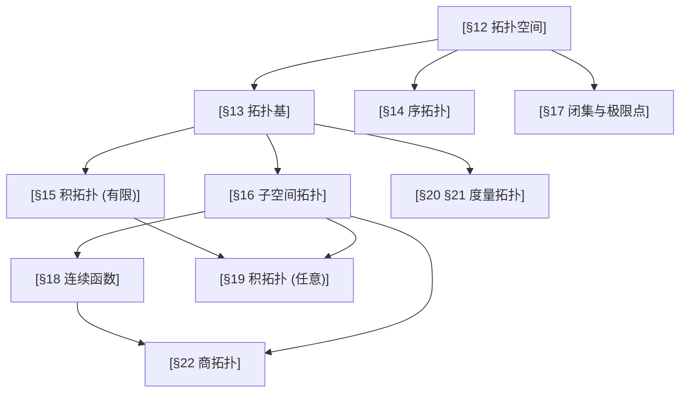

# Chapter 2: Topological Spaces and Continuous Functions

本章是点集拓扑学的核心，定义了拓扑空间、基、子空间、闭集、连续函数、乘积拓扑、度量拓扑和商拓扑等基本概念。所有后续章节都建立在第二章的基础之上。

## 逻辑依赖关系

## 各节概览

| 节 | 标题 | 核心内容 |
|----|------|----------|
| §12 | [[12_Topological_Spaces\|拓扑空间]] | 拓扑空间公理化定义，开集，离散/平庸/有限补拓扑 |
| §13 | [[13_Basis_for_a_Topology\|拓扑基]] | 基的定义，基生成的拓扑，子基 |
| §14 | [[14_The_Order_Topology\|序拓扑]] | 全序集上的序拓扑，区间，射线 |
| §15 | [[15_The_Product_Topology_on_XxY\|积拓扑 (有限)]] | 有限积空间的积拓扑，投影映射 |
| §16 | [[16_The_Subspace_Topology\|子空间拓扑]] | 子空间拓扑，子空间中的开/闭集 |
| §17 | [[17_Closed_Sets_and_Limit_Points\|闭集与极限点]] | 闭集，极限点，闭包，Hausdorff 空间 |
| §18 | [[18_Continuous_Functions\|连续函数]] | 连续函数的三种等价定义，同胚 |
| §19 | [[19_The_Product_Topology\|积拓扑 (任意)]] | 任意积空间的积拓扑与箱拓扑 |
| §20–§21 | [[20_The_Metric_Topology_I\|度量拓扑]] | 度量空间，度量拓扑，等距嵌入 |
| §22 | [[22_The_Quotient_Topology\|商拓扑]] | 商映射，商拓扑，商空间 |

## 核心定理索引

- [[12_Topological_Spaces#^theorem-12-collection|引理 12.2]] — 拓扑中开集族的性质
- [[13_Basis_for_a_Topology#^theorem-13-1|引理 13.1]] — 基生成的拓扑的特征
- [[13_Basis_for_a_Topology#^theorem-13-2|引理 13.2]] — 基的判定准则
- [[16_The_Subspace_Topology#^theorem-16-1|引理 16.1]] — 子空间拓扑中基的性质
- [[17_Closed_Sets_and_Limit_Points#^theorem-17-1|定理 17.1]] — 闭集的性质
- [[17_Closed_Sets_and_Limit_Points#^theorem-17-5|定理 17.5]] — 闭包的性质
- [[18_Continuous_Functions#^theorem-18-1|定理 18.1]] — 连续性的等价条件
- [[18_Continuous_Functions#^theorem-18-2|定理 18.2]] — 连续函数的复合、限制等
- [[19_The_Product_Topology#^theorem-19-6|定理 19.6]] — 到积空间的映射的连续性
- [[20_The_Metric_Topology_I#^theorem-20-1|引理 20.1]] — 度量拓扑中开球构成基
- [[22_The_Quotient_Topology#^theorem-22-1|定理 22.1]] — 商映射的特征
- [[22_The_Quotient_Topology#^theorem-22-2|定理 22.2]] — 商空间的万有性质
