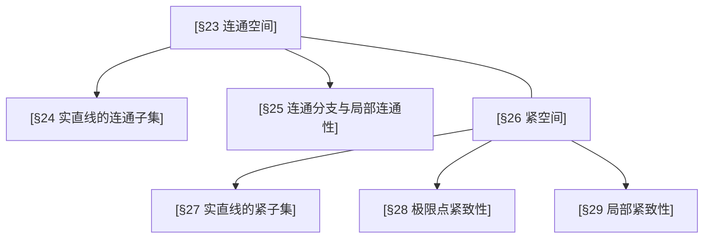

---
title: "Chapter 3 - Connectedness and Compactness"
date: 2026-07-08
tags:
  - topology/munkres/chapter3
  - topology/connectedness
  - topology/compactness
---

# Chapter 3: Connectedness and Compactness

本章研究拓扑空间两个最重要的全局性质：连通性和紧致性。这两者都是拓扑不变性质（同胚保持），且在分析和几何中有深远应用。

## 逻辑依赖关系

## 各节概览

| 节 | 标题 | 核心内容 |
|----|------|----------|
| §23 | [[23_Connected_Spaces\|连通空间]] | 连通性定义、分离、连续像保连通、连通集的并 |
| §24 | [[24_Connected_Subspaces_of_R\|实直线的连通子集]] | R 的连通子集=区间、介值定理 |
| §25 | [[25_Components_and_Local_Connectedness\|连通分支与局部连通性]] | 连通分支、道路连通、局部连通性 |
| §26 | [[26_Compact_Spaces\|紧空间]] | 开覆盖定义、闭子集紧、Hausdorff 中紧子集闭、连续像保紧、有限积紧 |
| §27 | [[27_Compact_Subspaces_of_R\|实直线的紧子集]] | Heine-Borel 定理、极值定理、一致连续性 |
| §28 | [[28_Limit_Point_Compactness\|极限点紧致性]] | 极限点紧、列紧、三者关系 |
| §29 | [[29_Local_Compactness\|局部紧致性]] | 局部紧、单点紧化、Alexandroff 紧化 |

## 核心定理索引

- [[23_Connected_Spaces#^thm-23-5|定理 23.5]] — 连通集的连续像是连通集
- [[24_Connected_Subspaces_of_R#^thm-24-1|定理 24.1]] — R 的连通子集 = 区间
- [[24_Connected_Subspaces_of_R#^thm-24-3|定理 24.3]] — 介值定理
- [[26_Compact_Spaces#^thm-26-2|定理 26.2]] — 紧空间的闭子集紧
- [[26_Compact_Spaces#^thm-26-3|定理 26.3]] — Hausdorff 空间中紧子集闭
- [[26_Compact_Spaces#^thm-26-5|定理 26.5]] — 紧集的连续像是紧集
- [[26_Compact_Spaces#^thm-26-6|定理 26.6]] — 紧集的有限积紧（Tychonoff 有限情形）
- [[26_Compact_Spaces#^thm-26-7|定理 26.7]] — 管引理
- [[27_Compact_Subspaces_of_R#^thm-27-3|定理 27.3]] — Heine-Borel：R^n 中子集紧 ⇔ 有界闭
- [[27_Compact_Subspaces_of_R#^thm-27-4|定理 27.4]] — 极值定理
- [[29_Local_Compactness#^thm-29-1|定理 29.1]] — 单点紧化
