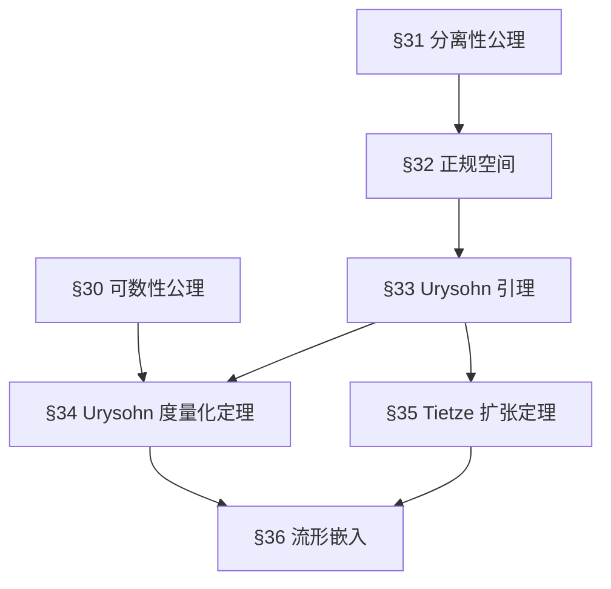

# Chapter 4: Countability and Separation Axioms

> [!abstract] 核心问题
> 在拓扑空间上附加"可数性条件"和"分离性条件"后，可以得到哪些更强的结论？这些条件如何用于度量化定理的证明？

## 章节概览

本章是点集拓扑学的核心章节之一，引入两类最重要的拓扑附加条件：

- **可数性公理**（§30）：第一可数、第二可数、可分、Lindelöf
- **分离性公理**（§31）：T₀, T₁, T₂ (Hausdorff), T₃ (正则), T₃½ (完全正则), T₄ (正规)
- **正规空间**（§32）：正规性的等价刻画与遗传性质
- **Urysohn 引理**（§33）：正规空间中不相交闭集可由连续函数分离
- **Urysohn 度量化定理**（§34）：第二可数的正则空间可度量化
- **Tietze 扩张定理**（§35）：正规空间上闭子集上的连续函数可扩张到全空间
- **流形的嵌入**（§36）：紧流形可嵌入到 ``$mathbb{R}^n$``

## 逻辑依赖图

## 章节笔记列表

| 节号 | 标题 | 文件 |
|------|------|------|
| §30 | The Countability Axioms | [[30_Countability_Axioms|§30]] |
| §31 | The Separation Axioms | [[31_Separation_Axioms|§31]] |
| §32 | Normal Spaces | [[32_Normal_Spaces|§32]] |
| §33 | The Urysohn Lemma | [[33_The_Urysohn_Lemma|§33]] |
| §34 | The Urysohn Metrization Theorem | [[34_The_Urysohn_Metrization_Theorem|§34]] |
| §35 | The Tietze Extension Theorem | [[35_The_Tietze_Extension_Theorem|§35]] |
| §36 | Imbeddings of Manifolds | [[36_Imbeddings_of_Manifolds|§36]] |

## 相关链接

- 上一章：[[../Chapter 03 - Connectedness and Compactness/00_Chapter_03_Overview|Chapter 3: Connectedness and Compactness]]
- 下一章：[[../Chapter 05 - The Tychonoff Theorem/00_Chapter_05_Overview|Chapter 5: The Tychonoff Theorem]]
