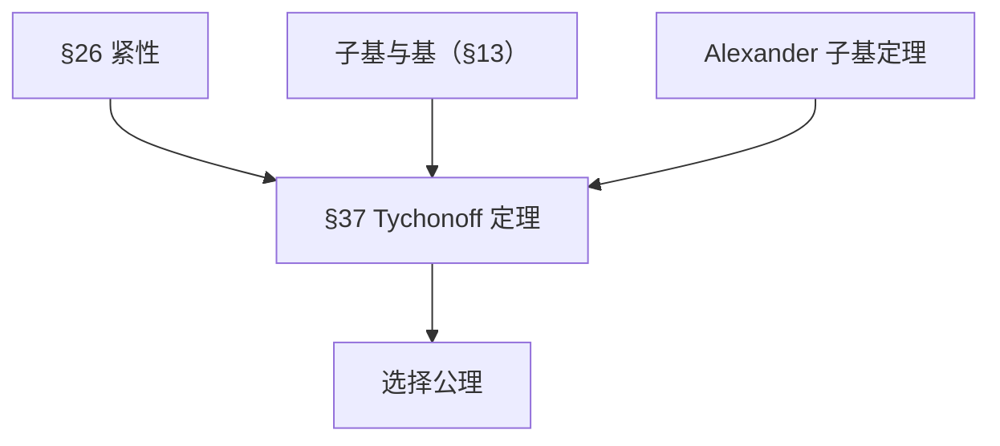

# Chapter 5: The Tychonoff Theorem

> [!abstract] 核心问题
> 紧空间的任意乘积是否仍是紧的？Tychonoff 定理给出肯定回答——这是点集拓扑学中最深刻、最常用的定理之一，与选择公理等价。

## 章节概览

本章篇幅虽短（仅一节），但 Tychonoff 定理的证明（经由 Alexander 子基定理）是拓扑学中最优美的论证之一。

## 逻辑依赖图

## 相关链接
- 上一章：[[../Chapter 04 - Countability and Separation Axioms/00_Chapter_04_Overview|Chapter 4]]
- 下一章：[[../Chapter 06 - Metrization Theorems and Paracompactness/00_Chapter_06_Overview|Chapter 6]]