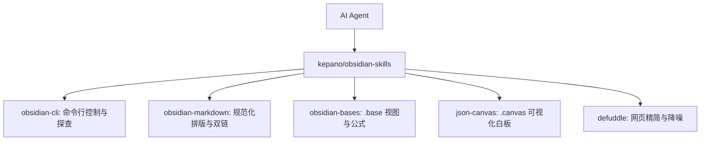

# Obsidian 技能与 Agent 调用指南

> [!abstract] 核心概述
> 本指南系统梳理面向 AI Agent（如 Claude Code、Codex、Cursor、Gemini 等）的 **Obsidian Skills 规范、CLI 命令集、安装配置方式与扩展生态**，为数学讲义仓库的自动化检索、双链维护、公式排版与结构化数据库管理提供标准化技术接口说明。

## 1. 核心技能集：`kepano/obsidian-skills`

由 Obsidian 官方团队主导维护的标准化 Agent 技能仓库（[kepano/obsidian-skills](https://github.com/kepano/obsidian-skills)）定义了知识库操作的五大核心模块：



### 1.1 `obsidian-cli`：命令行交互与库状态巡检
要求 Obsidian 桌面端版本为 **v1.12.4 或以上**，并在 **设置 (Settings) -> 通用 (General) -> Command line interface** 中开启及注册系统 `PATH`。

- **参数传递规则**：键值对参数使用 `key="value"` 格式（含空格的值必须加引号），布尔开关直接写出标志名（如 `verbose`）。
- **定位参数**：使用 `vault="<库名>"` 指定目标知识库，使用 `file="<笔记名>"`（按 Wikilink 规则解析）或 `path="<相对路径>"` 指定目标文件。

```bash
# 1. 检查全库未解析的双向链接（断链巡检）
obsidian unresolved verbose vault="数学"

# 2. 查询全库标签分布与统计
obsidian tags counts vault="数学"

# 3. 查询指定笔记的反向链接（Backlinks）與出链（Links）
obsidian backlinks file="实变函数简明教程重点与数学思想" vault="数学"
obsidian links path="实变函数/实变函数简明教程重点与数学思想.md" vault="数学"

# 4. 全文搜索关键词并携带行号上下文
obsidian search:context query="Carathéodory" vault="数学"

# 5. 创建或追加笔记内容
obsidian create name="新笔记" content="# 标题" vault="数学"
```

### 1.2 `obsidian-markdown`：Obsidian 扩展 Markdown 规范
1. **YAML Frontmatter**：位于文档首部，用于定义 `title`、`date`、`tags`、`aliases` 等属性。
2. **内部双向链接（Wikilinks）**：
   - 笔记链接：`[[笔记名|显示文本]]` 或 `[[相对路径/笔记名|显示文本]]`
   - 标题锚点链接：`[[笔记名#章节标题|显示文本]]`
   - 块级引用链接：`[[笔记名#^theorem-1-1|定理 1.1]]`
3. **Callouts 标注块**：使用 `> [!note]`（定义/定理）、`> [!abstract]`（核心问题/导读）、`> [!example]`（算例/反例）、`> [!question]`（习题解析）、`> [!tip]`（数学思想/方法总结），加 `+` 或 `-` 控制默认展开或折叠。
4. **LaTeX 数学公式**：行内公式使用 `$...$`（紧贴公式字符，不留首尾多余空格），独立行间公式使用 `$$...$$`。

### 1.3 `obsidian-bases`：`.base` 数据库视图配置
Obsidian Bases（`.base` 文件）采用标准 YAML 语法定义基于笔记属性与标签的动态表格或卡片视图：

```yaml
filters:
  and:
    - file.hasTag("matlab/lecture")
views:
  - type: table
    name: "MATLAB 课程讲义视图"
    order:
      - file.name
      - title
      - date
      - tags
```

### 1.4 `json-canvas`：`.canvas` 知识拓扑白板
遵循 [JSON Canvas 1.0 规范](https://jsoncanvas.org/spec/1.0/)，由顶层 `nodes` 数组与 `edges` 数组构成：
- **节点类型 (`type`)**：`text`（Markdown 文本卡片）、`file`（库内笔记或附件引用）、`link`（外部网页链接）、`group`（视觉分组框）。
- **连线属性 (`edges`)**：包含 `id`、`fromNode`、`toNode`、`fromSide`/`toSide`（`top` | `right` | `bottom` | `left`）、`toEnd`（`"arrow"`）及 `label`。

### 1.5 `defuddle`：外部网页提取与 Token 降噪
在采集在线数学文献或技术文档时，使用 `defuddle` 剥离网页导航栏与冗余 DOM，直接转换为纯净 Markdown：

```bash
npm install -g defuddle
defuddle parse https://example.com/math-article --md -o note.md
```

## 2. 技能安装与挂载方式

### 方式 A：通过 Skills CLI 自动安装
```bash
npx skills add https://github.com/kepano/obsidian-skills
```

### 方式 B：按 Agent 平台挂载至本地技能目录

| Agent 运行环境 | 项目级或全局技能存放路径 |
| :--- | :--- |
| **Claude Code** | `~/.claude/skills/` 或项目根目录 `.claude/skills/` |
| **Codex / OpenAI CLI** | `~/.codex/skills/` 或项目级 `.agents/skills/` |
| **Cursor / Windsurf** | `.cursor/rules/` 或 `.agent/skills/` |
| **Gemini / Antigravity** | `~/.gemini/skills/` 或工作区技能目录 |

## 3. 进阶社区生态与联动协议

1. **Obsidian Local REST API 插件**：在本地开启 HTTPS REST 端口（默认 `27124`），支持外部脚本通过标准 HTTP 请求（`GET`、`POST`、`PUT`、`DELETE`）读写笔记。
2. **Model Context Protocol (MCP) 服务**：如 `mcp-obsidian`，将 Vault 检索、读写与元数据查询封装为符合 MCP 标准的大模型工具集。
3. **Agent 外部记忆技能（`obsidian-agent-memory-skills`）**：利用 Obsidian 双链图谱维护长期研究专题的上下文笔记与跨章节索引。
4. **库内交互插件**：如 `Claudian`、`Copilot`、`Smart Connections`，支持侧栏对话与基于本地向量嵌入（Embedding）的语义检索。

## 4. 本仓库（math-notes）协作与维护准则

1. **公式与符号严谨性**：统一采用标准 LaTeX 语法（`$...$` 与 `$$...$$`），保持同一专题内数学符号的一致性。
2. **双向链接完整性**：新增跨章节引用时，使用 `[[相对路径/笔记名#标题|显示文本]]` 或块锚点 `^theorem-id`，并通过 `obsidian unresolved` 确保无失效断链。
3. **版本控制纯净性**：不将 `.obsidian/workspace*`、`.trash/` 等本地运行缓存纳入 Git 提交；新增讲义同步更新对应目录的 `.base` 视图与 `README.md` 索引。

## 5. 相关技术调研

- [[AI教学工程/Obsidian_Codex侧栏插件开发调研|Obsidian Codex 侧栏插件开发调研]]：分析侧栏插件架构、选区上下文捕获与公式保真渲染方案。
- [[AI教学工程/OpenMAIC课程与教材规划调研|OpenMAIC 课程与教材规划调研]]：分析多 Agent 交互式课程大纲规划与结构化教学法约束机制。
