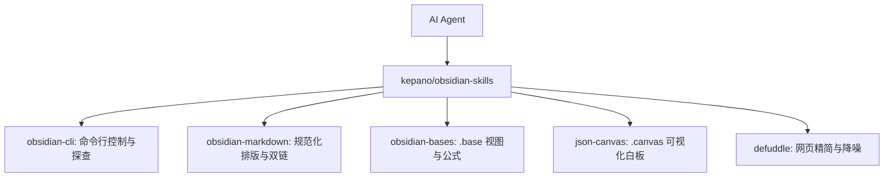

# Obsidian 技能与 Agent 调用指南

> [!abstract] 核心概述
> 本指南系统汇总了面向 AI Agent（如 Claude Code、DSH、Antigravity、Cursor 等）的 **Obsidian Skills 规范、安装方式、调用指令与扩展生态**。通过标准化的技能包，AI Agent 能够安全、规范地读写 Obsidian 库中的 Markdown 笔记、Base 数据库视图、JSON Canvas 白板，并通过官方 CLI 或 REST API / MCP 实现深度联动。

---

## 1. 核心技能集：`kepano/obsidian-skills`

由 Obsidian CEO Steph Ango（`@kepano`）主导维护的官方标准 Agent Skills 仓库：[kepano/obsidian-skills](https://github.com/kepano/obsidian-skills)。遵循 [Agent Skills 规范](https://agentskills.io)，将知识库操作规则与 CLI 工具直接赋予 Agent。



### 1.1 `obsidian-cli`：命令行调用与库管理

官方 Obsidian CLI（内置于 Obsidian 1.12.4+ 桌面端）提供了 Agent 控制运行中 Obsidian 实例的标准接口。

#### 语法规则
- **参数赋值**：使用 `=` 连接，含空格的值需加引号：`obsidian create name="My Note" content="Hello world"`
- **布尔开关**：无值 flag，如 `silent`（不打开界面新标签页）、`overwrite`（覆盖已有文件）
- **多行文本**：换行使用 `\n`，制表符使用 `\t`
- **定位库与文件**：
  - `vault="<库名称>"`：指定目标库（默认聚焦当前库）
  - `file="<笔记名>"`：以类似 Wikilink 的方式解析文件名（无需路径与 `.md` 后缀）
  - `path="<相对路径>"`：自库根目录起的精确相对路径（如 `拓扑学 Munkres/00_Overview.md`）

#### 常用命令速查

```bash
# 1. 笔记读取与写入
obsidian read file="变分法基本引理"
obsidian create name="新笔记" content="# 标题\n内容" template="Template" silent
obsidian append file="学习计划" content="- [ ] 新增任务"
obsidian prepend file="日志" content="2026-08-25: 更新记录\n"

# 2. 搜索与反向链接
obsidian search query="Sturm-Liouville" limit=10
obsidian backlinks file="拓扑空间与连续函数"
obsidian links file="SL谱理论讲义总览"
obsidian outline file="Chapter 02 Overview"

# 3. Frontmatter 属性管理
obsidian property:set name="status" value="completed" file="§12 拓扑空间"
obsidian property:get name="tags" file="§12 拓扑空间"

# 4. 日记与待办任务
obsidian daily:read
obsidian daily:append content="- [ ] 整理特征值证明"
obsidian tasks daily todo
obsidian tags sort=count counts

# 5. 开发者与插件调试命令
obsidian plugin:reload id="my-plugin"      # 热重载插件
obsidian dev:errors                       # 抓取控制台报错
obsidian dev:console level=error          # 捕获日志输出
obsidian dev:screenshot path="ui.png"     # 截取界面快照
obsidian dev:dom selector=".workspace" text # 探查 DOM 树
obsidian eval code="app.vault.getFiles().length" # 在应用上下文执行 JS
```

---

### 1.2 `obsidian-markdown`：Obsidian 语法规范

确保 Agent 生成完全符合 Obsidian 解析标准的 Markdown 文件。

#### 核心要素
1. **Frontmatter 属性**：置于文件顶部，规范元数据：
   ```yaml
   ---
   title: "笔记标题"
   date: 2026-08-25
   tags:
     - math/topology
     - munkres
   aliases:
     - "Topology Note"
   ---
   ```
2. **内部双向链接（Wikilinks）**：
   - 基础链接：`[[笔记名称]]`
   - 自定义别名：`[[笔记名称|显示文本]]`
   - 章节标题锚点：`[[笔记名称#章节标题]]`
   - 块引用锚点：`[[笔记名称#^block-id]]`（段落末尾添加 `^block-id`）
3. **内容嵌入（Embeds）**：
   - 嵌入笔记全文：`![[笔记名称]]`
   - 嵌入特定小节：`![[笔记名称#小节]]`
   - 嵌入图片/PDF：`![[image.png|400]]`，`![[paper.pdf#page=5]]`
4. **数学公式（LaTeX）**：
   - 行内公式：`$\int_a^b f(x)dx$`
   - 行间独立公式：
     ```latex
     $$
     -\frac{d}{dx}\left(p(x)\frac{dy}{dx}\right) + q(x)y = \lambda w(x)y
     $$
     ```
5. **Callout 标注块**：
   - 格式：`> [!type] 标题`
   - 常用类型：`note`, `abstract`, `important`, `tip`, `warning`, `example`, `question`, `quote`
   - 折叠 Callout：`> [!faq]- 点击展开解答`（`-` 默认收起，`+` 默认展开）

---

### 1.3 `obsidian-bases`：`.base` 数据库视图与筛选公式

用于创建与维护结构化数据库视图文件（`.base`，YAML 格式）。

```yaml
filters:
  and:
    - file.hasTag("topology/munkres")
    - 'file.ext == "md"'
    - not:
        - 'status == "archived"'

formulas:
  days_since_update: '(now() - file.mtime).days.round(0)'
  progress_status: 'if(status == "done", "✅ 完成", "⏳ 进行中")'

properties:
  status:
    displayName: "状态"
  formula.progress_status:
    displayName: "进度"
  formula.days_since_update:
    displayName: "更新距今天数"

views:
  - type: table
    name: "拓扑笔记概览"
    order:
      - file.name
      - formula.progress_status
      - tags
      - formula.days_since_update
    groupBy:
      property: status
      direction: ASC
```

---

### 1.4 `json-canvas`：`.canvas` 无限白板与知识拓扑

遵循 [JSON Canvas 1.0 规范](https://jsoncanvas.org/spec/1.0/)，结构由 `nodes`（节点）和 `edges`（连线）构成。

* **节点类型 (`type`)**：
  * `text`：Markdown 文本卡片（内容存入 `text` 字段，换行使用 `\n`）。
  * `file`：关联库中文件/图片（字段 `file`，可选 `subpath` 定位标题）。
  * `link`：外部 URL 链接（字段 `url`）。
  * `group`：分组容器框（可配置 `label` 与背景）。
* **连线 (`edges`)**：
  * 包含 `fromNode`、`toNode`、`fromSide`/`toSide`（`top`|`right`|`bottom`|`left`）、`toEnd: "arrow"`、`label`。
* **节点 ID 规范**：使用 16 位小写十六进制字符串（如 `"6f0ad84f44ce9c17"`）。

---

### 1.5 `defuddle`：网页提取与 token 优化

Agent 在从网络阅读参考资料或文献时，可使用 Defuddle 工具自动剥离导航栏、广告和杂质 HTML，直接转换为纯净 Markdown，大幅降低 Agent token 消耗。

```bash
# 全局安装
npm install -g defuddle

# 解析并输出为 Markdown
defuddle parse https://example.com/math-article --md -o note.md
```

---

## 2. 技能安装与配置方式

### 方式 A：通过 Agent Skills CLI 自动添加（推荐）

如果使用的 Agent 运行环境支持 `skills` 管理器：

```bash
npx skills add https://github.com/kepano/obsidian-skills
```

### 方式 B：本地 Agent 技能目录挂载

将技能文件夹直接放置于 Agent 的全局或项目级技能路径：

| 平台 / Agent 环境 | 技能存放路径 |
| :--- | :--- |
| **DSH / 本地 Agent** | `C:\Users\<Username>\.dsh\skills\` |
| **Claude Code** | `~/.claude/skills/` 或项目根目录 `.claude/skills/` |
| **Cursor / Windsurf** | `.agent/skills/` 或 Rules 目录 |
| **Antigravity / Gemini** | `~/.gemini/antigravity/builtin/skills/` 或 工作区插件目录 |

### 方式 C：Obsidian CLI 桌面端注册

1. 确保 Obsidian 桌面版已升级至 **v1.12.4 或以上**。
2. 打开 Obsidian → **设置 (Settings)** → **通用 (General)**。
3. 找到 **Command line interface**，将其切换为 **开启 (ON)**。
4. 点击 **注册 CLI (Register CLI)** 按钮，将 `obsidian` 自动注册进系统 `PATH` 环境变量。
5. 在终端运行 `obsidian help` 验证安装成功。

---

## 3. 进阶生态与扩展协议

除了 `kepano/obsidian-skills` 外，社区还提供了多种强大的 Agent 交互方案：

### 3.1 Obsidian Local REST API 插件
* **插件名**：`obsidian-local-rest-api`（社区插件市场直接安装）
* **特点**：在本地开启安全的 HTTPS REST 端口（默认 `27124`），Agent 可通过标准 HTTP API 发起 `GET`、`PUT`、`POST`、`DELETE` 请求。
* **典型用途**：跨语言脚本、远程 Agent 自动化调用、大批量文件索引与检索。

### 3.2 Model Context Protocol (MCP) 服务
* **代表实现**：`obsidian-mcp-server`、`calclavia/mcp-obsidian`
* **特点**：遵循 Anthropic MCP 标准协议，将 Obsidian 的搜索、读取、更新能力作为标准 Tool 暴露给大模型。

### 3.3 Agent 长期记忆系统 (`obsidian-agent-memory-skills`)
* **开源项目**：[adamtylerlynch/obsidian-agent-memory-skills](https://github.com/adamtylerlynch/obsidian-agent-memory-skills)
* **核心思路**：将 Obsidian 作为 Agent 的外脑（External Memory），在 Vault 中维护持久化思考脉络、研究断点与双向关联。

### 3.4 库内原生 AI 插件
* **Claudian**：在 Obsidian 侧边栏嵌入 Claude 交互。
* **Agent Fleet / obsidian-AI-agents**：在 Obsidian 内运行多 Agent 编排任务。
* **Copilot / Smart Connections**：基于本地向量嵌入（Embedding）实现文档语义检索与 RAG 问答。

---

## 4. 本仓库（math-notes）Agent 协作守则

针对 `F:\Obsidian Storage\数学` 仓库的维护，所有调用本技能集的 Agent 需遵守以下准则：

1. **数学公式保真**：公式一律采用标准 LaTeX 格式（`$...$` 与 `$$...$$`），避免引入不兼容的 KaTeX 宏。
2. **双向链接规范**：引用定理与概念时优先使用 `[[章节/笔记名#^theorem-id|显示名]]` 保持反向链接图谱完整。
3. **版本控制纯净**：`.obsidian` 与 `.trash` 严禁提交至 Git；所有新增与修改需如实登记于 `README.md` 与 `AGENTS.md` 并同步至 GitHub。


## 5. Codex 侧栏插件开发调研

2026-10-11 的专项调研见 [[AI教学工程/Obsidian_Codex侧栏插件开发调研|Obsidian Codex 侧栏插件开发调研]]。该文核对当前 Claudian 与 Copilot 的 Codex 实现, 区分编辑器选区、阅读视图选区、当前可见章节和图像上下文, 并给出 Windows 本机 App Server 接入路线与数学公式保真方案。当前只完成文档/源码调研及本机登录状态探测, 尚未安装或验收插件。
