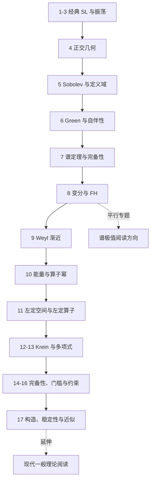

# Sturm-Liouville 谱理论讲义总览

本讲义面向已修完数学分析、线性代数、实变函数与常微分方程课程的数学系高年级本科生，正文不预设读者已修读过系统的泛函分析或 Sobolev 空间课程。全书从经典的正则 Sturm--Liouville (SL) 边值问题出发，逐步建立 Hilbert 空间、Green 函数与紧自伴算子谱定理，并在此基础上深入探讨左定（Left-Definite）空间标度、具体 Krein 模型、指定函数族的算子幂域成员性与完备性判据、迹约束带来的逼近障碍，以及有限维投影构造与基稳定性分析。

为保持笔记仓库中双向链接的兼容性，本目录沿用了原有的文件命名，文件名前缀的数字不再代表当前章序；阅读时请以如下目录表中的**新章号（第 1–17 章）**为准。全书共包含 17 章正文与 96 道配套习题（含详细解答，均附于各章讲义末尾）。在符号约定上，全书严格区分原方程势函数 $q(x)$ 与 Liouville 标准形势函数 $Q(s)$，并将全体特征值按重数从指标 $n=1$ 起递增排列。对于篇幅较长的定理证明，正文均先交代核心构造目标与关键先验估计，再按逻辑环节分段展开推导。

| 新章 | 内容 | 阅读副本 |
|---|---|---|
| 1 | 从物理问题到正则 SL 问题 | [[02_正则Sturm-Liouville问题]] |
| 2 | Liouville 标准形与 Prüfer 变换 | [[03_Liouville标准形]] |
| 3 | Sturm 比较定理与零点交错 | [[05_Sturm比较定理与零点交错]] |
| 4 | Hilbert 空间中的正交几何 | [[06_特征函数正交性与广义Fourier级数]] |
| 5 | 一维 Sobolev 空间、算子域与边界形式 | [[07_自伴边界条件与Hilbert空间框架]] |
| 6 | Green 函数、紧预解式与自伴性 | [[09_Green函数预解式与紧性]] |
| 7 | 紧自伴谱定理与特征函数完备性 | [[10_完备性与Fourier收敛]] |
| 8 | 变分原理、系数单调性与方向导数 | [[08_特征值的变分刻画与单调性]] |
| 9 | 特征值渐近与 Weyl 公式 | [[11_特征值渐近与Weyl公式]] |
| 10 | 从能量到算子幂 | [[12_从L2展开到能量空间]] |
| 11 | 左定空间与左定算子 | [[21_右定算子与左定空间]] |
| 12 | Krein 边界条件与移位模型 | [[22_边界条件与Krein模型]] |
| 13 | 正交多项式与三类函数系 | [[23_正交多项式与Krein-Sobolev系]] |
| 14 | 稀疏多项式族在第二、第三左定空间中的完备性 | [[24_第二第三左定空间中的完备性]] |
| 15 | 分数阶门槛与相容多项式组合 | [[25_分数阶门槛与高阶相容多项式]] |
| 16 | 约束与删项：两迹分类 | [[26_约束与删项后的完备性]] |
| 17 | 从完备性到构造与近似 | [[27_现代左定理论的阅读入口]] |

## 理论范围与阅读边界

本讲义第 14–16 章将左定空间中特定稀疏多项式族完备性的前沿研究证明改编为自包含的教学案例，旨在展示如何结合算子幂域刻画与矩递推分析解决具体的非本征函数族稠密性问题。至于针对一般无界自伴算子的抽象谱测度定理、复插值与实插值空间理论以及奇异 Sturm--Liouville 算子的 Weyl--Kodaira 自伴扩张理论，本讲义不在正文中展开抽象证明，而是在[[27_现代左定理论的阅读入口|第 17 章]]中提供清晰的定理陈述与权威文献导引。

## 配套索引

- [[符号表]]
- [[术语索引]]
- [[习题分类索引]]
- [[Zettl参考映射]]
- [[物理模型索引]]
- [[项目文档映射表]]
- [[SL谱理论/讲义书写计划]]

![[SL谱理论讲义.base]]

## 前言与问题驱动

本讲义专为已完成本科阶段分析与代数基础课程（数学分析、线性代数、实变函数与常微分方程）的读者编写。正文不要求读者预先掌握泛函分析或偏微分方程中的 Sobolev 空间理论；凡后续推导所需的 Hilbert 空间正交分解、一维 Sobolev 嵌入不等式、Green 积分算子紧性以及紧自伴算子谱定理，均在正文中以自包含且简洁直观的方式逐一建立。

贯穿全书的核心数学问题可以概括为以下两个层面：
1. **从 $L^2$ 收敛到高阶能量收敛**：经典 Sturm--Liouville 特征函数展开在加权平方可积空间 $L^2_r(a,b)$ 中依范数收敛；那么，在什么条件下该展开还能在能量范数（$H^1$ 型范数）乃至更高阶的算子幂范数中收敛？
2. **非本征指定函数族的完备性**：如果我们放弃算子自身的特征函数系，转而考察一个由代数或物理结构预先指定的、未必正交的函数族（例如缺失特定次数的稀疏多项式族），它是否仍然属于某个高阶左定空间，并在其中保持稠密（完备）？

## 章节逻辑与阅读路线

1. **经典常微分方程与振荡理论（第 1–3 章）**：从压杆屈曲与弦振动等力学模型出发导出正则 Sturm--Liouville 方程，引入 Liouville 标准形变换与 Prüfer 极坐标变换，并通过 Wronskian 与 Sturm 比较定理刻画解的零点交错与振荡频次。
2. **Hilbert 空间正交几何（第 4 章）**：在加权 $L^2_r$ 空间中建立内积、正交投影与 Bessel 不等式，阐明有限维子空间上的最佳逼近与无穷维空间中正交系完备性之间的本质区别。
3. **算子域、Green 函数与完备性证明（第 5–7 章）**：依次建立一维 Sobolev 空间、自伴边界形式、Green 积分算子及其紧自伴性，运用紧自伴算子谱定理严格证明特征函数系的完备性，并结合 Prüfer 相位将谱排序序号与 Dirichlet 本征函数的内部零点数精确对应。
4. **变分原理与高频渐近分析（第 8–9 章）**：在已确立本征基完备性的基础上，建立特征值的 Rayleigh--Ritz 与 Courant--Fischer 变分刻画，推导特征值关于系数的单调性、Feynman--Hellmann 方向导数公式以及高阶特征值的 Weyl 渐近律。
5. **从能量范数到左定空间标度（第 10–11 章）**：以正弦级数的高频权重与导数控制为切入点，引入正定自伴算子的分数阶幂 $A^{s/2}$，构建左定 Hilbert 空间族 $\mathcal H_s$ 及其上的左定自伴算子实现。
6. **Krein 模型与稀疏多项式族的完备性及门槛（第 12–16 章）**：围绕带耦合边界条件的移位 Krein 算子，系统分析边界能量、三类正交多项式系、指定稀疏多项式族在第二与第三左定空间中的完备性证明、分数阶幂域的 $s=7/2$ 成员门槛机制，以及施加点迹约束或删去有限项后的闭包余维分类。
7. **有限维逼近构造、基稳定性与现代理论导引（第 17 章）**：从有限维试探空间上的 Gram 方程出发讨论最佳逼近构造，辨析稠密生成族与 Schauder 基、Riesz 基之间的严格差距，阐明获得定量收敛速度所需的附加分析条件，并为乘法算子模型、加权多项式插值及现代一般左定理论提供进阶阅读指南。

（注：关于质量密度优化、bang--bang 极值结构、Keller 条件与 Mahar--Willner 方法的**谱极值问题**，与左定理论共享第 1–9 章的基础工具，读者可在学完第 8–9 章后作为平行专题独立阅读。）

## 证明阅读建议与预备知识说明

- **分析工具自包含性**：第 4 章从实变函数论中的 $L^2$ 空间出发，给出了完备性（Riesz--Fischer 定理）的完整证明并建立正交几何；第 5 章仅使用绝对连续函数的微积分基本定理、Fubini 定理、Lebesgue 控制收敛定理及基本的 $L^p$ 光滑逼近性质；其余章节的推导主要依赖高等微积分、线性代数与常微分方程的基本定理。
- **长证明的阅读方法**：各章末尾均附有配套习题与同号详细解答。在阅读篇幅较长的构造性证明（如第 6 章的 Green 核对称性、第 7 章的谱定理与振荡定理、第 14–16 章的左定完备性与两迹分类）时，建议先把握证明开头所提炼的**核心构造对象**，再审视控制余项或正交障碍的**关键不等式估计**，最后回看各步骤如何闭合逻辑链条。

## 学习目标

通过本讲义的系统学习，读者应当能够：
1. 在离散谱自伴算子框架下独立重构左定空间标度 $\mathcal H_s$ 及其上的左定算子实现；
2. 熟练运用迭代边界迹条件，检验一个给定函数族是否属于高阶算子幂域 $D(A^{s/2})$；
3. 完整复核非本征多项式族在左定空间中的稠密性证明（算子等距降阶、矩递推关系与渐近增长矛盾）；
4. 清晰解释分数阶左定空间中的成员门槛机制、相容多项式重组方法以及删项/迹约束下的闭子空间余维分类。

## 跨主题参照

- [[00_跨主题阅读索引|跨主题阅读索引]]：可按共享的数学定义、证明方法与物理背景检索仓库中其他课程（如《数学物理方程》与《变分法》）的对应笔记。
