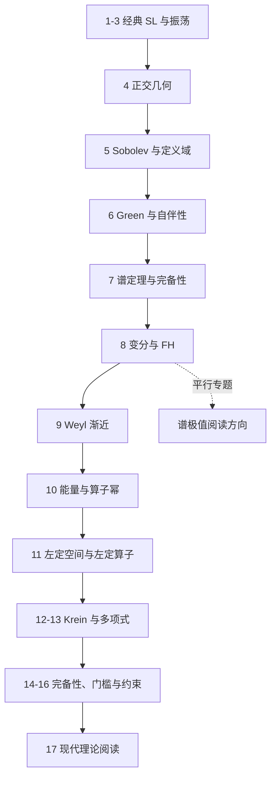

# SL 谱理论讲义总览

面向学过数学分析、线性代数、实变函数和常微分方程的本科高年级读者. 不预设泛函分析或 Sobolev 课程. 主线是左定空间、算子幂域和指定多项式族的完备性.

LaTeX 是唯一整本构建入口. 本目录保留历史文件名, 文件名前缀不再表示阅读顺序; 请按下表的新章号阅读. 新旧正文已经同步, 习题与解答均在对应阅读副本中.

| 新章 | 内容 | 阅读副本 |
|---|---|---|
| 1 | 从物理问题到正则 SL 问题 | [[02_正则Sturm-Liouville问题]] |
| 2 | Liouville 标准形与 Prüfer 变换 | [[03_Liouville标准形]] |
| 3 | Sturm 比较定理与零点交错 | [[05_Sturm比较定理与零点交错]] |
| 4 | Hilbert 空间中的正交几何 | [[06_特征函数正交性与广义Fourier级数]] |
| 5 | 一维 Sobolev 空间,算子域与边界形式 | [[07_自伴边界条件与Hilbert空间框架]] |
| 6 | Green 函数,紧预解式与自伴性 | [[09_Green函数预解式与紧性]] |
| 7 | 紧自伴谱定理与特征函数完备性 | [[10_完备性与Fourier收敛]] |
| 8 | 变分原理,系数单调性与方向导数 | [[08_特征值的变分刻画与单调性]] |
| 9 | 特征值渐近与 Weyl 公式 | [[11_特征值渐近与Weyl公式]] |
| 10 | 从能量到算子幂 | [[12_从L2展开到能量空间]] |
| 11 | 左定空间与左定算子 | [[21_右定算子与左定空间]] |
| 12 | Krein 边界条件与移位模型 | [[22_边界条件与Krein模型]] |
| 13 | 正交多项式与三类函数系 | [[23_正交多项式与Krein-Sobolev系]] |
| 14 | 稀疏多项式族在第二,第三左定空间中的完备性 | [[24_第二第三左定空间中的完备性]] |
| 15 | 分数阶门槛与相容多项式组合 | [[25_分数阶门槛与高阶相容多项式]] |
| 16 | 约束,删项与第二左定空间的两迹分类 | [[26_约束与删项后的完备性]] |
| 17 | 现代左定理论的阅读入口 | [[27_现代左定理论的阅读入口]] |

## 阅读边界

第 14--16 章是已有项目研究结果的教学重编. 一般谱测度定理、复杂插值结论与奇异扩张理论以第 17 章注明的引用和阅读方向为限. 本册没有把全部现代左定理论或谱极值问题称作已完成.

## 配套索引

- [[符号表]]
- [[术语索引]]
- [[习题分类索引]]
- [[Zettl参考映射]]
- [[物理模型索引]]
- [[项目文档映射表]]
- [[SL谱理论/讲义书写计划]]

![[SL谱理论讲义.base]]
