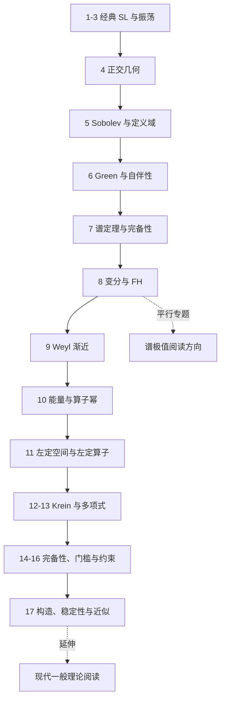

# SL 谱理论讲义总览

面向学过数学分析、线性代数、实变函数和常微分方程的本科高年级读者. 不预设泛函分析或 Sobolev 课程. 主线是具体 Krein 模型、指定族的成员性与完备性、约束障碍，以及构造与近似.

LaTeX 是唯一整本构建入口. 本目录保留历史文件名, 文件名前缀不再表示阅读顺序; 请按下表的新章号阅读. 新旧正文已经同步, 习题与解答均在对应阅读副本中.

| 新章 | 内容 | 阅读副本 |
|---|---|---|
| 1 | 从物理问题到正则 SL 问题 | [[02_正则Sturm-Liouville问题]] |
| 2 | Liouville 标准形与 Prüfer 变换 | [[03_Liouville标准形]] |
| 3 | Sturm 比较定理与零点交错 | [[05_Sturm比较定理与零点交错]] |
| 4 | Hilbert 空间中的正交几何 | [[06_特征函数正交性与广义Fourier级数]] |
| 5 | 一维 Sobolev 空间,算子域与边界形式 | [[07_自伴边界条件与Hilbert空间框架]] |
| 6 | Green 函数,紧预解式与自伴性 | [[09_Green函数预解式与紧性]] |
| 7 | 紧自伴谱定理与特征函数完备性 | [[10_完备性与Fourier收敛]] |
| 8 | 变分原理,系数单调性与方向导数 | [[08_特征值的变分刻画与单调性]] |
| 9 | 特征值渐近与 Weyl 公式 | [[11_特征值渐近与Weyl公式]] |
| 10 | 从能量到算子幂 | [[12_从L2展开到能量空间]] |
| 11 | 左定空间与左定算子 | [[21_右定算子与左定空间]] |
| 12 | Krein 边界条件与移位模型 | [[22_边界条件与Krein模型]] |
| 13 | 正交多项式与三类函数系 | [[23_正交多项式与Krein-Sobolev系]] |
| 14 | 稀疏多项式族在第二,第三左定空间中的完备性 | [[24_第二第三左定空间中的完备性]] |
| 15 | 分数阶门槛与相容多项式组合 | [[25_分数阶门槛与高阶相容多项式]] |
| 16 | 约束与删项: 两迹分类 | [[26_约束与删项后的完备性]] |
| 17 | 从完备性到构造与近似 | [[27_现代左定理论的阅读入口]] |

## 阅读边界

第 14--16 章是已有项目研究结果的教学重编. 一般谱测度定理、复杂插值结论与奇异扩张理论以第 17 章注明的引用和阅读方向为限. 本册没有把全部现代左定理论或谱极值问题称作已完成.

## 配套索引

- [[符号表]]
- [[术语索引]]
- [[习题分类索引]]
- [[Zettl参考映射]]
- [[物理模型索引]]
- [[项目文档映射表]]
- [[SL谱理论/讲义书写计划]]

![[SL谱理论讲义.base]]

## 前言与阅读路线

本讲义面向完成数学分析,线性代数,实变函数与常微分方程课程的数学系本科高年级学生. 正文不预设系统的泛函分析或 Sobolev 空间课程. 所需的 Hilbert 空间,无界算子与 一维 Sobolev 空间知识随主线引入. 后半部分通向左定理论的现代文献和具体完备性问题, 也可作为研究生入门阅读材料.

贯穿全书的问题是: 特征展开在 $L^2$ 中收敛, 什么时候还能在能量范数或更高阶范数中收敛? 如果把本征函数换成一个预先指定,未必正交的函数族, 怎样先检查成员性, 再证明或否定完备性? 加入约束以后缺少哪些方向, 又怎样恢复逼近并构造有限近似?

## 阅读路线

1.  第 1--3 章从物理模型进入正则 SL 方程,Liouville 变换,相位和零点比较.

2.  第 4 章建立 Hilbert 空间的正交几何, 说明有限维最佳逼近与无限维完备性之间的差别.

3.  第 5--7 章依次建立 Sobolev 定义域,边界形式,Green 算子,紧性,自伴性和谱定理, 再把谱序号与 Dirichlet 本征函数的内部零点数连接起来.

4.  第 8--9 章在已经证明完备性的基础上讨论变分刻画,Feynman--Hellmann 公式和 Weyl 渐近.

5.  第 10--11 章从正弦级数的高频权重进入算子幂,左定空间和其中的左定算子.

6.  第 12--16 章用 Krein 模型串联边界能量,正交多项式,第二与第三左定空间完备性, 分数阶门槛以及约束与删项后的闭包分类.

7.  第 17 章从有限 Gram 方程进入最佳逼近,基与稳定性, 说明误差估计所需的额外条件; 乘法算子,加权插值和现代文献作为延伸阅读.

谱极值研究与左定主线共享第 1--9 章的基础. 密度优化,bang--bang 结构, Keller 条件,Mahar--Willner 方法和精确开关数作为平行专题保留在书末阅读指南中; 它们不是阅读第 10 章的先修内容.

## 怎样阅读证明

第 4 章从实变中的 $L^2$ 出发, 补证完备性并建立正交几何. 第 5 章使用绝对连续积分基本定理, Fubini 与控制收敛定理及基本 $L^p$ 逼近, 从积分表示建立一维 Sobolev 空间. 不熟悉某个抽象符号时, 先回到该章的可计算例子. 每章末的习题既有计算与证明补全, 也有判断题: 多项式是否必在算子幂域中? 稠密族筛选以后是否仍然稠密? 习题统一按"章号.题号"编号: "基础"练习定义和计算, "主线"训练后续章节使用的方法, "拓展"供第二遍阅读. 第16章可先读约束操作与具体两迹分类, 第17章可先读有限逼近,基与误差; 一般矩与现代谱理论入口留待进一步阅读. 答案集中在附录 A, 阅读副本中也保留同号同标识的解答.

正文把重要结论写成定理及证明. 超出本册所建工具的内容明确标成引用定理或阅读方向, 并指出来源. 第 14--16 章是研究项目已有证明的教学重编, 不是经典理论的无来源延伸, 也不代表本书涵盖左定理论的全部前沿. 本册不以数值实验代替证明.

## 完成本册后的目标

读者应能在离散谱情形重建左定空间和其中的算子实现, 检查指定函数族是否属于目标空间, 复核一个非本征多项式族的完整稠密性证明, 解释分数阶阈值与边界残差的关系. 面对约束, 应区分逐项筛选,先组合后满足约束和正交投影, 算出具体例子的闭包与缺失方向, 并理解补充方向,有限迹修正与边界相容重组各自恢复了什么. 最后能够用有限 Gram 方程求最佳逼近, 区分完备性,展开唯一性与稳定性, 辨认误差估计还需要的正则性或结构条件. 全书以具体模型,一般判据,构造与近似三个层次收束. 一般谱测度,复杂插值理论与奇异端点扩张是进一步阅读的方向, 各章会写明哪些结论已证,哪些是外部输入.
