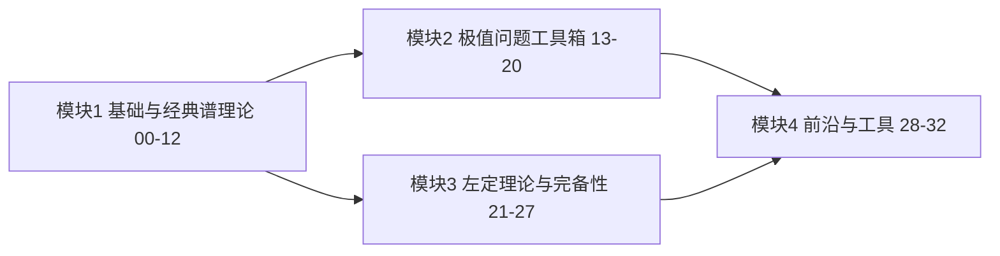

# SL 谱理论讲义书写计划

> [!abstract] 目的
> 把 SL 谱理论讲义当作一条完整的“系列课”来写：先确认系列课表（Gate 2），
> 再按单课模板逐讲产出 Obsidian md 与 LaTeX 两个版本。全部内容以
> “从本科高年级到研究入门”为读者定位，标准理论给完整证明，研究前沿给论文级证明或明确开放状态。

## Gate 1：已确认的约束

| 项目 | 选择 | 含义 |
|---|---|---|
| 目标读者 | A + C | 本科高年级到研究生入门，背景混合，需要前置回顾 |
| 最终目标 | C | 形成从基础到研究前沿的完整教材 |
| 证明深度 | C | 标准结论完整证明；前沿结果做到论文级证明或明确 OPEN |
| 输出格式 | md + LaTeX | Obsidian md 用于阅读与链接，LaTeX 用于打印/审计 |
| 数值实验 | 不需要 | 不安排数值实验课；如引用项目已有数值，仅作 `EVIDENCE` 备注 |

> [!warning] 证据与证明分层
> 讲义中严格区分：
> - `严格证明` / `STRICT`：完整解析证明；
> - `数值证据` / `EVIDENCE`：仅作直觉或现状说明，不构成证明；
> - `猜想` / `OPEN`：明确未解决；
> - `NOT-YET-STRICT`：有证明骨架但仍有缺口。

## 一、系列结构



### 模块 1：基础与经典谱理论

| 编号 | 标题 | 状态 | 前置 |
|---|---|---|---|
| 00 | SL 谱理论讲义总览 | 已完成初稿 | - |
| 01 | 杆的弯曲问题与 Euler–Bernoulli 梁 | 已完成初稿 | - |
| 02 | 正则 Sturm–Liouville 问题 | 已完成初稿 | 01 |
| 03 | Liouville 标准形 | 已完成初稿 | 02 |
| 04 | Prüfer 变换与特征值存在性 | 已完成初稿 | 03 |
| 05 | Sturm 比较定理与零点交错 | 已完成初稿 | 04 |
| 06 | 特征函数正交性与广义 Fourier 级数 | 已完成初稿 | 05 |
| 07 | 自伴边界条件与 Hilbert 空间框架 | 已完成初稿 | 06 |
| 08 | 特征值的变分刻画与单调性 | 已完成初稿 | 07 |
| 09 | Green 函数、预解式与紧性 | drafting | 07 |
| 10 | 完备性与 Fourier 收敛 | 待写 | 06, 07, 09 |
| 11 | 特征值渐近与 Weyl 公式 | 待写 | 08, 10 |
| 12 | 振荡理论进阶 | 待写 | 04, 05, 11 |

### 模块 2：极值问题工具箱

| 编号 | 标题 | 前置 |
|---|---|---|
| 13 | 二次型、Rayleigh 商与特征值不等式 | 08, 10 |
| 14 | 方向导数与 Feynman–Hellmann 公式 | 08, 13 |
| 15 | 紧性与 bang–bang 饱和 | 13, 14 |
| 16 | Keller 变分条件与转移矩阵 | 14, 15 |
| 17 | Mahar–Willner 两步极值法 | 11, 16 |
| 18 | $n=1$ 间距极值 | 15, 17 |
| 19 | 有限块约化与精确 $2n$ 开关 | 18 |
| 20 | 比值上确界与下确界 | 11, 17 |

### 模块 3：左定理论与完备性

| 编号 | 标题 | 前置 |
|---|---|---|
| 21 | 右定算子与左定空间 $H^s$ | 07, 10 |
| 22 | 左定算子与 Littlejohn–Wellman 定理 | 21 |
| 23 | Krein–Sobolev 正交多项式 | 22 |
| 24 | 矩跳跃递推与 $H^2$ 完备性 | 23 |
| 25 | $H^3$ 与一般 $H^s$ 完备性 | 24 |
| 26 | 一般边界稠密性判据 | 20, 25 |
| 27 | 开放问题导读 | 26 |

### 模块 4：前沿与工具

| 编号 | 标题 | 前置 |
|---|---|---|
| 28 | 研究地图与开放问题 | 19, 27 |
| 29 | 证明技术词典 | 全部 |
| 30 | 分层习题集 | 全部 |
| 31 | 项目文档导读与证据分层 | 28, 29 |
| 32 | LaTeX/PDF 发布与形式化边界 | 全部 |

## 二、Gate 2 详细课表：09–14

以下 6 讲先进入写作队列，确认后逐讲落地。

### 09 Green 函数、预解式与紧性

- `stage_type`: lecture
- 前置：07（自伴框架）
- 学完能做什么：会构造正则 SL 问题的 Green 函数，证明其对称性，并说明预解算子是 Hilbert–Schmidt/紧算子。
- 内容大纲：
  1. 从 $(L-\lambda r)y=f$ 到积分算子
  2. 变分参数法构造 Green 函数
  3. 分离边界条件下的 Green 函数存在性与对称性
  4. 预解算子与紧性
  5. 紧预解式给出离散谱
  6. 例子：Dirichlet / Neumann / Robin
- 证明要求：完整证明 Green 函数构造与对称性；紧性用连续核 + Hilbert–Schmidt 标准定理，并给定理的精确条件。
- 习题：3–5 道（构造不同边界条件的 Green 函数、验证对称性、说明紧性）。
- 对应教材：Zettl，Teschl；项目内对应 `07` 后续缺口。

### 10 完备性与 Fourier 收敛

- `stage_type`: lecture
- 前置：06、07、09
- 学完能做什么：证明正则 SL 特征函数系在带权 $L^2_r$ 中完备，并说清 $L^2$ 收敛与逐点收敛的条件差别。
- 内容大纲：
  1. 正交系、Bessel 不等式、Parseval
  2. 完备性等价于“与所有特征函数正交的函数为零”
  3. 紧自伴算子的谱定理（标准定理的精确陈述与证明路线）
  4. 特征展开在 $L^2_r$ 中的收敛
  5. Dirichlet 条件下的逐点收敛
  6. 例子与反例
- 证明要求：完备性证明完整；紧自伴谱定理作为泛函分析标准定理引用，但在附录给出证明路线和可用教材位置。
- 习题：证明 Parseval、构造展开、辨析逐点收敛条件。
- 对应项目：为 `H^2/H^3/H^s` 完备性提供基础。

### 11 特征值渐近与 Weyl 公式

- `stage_type`: lecture
- 前置：08、10
- 学完能做什么：证明 $\lambda_n\sim(n\pi/c)^2$，并由此推出比值下确界为 1。
- 内容大纲：
  1. Prüfer 相位与 Dirichlet/Neumann 比较
  2. 特征值计数函数 $N(\lambda)$
  3. Weyl 渐近公式
  4. 比值 $\lambda_{n+1}/\lambda_n$ 的下确界
  5. 与常系数例子的对照
- 证明要求：完整证明渐近估计；比较定理的使用逐步写清。
- 习题：证明 Dirichlet/Neumann 夹逼、推导 Weyl 常数、计算常系数极限。
- 对应项目：`SL_inf_ratio_proof.pdf`。

### 12 振荡理论进阶

- `stage_type`: lecture
- 前置：04、05、11
- 学完能做什么：用 Prüfer 比较给出结点计数定理与零点估计，并能复述 Sturm 比较的定量版本。
- 内容大纲：
  1. Prüfer 相位关于 $x$ 与 $\lambda$ 的单调性
  2. 相位比较与 Sturm 比较
  3. 第 $n$ 个特征函数的零点计数
  4. 零点间距估计
  5. 与谱隙的关系
- 证明要求：完整证明结点计数与比较估计。
- 习题：结点计数、零点间距、相位比较。
- 对应项目：为 `finite_reduction` 和 `exact_2n_switches` 的零点公式做准备。

### 13 二次型、Rayleigh 商与特征值不等式

- `stage_type`: lecture
- 前置：08、10
- 学完能做什么：在二次型定义域上严格使用极小极大原理，证明特征值比较与单调性。
- 内容大纲：
  1. 二次型与算子定义域
  2. 极小极大原理的完整陈述
  3. 特征值对 $p,q,r$ 的单调性
  4. 特征值比较不等式
  5. Poincaré 不等式与谱隙下界
- 证明要求：完整证明极小极大原理在正则 SL 情形的适用性；引用紧自伴谱定理时给出精确定理号。
- 习题：比较不同权的特征值、证明谱隙下界、构造反例。
- 对应项目：为第 14 讲方向导数做铺垫。

### 14 方向导数与 Feynman–Hellmann 公式

- `stage_type`: lecture
- 前置：08、13
- 学完能做什么：完整证明简单特征值的方向导数公式，并应用到盒约束谱优化。
- 内容大纲：
  1. 单参数扰动 $p_\epsilon,q_\epsilon,r_\epsilon$
  2. 简单特征值与归一化
  3. Feynman–Hellmann 公式的完整证明
  4. 只扰动 $r$ 的情形
  5. 常系数 Dirichlet 例子
  6. 与 bang–bang 变分条件的衔接
- 证明要求：完整证明简单特征值情形；重特征值情形明确标为 OPEN/NOT-YET-STRICT。
- 习题：计算 $\dot\lambda$、验证单调性、推导一阶最优性条件。
- 对应项目：`SL_gap_nge2_finite_reduction_proof.pdf`、`SL_ratio_proof.pdf`。

## 三、每讲写作模板

```markdown
---
title:
date:
tags: [SL, spectral-theory, ...]
aliases: [...]
stage_type: lecture | workshop | seminar | proof-reading
prerequisites: [...]
enduring_understanding: "..."
essential_question: "..."
performance_evidence: "..."
status: planned | drafting | self-reviewed | audited | published
---

# 标题

> [!abstract] 本节目标
> ...

> [!question] 基本问题
> ...

## 0. 动机与前置回顾
## 1. 定义与概念
## 2. 主定理与完整证明
## 3. 例子与反例
## 4. 与项目文档的联系
## 5. 常见误区
## 6. 习题
> [!question]
> [!success]- 解答
## 7. 下一讲衔接
```

## 四、每讲约束

```yaml
constraints:
  min_definitions: 1
  min_theorems: 1
  min_examples: 2
  min_exercises: 3
  require_proof: true
  require_misconception_callout: true
  require_prev_next_links: true
  require_reference_section: true
  strict_evidence_labels: true
  forbid_numerical_experiments: true
```

- 标准定理必须给完整证明，或明确写“引用 + 附录证明路线”；
- 项目前沿定理必须标注 `STRICT` / `EVIDENCE` / `OPEN`；
- 不使用数值实验作为讲义内容；
- 每讲同时维护 md 与 LaTeX 版本。

## 五、md 与 LaTeX 双轨结构

```text
Obsidian:
F:\Obsidian Storage\数学\SL谱理论\讲义\
├── 00_SL谱理论讲义总览.md
├── Zettl参考映射.md
├── 01–09 各讲 Markdown
├── images\
│   ├── fig_logic.svg
│   ├── fig_beam.svg
│   ├── fig_prufer.svg
│   ├── fig_sturm.svg
│   ├── fig_projection.svg
│   ├── fig_green.svg
│   ├── fig_spectrum.svg
│   └── fig_minmax.svg
└── SL谱理论讲义.base

LaTeX（整本主文件 + 章节文件）:
F:\LaTeX\SL_Spectral_Theory_Lecture\
├── SL_Spectral_Theory_Lecture_Notes.tex   # 整本主文件（唯一编译入口）
├── SL_Spectral_Theory_Lecture_Notes.pdf   # 整本 PDF
├── frontmatter\
│   └── preface.tex
├── backmatter\
│   └── references.tex     # 参考文献与 Zettl 章节对照
├── chapters\
│   ├── 01_physics_to_sl.tex
│   ├── 02_standard_prufer.tex
│   ├── 03_oscillation.tex
│   ├── 04_fourier.tex
│   ├── 05_self_adjoint.tex
│   ├── 06_variational.tex
│   ├── 07_green.tex
│   ├── 08_project_guide.tex
└── images\
```

LaTeX 当前分部分结构：

- 第一部分：基础与经典谱理论（第 1–2 章）
- 第二部分：振荡与展开（第 3–4 章）
- 第三部分：谱结构与变分（第 5–7 章）
- 第四部分：研究项目导引（第 8 章）

样式策略：

- LaTeX 侧统一使用 `styles/sl-lecture.sty` 中的 tcolorbox 定理、定义、例子与注样式；
- Obsidian 侧使用 `styles/sl-lecture-callouts.css`，并安装到 `.obsidian/snippets/` 启用；
- 符号统一登记在 `符号表.md` 与 `frontmatter/notation.tex`；
- Zettl 引用统一登记在 `Zettl参考映射.md`，LaTeX 侧每章末尾设“标准参考与延伸阅读”。

图示策略：

- Obsidian 侧使用 SVG 插图与 Mermaid 逻辑图；
- LaTeX 侧使用 TikZ 重绘同一批示意图；
- 后续每讲至少配一张“结构图”或“几何示意图”，避免连续多页纯文字。

规则：

- Obsidian md 是阅读与交叉链接版本；
- LaTeX 是打印与审计版本，统一由 `SL_Spectral_Theory_Lecture_Notes.tex` 编译成整本；
- 同一讲内容同步更新，避免只改一边；
- 每讲开头用 `> [!info] 本讲位置` 标明前置、模块与下一讲。

## 六、螺旋式概念脊柱

| 核心概念 | 首次 | 重访 | 升阶 |
|---|---|---|---|
| SL 算子与自伴性 | 07 | 09、21、22 | 对称性 → 紧预解式 → 左定算子 |
| 零点与振荡 | 04–05 | 12、19 | 比较定理 → Prüfer 比较 → 精确零点计数 |
| 正交展开与完备性 | 06 | 10、24、25、26 | 形式展开 → Hilbert–Schmidt → 左定空间 |
| 变分刻画 | 08 | 13、14、16、20 | Rayleigh → FH → Keller → 平衡相位 |
| 谱渐近 | 11 | 20、27 | Weyl → 比值界 → 开放问题 |
| 极值结构 | 15 | 18、19、20 | bang–bang → $n=1$ → 一般 $n$ |

## 七、Zettl 参考映射与使用方式

Zettl 的 *Sturm-Liouville Theory* 是本讲义已确认的主外部参考。
逐章对照、讲义讲次到 Zettl 的最小阅读集、可补强的定理清单与引用规范，
统一登记在 [[Zettl参考映射]]。写作时遵守三条规则：

1. 标准结论仍在讲义内给出完整证明，Zettl 用于一致性核对与边界情形补强；
2. 超出当前主线的奇异/左定结果写“引用 Zettl §x.y + 证明路线”，不整段复制；
3. 项目前沿结论继续按 `STRICT` / `EVIDENCE` / `OPEN` 分层，不用 Zettl 的教材结论替换证据状态。

每讲写作前先查 [[Zettl参考映射]] 的“讲义讲次 → Zettl 最小参考集”，
写作后在 md 与 LaTeX 两侧同步补“标准参考”小节。

## 八、质量门与工作流

1. **Gate 2 确认**：确认 09–14 课表；
2. **Draft**：按模板写初稿；
3. **Self-check**：定义、证明、符号、链接；
4. **Independent audit**：
   - 标准结论：对照 Zettl / Teschl / Reed–Simon，章节对照见 [[Zettl参考映射]]；
   - 前沿结论：`rigorous-open-math-research`；
   - 形式化目标：`lean-verify`；
5. **Format**：`obsidian-markdown` 规范检查；
6. **Sync**：更新 `.base`、README、AGENTS，提交并推送。

## 九、下一步

1. 确认 09–14 的课表；
2. 创建 `SL谱理论讲义.base` 状态表；
3. 09 已完成首版 STRICT 初稿并进入 `drafting` 状态；下一步按周推进 10–14。
