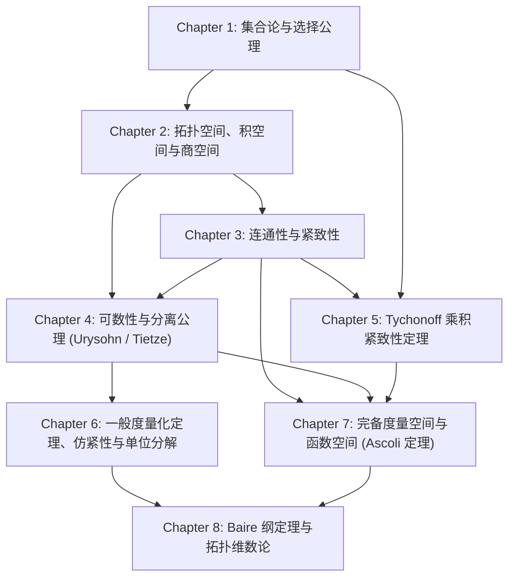

# 拓扑学 (Munkres) 课程讲义总览

> [!abstract] 课程主线与核心思想
> 本专题依据 James R. Munkres 所著经典教材《Topology》（第 2 版）第 1 章至第 8 章编写，系统构建点集拓扑学（Point-Set Topology）的公理化理论体系。点集拓扑学的核心在于剥离欧氏空间 $\mathbb{R}^n$ 中依赖具体距离公式的度量结构，将“开集”提取为最基本的原始概念，从而在一般的集合上严格定义邻近关系、极限过程与连续映射，并深入研究连通性、紧致性、可数性与分离公理、度量化问题、完备度量空间与函数空间拓扑以及 Baire 纲理论。

## 章节导航与知识脉络

本讲义按原书前八章结构组织，每章设有章节总览（`00_Chapter_XX_Overview.md`），各节讲义均包含核心动机问题、公理与定义解读、定理的完整证明步骤以及精选课后习题解析：

- **[[Chapter 01 - Set Theory and Logic/00_Chapter_01_Overview|Chapter 01: Set Theory and Logic（集合论与逻辑基础）]]**
  - 梳理集合代数运算、映射与关系、等价关系与序关系、可数集与不可数集、良序集、选择公理（Axiom of Choice）、良序定理（Well-Ordering Theorem）及 Zorn 引理，为无限乘积空间和超限归纳论证提供严密的集合论基础。
- **[[Chapter 02 - Topological Spaces and Continuous Functions/00_Chapter_02_Overview|Chapter 02: Topological Spaces and Continuous Functions（拓扑空间与连续映射）]]**
  - 建立拓扑空间与开集公理（[[Chapter 02 - Topological Spaces and Continuous Functions/12_Topological_Spaces|§12]]）、拓扑基与子基（[[Chapter 02 - Topological Spaces and Continuous Functions/13_Basis_for_a_Topology|§13]]），系统介绍序拓扑（[[Chapter 02 - Topological Spaces and Continuous Functions/14_The_Order_Topology|§14]]）、有限积拓扑（[[Chapter 02 - Topological Spaces and Continuous Functions/15_The_Product_Topology_on_XxY|§15]]）、子空间拓扑（[[Chapter 02 - Topological Spaces and Continuous Functions/16_The_Subspace_Topology|§16]]）、闭集与极限点及 Hausdorff 性质（[[Chapter 02 - Topological Spaces and Continuous Functions/17_Closed_Sets_and_Limit_Points|§17]]）、连续映射与同胚（[[Chapter 02 - Topological Spaces and Continuous Functions/18_Continuous_Functions|§18]]）、任意乘积上的积拓扑与箱拓扑对比（[[Chapter 02 - Topological Spaces and Continuous Functions/19_The_Product_Topology|§19]]）、度量拓扑与函数空间一致收敛度量（[[Chapter 02 - Topological Spaces and Continuous Functions/20_The_Metric_Topology_I|§20]]–[[Chapter 02 - Topological Spaces and Continuous Functions/21_The_Metric_Topology_II|§21]]）以及商拓扑与商映射万有性质（[[Chapter 02 - Topological Spaces and Continuous Functions/22_The_Quotient_Topology|§22]]）。
- **[[Chapter 03 - Connectedness and Compactness/00_Chapter_03_Overview|Chapter 03: Connectedness and Compactness（连通性与紧致性）]]**
  - 深入剖析点集拓扑中最重要的两个拓扑不变量：**连通性**（[[Chapter 03 - Connectedness and Compactness/23_Connected_Spaces|§23 连通空间]]、[[Chapter 03 - Connectedness and Compactness/24_Connected_Subspaces_of_R|§24 实直线上的连通子集与介值定理]]、[[Chapter 03 - Connectedness and Compactness/25_Components_and_Local_Connectedness|§25 连通分支、道路连通与局部连通]]）与**紧致性**（[[Chapter 03 - Connectedness and Compactness/26_Compact_Spaces|§26 紧致空间与管状引理]]、[[Chapter 03 - Connectedness and Compactness/27_Compact_Subspaces_of_R|§27 Heine-Borel 定理与 Lebesgue 数引理]]、[[Chapter 03 - Connectedness and Compactness/28_Limit_Point_Compactness|§28 极限点紧致性与序列紧致性]]、[[Chapter 03 - Connectedness and Compactness/29_Local_Compactness|§29 局部紧致性与 Alexandroff 单点紧化]]）。
- **[[Chapter 04 - Countability and Separation Axioms/00_Chapter_04_Overview|Chapter 04: Countability and Separation Axioms（可数性与分离公理）]]**
  - 探讨第一可数、第二可数、可分与 Lindelöf 等可数性公理（[[Chapter 04 - Countability and Separation Axioms/30_Countability_Axioms|§30]]），系统梳理 $T_1$、Hausdorff ($T_2$)、正则 ($T_3$) 与正规 ($T_4$) 分离公理体系（[[Chapter 04 - Countability and Separation Axioms/31_Separation_Axioms|§31]]–[[Chapter 04 - Countability and Separation Axioms/32_Normal_Spaces|§32]]），并给出分析与几何中极具威力的四大经典定理：[[Chapter 04 - Countability and Separation Axioms/33_The_Urysohn_Lemma|§33 Urysohn 引理]]、[[Chapter 04 - Countability and Separation Axioms/34_The_Urysohn_Metrization_Theorem|§34 Urysohn 度量化定理]]、[[Chapter 04 - Countability and Separation Axioms/35_The_Tietze_Extension_Theorem|§35 Tietze 扩张定理]]以及 [[Chapter 04 - Countability and Separation Axioms/36_Imbeddings_of_Manifolds|§36 紧流形的欧氏嵌入定理]]。
- **[[Chapter 05 - The Tychonoff Theorem/00_Chapter_05_Overview|Chapter 05: The Tychonoff Theorem（Tychonoff 乘积紧致性定理）]]**
  - 借助有限交性质（FIP）、Zorn 引理与 Alexander 子基定理，完整证明任意族紧致空间的积空间仍紧致的 [[Chapter 05 - The Tychonoff Theorem/37_The_Tychonoff_Theorem|§37 Tychonoff 定理]]（原书第 5 章还包括 §38 Stone-Čech 紧化）。
- **[[Chapter 06 - Metrization Theorems and Paracompactness/00_Chapter_06_Overview|Chapter 06: Metrization Theorems and Paracompactness（度量化定理与仿紧性）]]**
  - 引入集族的局部有限性与 $\sigma$-局部有限基（原书第 6 章 §39），建立一般可度量化判据 [[Chapter 06 - Metrization Theorems and Paracompactness/38_Metrization_Theorems|Nagata-Smirnov 度量化定理（原书 §40，笔记文件编号 38）]]，并探讨 [[Chapter 06 - Metrization Theorems and Paracompactness/39_Paracompactness|仿紧空间与 Smirnov 度量化定理（原书 §41–§42，笔记文件编号 39）]] 及微分几何中不可或缺的 [[Chapter 06 - Metrization Theorems and Paracompactness/40_Partitions_of_Unity|单位分解定理（原书 §36 / §41，笔记文件编号 40）]]。
- **[[Chapter 07 - Complete Metric Spaces and Function Spaces/00_Chapter_07_Overview|Chapter 07: Complete Metric Spaces and Function Spaces（完备度量空间与函数空间）]]**
  - 架起通往现代泛函分析的桥梁：研究 [[Chapter 07 - Complete Metric Spaces and Function Spaces/43_Complete_Metric_Spaces|§43 完备度量空间与等距完备化（原书 §43）]]、[[Chapter 07 - Complete Metric Spaces and Function Spaces/44_Compactness_in_Metric_Spaces|Peano 空间填充曲线与度量空间中的紧性刻画（完备 + 全有界）（原书 §44 空间填充曲线、§45 度量空间紧性，合并归档于笔记文件 44）]]、[[Chapter 07 - Complete Metric Spaces and Function Spaces/45_Function_Spaces|函数空间上的逐点收敛、紧收敛与紧开拓扑（原书 §46，笔记文件编号 45）]] 以及判别函数族列紧性的 [[Chapter 07 - Complete Metric Spaces and Function Spaces/46_Ascolis_Theorem|Arzelà-Ascoli 定理（原书 §47，笔记文件编号 46）]]。
- **[[Chapter 08 - Baire Spaces and Dimension Theory/00_Chapter_08_Overview|Chapter 08: Baire Spaces and Dimension Theory（Baire 空间与维数论）]]**
  - 阐述无处稠密集、第一纲集与 [[Chapter 08 - Baire Spaces and Dimension Theory/48_Baire_Spaces|§48 Baire 纲定理]]（及其在连续处处不可微函数存在性证明中的应用），并介绍拓扑维数（Lebesgue 覆盖维数）与紧可度量化空间的欧氏嵌入理论（[[Chapter 08 - Baire Spaces and Dimension Theory/50_Dimension_Theory|§50 维数论]]）。

## 整体逻辑依赖架构

## 相关链接

- [[README|返回仓库首页]]
- [[00_跨主题阅读索引|跨主题阅读索引]]
