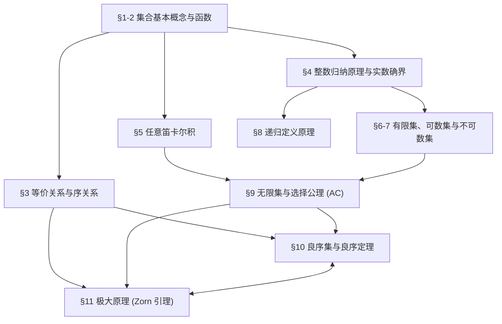

# Chapter 1: Set Theory and Logic

> [!abstract] 核心问题与章节概览
> 本章是全书的集合论与数理逻辑基础预备（对应 Munkres《Topology》第 2 版第 1 章 §1–§11），系统涵盖集合论基本概念与布尔运算、函数与原像性质、等价关系与序关系、整数归纳原理与实数最小上界性质、任意族的笛卡尔积、有限集与可数/不可数集、**递归定义原理**、选择公理、良序集与超限归纳法以及 Zorn 引理（极大原理）。

## 核心内容脉络与逻辑依赖图

- **§1–§2 集合、函数与基本逻辑**：集合的包含与布尔运算、De Morgan 定律与幂集；映射的单射、满射、双射及原像 $f^{-1}$ 保持集合运算的性质。
- **§3 关系（Relations）**：等价关系、等价类与集合划分；偏序、全序（线序）、严格序，以及上界与极大元的严格区分。
- **§4–§7 整数与实数、笛卡尔积、有限集与可数性**：正整数归纳原理与实数域 $\mathbb{R}$ 的最小上界性质；任意族笛卡尔积的选择函数定义；有限集与鸽巢原理；可数集与不可数集（$\mathbb{Z}_+ \times \mathbb{Z}_+$ 可数、可数并可数、$\mathbb{R}$ 与 $\{0,1\}^\omega$ 不可数）。
- **§8 递归定义原理（The Principle of Recursive Definition）**：自然数上递推构造函数的存在唯一性原理。
- **§9–§11 无限集、选择公理、良序集与极大原理**：无限集两种定义的等价性；选择公理（AC）、良序定理（Well-Ordering Theorem）、超限归纳法与 Zorn 引理（Maximum Principle）。

## §1 Fundamental Concepts

**集合（Set）**：作为不加定义的原始概念。$x \in A$ 表示 $x$ 是集合 $A$ 的元素，$x \notin A$ 表示 $x$ 不属于 $A$。**空集** $\varnothing$ 是不含任何元素的唯一集合。

**子集与真子集**：
- **子集（Subset）**：$A \subseteq B \iff \forall x\,(x \in A \implies x \in B)$；两集合相等 $A = B \iff A \subseteq B$ 且 $B \subseteq A$。
- **真子集（Proper Subset）**：$A \subsetneq B$ 表示 $A \subseteq B$ 且 $A \neq B$。

**集合的基本运算**：并集 $A \cup B = \{x \mid x \in A \text{ 或 } x \in B\}$、交集 $A \cap B = \{x \mid x \in A \text{ 且 } x \in B\}$、差集 $A \setminus B = \{x \mid x \in A \text{ 且 } x \notin B\}$。对全集 $X$ 中的子集（或任意集族 $\{A_\alpha\}_{\alpha \in J}$），恒成立 **De Morgan 对偶律**：
$$X \setminus (A \cup B) = (X \setminus A) \cap (X \setminus B), \qquad X \setminus \bigcup_{\alpha \in J} A_\alpha = \bigcap_{\alpha \in J} (X \setminus A_\alpha)$$
$$X \setminus (A \cap B) = (X \setminus A) \cup (X \setminus B), \qquad X \setminus \bigcap_{\alpha \in J} A_\alpha = \bigcup_{\alpha \in J} (X \setminus A_\alpha)$$

**幂集（Power Set）**：集合 $A$ 的全体子集构成的集合族，记作 $\mathcal{P}(A) = \{B \mid B \subseteq A\}$。

## §2 Functions

> [!note] **定义（函数 / 映射）**
> 从集合 $A$ 到集合 $B$ 的**映射（function / map）** $f: A \to B$ 是指积集 $A \times B$ 的一个子集（规则），满足对定义域 $A$ 中的每一个元素 $a \in A$，都存在陪域 $B$ 中**唯一**的元素 $b \in B$ 使得 $(a, b) \in f$，记作 $f(a) = b$。

- **单射（injective / one-to-one）**：$\forall a_1, a_2 \in A, \; f(a_1) = f(a_2) \implies a_1 = a_2$；
- **满射（surjective / onto）**：$\forall b \in B, \; \exists a \in A$ 使得 $f(a) = b$（即像集 $f(A) = B$）；
- **双射（bijective / one-to-one correspondence）**：既是单射又是满射（此时存在唯一的逆映射 $f^{-1}: B \to A$）。

**原像（Preimage / Inverse Image）**：对任意子集 $B_0 \subseteq B$，其原像定义为
$$f^{-1}(B_0) = \{a \in A \mid f(a) \in B_0\}$$
注意：无论 $f$ 是否为双射，原像 $f^{-1}: \mathcal{P}(B) \to \mathcal{P}(A)$ 作为幂集之间的集合函数**总是有定义的**，且完美保持任意并、任意交与差集运算：
$$f^{-1}\left(\bigcup_\alpha B_\alpha\right) = \bigcup_\alpha f^{-1}(B_\alpha), \quad f^{-1}\left(\bigcap_\alpha B_\alpha\right) = \bigcap_\alpha f^{-1}(B_\alpha), \quad f^{-1}(B \setminus B_0) = A \setminus f^{-1}(B_0)$$
（反之，正向像 $f(A_0)$ 保持任意并，但对交集一般仅有 $f(A_1 \cap A_2) \subseteq f(A_1) \cap f(A_2)$，当且仅当 $f$ 为单射时对任意子集取等号。）

**复合映射（Composition）**：设 $f: A \to B$ 且 $g: B \to C$，复合映射 $g \circ f: A \to C$ 定义为 $(g \circ f)(a) = g(f(a))$，且原像满足 $(g \circ f)^{-1}(C_0) = f^{-1}\bigl(g^{-1}(C_0)\bigr)$。

## §3 Relations

> [!note] **定义（二元关系）**
> 集合 $A$ 上的一个**二元关系（relation）** $R$ 是笛卡尔积 $A \times A$ 的一个子集（若 $(x, y) \in R$，常记作 $x R y$）。

**1. 等价关系与划分**：
- **等价关系（Equivalence Relation）**：满足**自反性**（$\forall x, \, x \sim x$）、**对称性**（$x \sim y \implies y \sim x$）与**传递性**（$x \sim y$ 且 $y \sim z \implies x \sim z$）的关系，记作 $x \sim y$。
- **等价类（Equivalence Class）**：$[x] = \{y \in A \mid y \sim x\}$，任意两个等价类要么完全相等，要么互不相交。
- **划分（Partition）**：$A$ 的全体等价类构成 $A$ 的一个两两不交的非空子集划分；反之，$A$ 的任意划分唯一决定 $A$ 上的一个等价关系。

**2. 序关系（Order Relations）**：
- **偏序（partial order，$\preceq$）**：满足**自反性**（$x \preceq x$）、**反对称性**（$x \preceq y$ 且 $y \preceq x \implies x = y$）与**传递性**（$x \preceq y$ 且 $y \preceq z \implies x \preceq z$）。
- **全序 / 线序（total / linear order）**：满足“任意两个元素均可比”（$\forall x, y \in A$，必有 $x \preceq y$ 或 $y \preceq x$）的偏序关系。
- **严格序（strict order，$<$）**：满足**非自反性**（不存在 $x$ 使 $x < x$）与**传递性**（$x < y$ 且 $y < z \implies x < z$）的关系（若进一步对任意 $x \neq y$ 有 $x < y$ 或 $y < x$，即为严格全序，对应 Munkres 书中定义的 linear order）。

**3. 上界（Upper Bound）与极大元（Maximal Element）的严格区分**：
设 $(A, \preceq)$ 是偏序集，$A_0 \subseteq A$：
- **上界**：元素 $b \in A$ 称为子集 $A_0$ 的一个**上界**，若对所有 $a \in A_0$ 均有 $a \preceq b$（若 $A_0$ 的全体上界构成的集合有最小元，则称为 $A_0$ 的**上确界 / 最小上界** $\sup A_0$）。
- **极大元**：元素 $m \in A_0$ 称为 $A_0$ 的一个**极大元**，若在 $A_0$ 中不存在任何严格大于 $m$ 的元素（即不存在 $a \in A_0$ 使得 $m \prec a$，或者说凡 $a \in A_0$ 满足 $m \preceq a$ 必有 $a = m$）。
- **关键区别**：**二者在一般偏序集中截然不同！** 极大元属于 $A_0$，它只要求在 $A_0$ 中没有元素排在它严格后面，但 $A_0$ 中可能有其他与 $m$ 不可比的元素，因此**极大元未必是 $A_0$ 的上界（最大元）**；反之，$A_0$ 的上界未必属于 $A_0$。

## §4 The Integers and the Real Numbers

**正整数归纳原理（Principle of Mathematical Induction）**：若正整数集的子集 $A \subseteq \mathbb{Z}_+$ 满足：(1) $1 \in A$；(2) 对任意 $n \in \mathbb{Z}_+$，由 $n \in A$ 可推出 $n + 1 \in A$，则必有 $A = \mathbb{Z}_+$。等价地，$\mathbb{Z}_+$ 的每个非空子集都有最小元（良序性质）。

**实数域 $\mathbb{R}$ 的公理化性质**：
- **代数性质**：关于加法和乘法构成一个域（Field）；
- **序性质**：具有与加法和乘法相容的严格全序 $<$（构成有序域）；
- **最小上界性质（Least Upper Bound Property / 确界原理）**：$\mathbb{R}$ 的每一个非空且有上界的子集 $A \subseteq \mathbb{R}$ 在 $\mathbb{R}$ 中必有最小上界（上确界 $\sup A \in \mathbb{R}$）；
- **Archimedes 性质**：正整数集 $\mathbb{Z}_+$ 在 $\mathbb{R}$ 中无上界（对任意 $x \in \mathbb{R}$，存在 $n \in \mathbb{Z}_+$ 使 $n > x$）。

## §5 Cartesian Products

> [!note] **定义（任意集族的笛卡尔积）**
> 设 $\{A_\alpha\}_{\alpha \in J}$ 是由指标集 $J$ 标号的一族集合，记 $X = \bigcup_{\alpha \in J} A_\alpha$。该集族的**笛卡尔积（Cartesian Product）**定义为全体从指标集 $J$ 到 $X$ 的如下函数（称为 $J$-元组 $\mathbf{x} = (x_\alpha)_{\alpha \in J}$）构成的集合：
> $$\prod_{\alpha \in J} A_\alpha = \left\{ \mathbf{x}: J \to \bigcup_{\alpha \in J} A_\alpha \;\middle|\; \forall \alpha \in J, \, \mathbf{x}(\alpha) = x_\alpha \in A_\alpha \right\}$$
> 即：**任意笛卡尔积的元素本质上是指标集上的选择函数（choice function）**。

当指标集为有限集 $J = \{1, \ldots, n\}$ 时，上述定义自然退化为熟悉的有限 $n$-元组空间 $A_1 \times \cdots \times A_n$；当 $J = \mathbb{Z}_+$ 且每个 $A_n = A$ 时，记作可数无穷乘积 $A^\omega$（即 $A$ 中的全体无穷序列）。

## §6 Finite Sets

> [!note] **定义（有限集与基数）**
> 集合 $A$ 称为**有限集（finite set）**，若 $A = \varnothing$，或者存在某个正整数 $n \in \mathbb{Z}_+$ 以及从截段 $\{1, \ldots, n\}$ 到 $A$ 的双射 $f: \{1, \ldots, n\} \to A$（此时整数 $n$ 由 $A$ 唯一确定，称为有限集 $A$ 的**基数 / 元素个数** $|A| = n$；空集的基数定义为 $0$）。

- **引理 6.1 & 推论 6.6**：有限集的任意子集仍是有限集；有限个有限集的并集与有限笛卡尔积仍是有限集。
- **推论 6.7（鸽巢原理 / Pigeonhole Principle）**：不存在从任何有限集 $A$ 到其真子集 $A_0 \subsetneq A$ 的双射。
- **等价判据**：集合 $B$ 是有限集 $\iff$ 存在从某个有限集 $A$ 到 $B$ 的满射（当 $B \neq \varnothing$）$\iff$ 存在从 $B$ 到某个有限集 $A$ 的单射。

## §7 Countable and Uncountable Sets

> [!note] **定义（可数集与不可数集）**
> - **可数无限集（countably infinite）**：存在与正整数集 $\mathbb{Z}_+$ 之间的双射 $f: \mathbb{Z}_+ \to A$；
> - **可数集（countable / 至多可数）**：有限集或可数无限集（等价于存在满射 $g: \mathbb{Z}_+ \to A$，或存在单射 $h: A \to \mathbb{Z}_+$）；
> - **不可数集（uncountable）**：不是可数集的无限集。

> [!important] **推论 7.4 / §7 例 2（原书 pp. 45–48；注：原书定理 7.1 为非空集合的三个可数性判据）**
> 正整数平面网格 $\mathbb{Z}_+ \times \mathbb{Z}_+$ 是可数无限集（可通过对角线编号单射 $(m, n) \mapsto 2^m 3^n$ 或双射 $h(m, n) = \frac{1}{2}(m+n-2)(m+n-1) + m$ 证明）。

> [!important] **定理 7.5 & 7.6**
> 1. **（定理 7.5）** 可数个可数集的并集仍是可数集；
> 2. **（定理 7.6）** 有限个可数集的笛卡尔积仍是可数集（特别地，有理数集 $\mathbb{Q}$ 是可数无限集）。

> [!important] **定理 7.7 & 7.8（Cantor 对角线定理与不可数集）**
> 1. **（定理 7.7）** 二元序列空间 $\{0, 1\}^\omega$（以及实数集 $\mathbb{R}$）是**不可数集**（Cantor 对角线论证：对任意序列列 $\mathbf{x}^{(n)} \in \{0, 1\}^\omega$，构造对角翻转序列 $y_n = 1 - x_n^{(n)}$，则 $\mathbf{y} \neq \mathbf{x}^{(n)}$ 对一切 $n$ 成立）；
> 2. **（定理 7.8：Cantor 定理）** 对任意集合 $A$，不存在从 $A$ 到其幂集 $\mathcal{P}(A)$ 的满射（也没有从 $\mathcal{P}(A)$ 到 $A$ 的单射，因为对任意 $g: A \to \mathcal{P}(A)$，对角子集 $B = \{a \in A \mid a \notin g(a)\} \in \mathcal{P}(A)$ 不在 $g$ 的像中）。特别地，$\mathcal{P}(\mathbb{Z}_+) \cong 2^{\mathbb{Z}_+}$ 不可数。

## §8 The Principle of Recursive Definition

> [!note] **定理 8.4（递归定义原理 / The Principle of Recursive Definition）**
> 设 $A$ 是一个集合，$a_0 \in A$ 是给定的初始元素，$\rho$ 是一个将每一个定义在截面 $\{1, \ldots, n\}$ 上的函数 $f: \{1, \ldots, n\} \to A$ 指派给 $A$ 中某个元素 $\rho(f) \in A$ 的规则（特别地，包括形如 $\rho(n, h(n)) \in A$ 的单步递推规则）。则**存在唯一**的函数 $h: \mathbb{Z}_+ \to A$，使得：
> $$h(1) = a_0, \qquad h(n) = \rho\bigl(h|_{\{1, \ldots, n-1\}}\bigr) \quad (\forall n \geqslant 2)$$
> （在单步马尔可夫型递推 $\rho: \mathbb{Z}_+ \times A \to A$ 下即为 $h(1) = a_0, \; h(n+1) = \rho(n, h(n))$。）

此原理严格保证了数学中一切归纳递推定义（如幂运算 $a^n$、阶乘 $n!$、Fibonacci 数列以及后续点集拓扑中逐歩选取点列的归纳构造）的存在性与唯一性。

## §9 Infinite Sets and the Axiom of Choice

> [!note] **公理（选择公理 / Axiom of Choice, AC）**
> 设 $\mathcal{A}$ 是一族互不相交的非空集合。则存在一个集合 $C \subseteq \bigcup_{A \in \mathcal{A}} A$（称为**选择集**），使得对每一个 $A \in \mathcal{A}$，交集 $C \cap A$ 恰好只含**唯一一个**元素。

**选择公理的常用等价形式**：
- **（引理 9.2：选择函数存在性）** 对任意非空集合族 $\mathcal{B}$，存在**选择函数** $c: \mathcal{B} \to \bigcup_{B \in \mathcal{B}} B$，使得对每个 $B \in \mathcal{B}$ 均有 $c(B) \in B$；
- 任意一族非空集合的笛卡尔积 $\prod_{\alpha \in J} A_\alpha$ 非空；
- 任意满射 $f: X \to Y$ 都存在右逆（截面 $s: Y \to X$ 满足 $f \circ s = \operatorname{id}_Y$）；
- 良序定理（§10）与 Zorn 引理（§11）。

> [!important] **定理 9.1（无限集的两种等价刻画）**
> 对任意集合 $A$，以下两条关于“$A$ 是无限集”的刻画完全等价：
> 1. $A$ 不是有限集；
> 2. $A$ 包含一个**可数无限子集**（即存在单射 $h: \mathbb{Z}_+ \to A$）；
> 3. 存在从 $A$ 到其某个真子集 $A_0 \subsetneq A$ 的双射（Dedekind 无限）。
>
> *证明核心与公理依赖边界*：(2) $\implies$ (3) $\implies$ (1) 仅需初等集合论与鸽巢原理；而 **(1) $\implies$ (2)** 的如下标准证明使用**选择公理（AC）**：按**引理 9.2** 在无限集 $A$ 的全体非空子集族 $\mathcal{P}(A) \setminus \{\varnothing\}$ 上取定一个选择函数 $c$，再结合 **§8 递归定义原理**令 $h(1) = c(A)$、$h(n) = c\bigl(A \setminus \{h(1), \ldots, h(n-1)\}\bigr)$（因 $A$ 无限，$A$ 减去有限集非空），从而无重复地选出可数无限子集 $h(\mathbb{Z}_+) \subseteq A$。（注：若仅依赖较弱的**可数选择公理 $\mathrm{AC}_\omega$**，因 $\mathcal{P}(A)\setminus\{\varnothing\}$ 一般不可数而不能直接取全局选择函数，可改取预先给定的可数族 $\mathcal{F}_n = \{f:\{1,\dots,n\}\to A \mid f\text{ 单射}\}$（$n\in\mathbb{Z}_+$）；由 $A$ 无限知每个 $\mathcal{F}_n$ 非空，以 $\mathrm{AC}_\omega$ 同时选出序列 $(f_n)_{n\ge 1}\in\prod_{n=1}^\infty \mathcal{F}_n$，则并集 $C = \bigcup_{n=1}^\infty f_n(\{1,\dots,n\})$ 可由双指标显式枚举去重且至少含 $n$ 个元素（$\forall n$），故为 $A$ 的可数无限子集。）

## §10 Well-Ordered Sets

> [!note] **定义（良序集与截面）**
> - **良序集（Well-Ordered Set）**：全序集 $(A, <)$ 称为**良序集**，若 $A$ 的**每一个非空子集**都有最小元（first / smallest element）。
> - **截面（Section）**：在全序集 $X$ 中，元素 $\alpha \in X$ 决定的**截面**（初段）定义为 $S_\alpha = \{x \in X \mid x < \alpha\}$。

**经典例子**：正整数集 $\mathbb{Z}_+$ 以及字典序下的 $\mathbb{Z}_+ \times \mathbb{Z}_+$（或 $\{1, \ldots, n\} \times \mathbb{Z}_+$）都是良序集；而 $\mathbb{Z}$ 与 $\mathbb{R}$ 在通常大小顺序下不是良序集（例如开区间 $(0, 1) \subseteq \mathbb{R}$ 无最小元）。

> [!important] **定理（良序定理 / Well-Ordering Theorem, Zermelo 1904）**
> **每一个集合 $A$ 上都存在一个良序关系。**（在 ZF 集合论中，良序定理与选择公理等价。）
>
> **引理 10.2 & 定理 10.3（最小不可数良序集 $S_\Omega$ 的存在性与可数子集上界性质，原书 p. 66）**：由良序定理，存在不可数良序集；取一个不可数良序集并添入最大元后，令 $\Omega$ 为其中使得截面 $S_\Omega$ 不可数的最小元素，则得到**最小不可数良序集 $S_\Omega$**（**引理 10.2**）——它是一个不可数良序集，但它的**每一个截面 $S_\alpha$（$\alpha \in S_\Omega$）都是可数集**！进一步地，在 $S_\Omega$ 中**任意可数子集都在 $S_\Omega$ 内有严格上界**（**定理 10.3**）。空间 $S_\Omega$ 与 $\overline{S}_\Omega = S_\Omega \cup \{\Omega\}$（即第一不可数序数 $\omega_1$ 与 $\omega_1 + 1$）是点集拓扑中极重要的反例源泉。

**超限归纳原理（Principle of Transfinite Induction）**：设 $(J, <)$ 是良序集，$J_0 \subseteq J$。若对每一个 $\alpha \in J$，都有以下蕴含关系成立：
$$\bigl(\forall \beta < \alpha, \; \beta \in J_0 \text{（即 } S_\alpha \subseteq J_0\text{）}\bigr) \implies \alpha \in J_0,$$
则必有 $J_0 = J$（即性质对全良序集所有元素成立）。

## §11 The Maximum Principle

> [!note] **定理（极大原理 / Zorn 引理 / Kuratowski-Zorn Lemma）**
> 设 $(A, \preceq)$ 是一个偏序集。若 $A$ 的**每一个全序子集（称为链 / chain）$C \subseteq A$ 在 $A$ 中都有上界**，则 $A$ 中至少存在一个**极大元** $m \in A$。

**逻辑等价闭环**：选择公理（AC）$\iff$ 良序定理（Well-Ordering Theorem）$\iff$ Zorn 引理（极大原理）$\iff$ Hausdorff 极大链原理（偏序集中每个全序子集都包含于某个极大展示全序子集中）。

> [!tip] **Zorn 引理在拓扑与代数中的标准使用范式**
> Zorn 引理是现代拓扑学（如证明 §37 Tychonoff 紧致性定理中的极大有限交族）与泛函分析（Hahn-Banach 定理、任意向量空间 Hamel 基存在性、交换环极大理想存在性）中最强大的非构造性存在工具：将待求的延拓对象或集族放入偏序集 $(A, \subseteq)$，通过取链的并集 $\bigcup_{C \in \mathcal{C}} C$ 验证任意链有上界，即可直接断言极大对象的存在！

## 相关链接

- 返回总览：[[../00_拓扑学总览|拓扑学总览]]
- 下一章：[[../Chapter 02 - Topological Spaces and Continuous Functions/00_Chapter_02_Overview|Chapter 2: Topological Spaces and Continuous Functions]]
