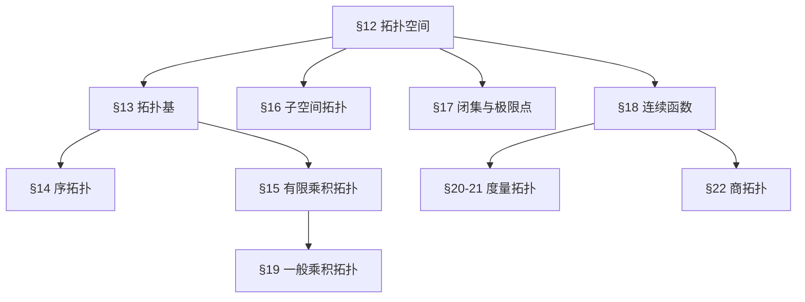

# Chapter 2: Topological Spaces and Continuous Functions

> [!abstract] 核心问题
> 什么是拓扑空间？如何在不依赖距离度量的前提下公理化地刻画“开集”、“极限”与“连续性”？又如何通过已有的拓扑空间系统地构造新的拓扑空间（子空间、乘积空间、度量空间与商空间）？

## 章节概览

本章建立点集拓扑学的核心概念与公理体系。通过将欧氏空间中开集对“任意并”和“有限交”封闭的性质提炼为拓扑公理，本章构建了描述空间局部与整体几何结构的通用语言，并系统阐述了拓扑学中四大基本空间构造方式（序拓扑、子空间拓扑、乘积拓扑、商拓扑）以及度量拓扑与一般拓扑之间的深刻联系。

## 各节概览

- **[[12_Topological_Spaces|§12 拓扑空间]]**：拓扑空间的公理化定义（开集族公理）及离散拓扑、平庸拓扑、有限补拓扑等基本算例。
- **[[13_Basis_for_a_Topology|§13 拓扑基]]**：用较小的“基本开集族”生成整个拓扑的机制、基的判定准则、拓扑粗细比较及子基（Subbasis）。
- **[[14_The_Order_Topology|§14 序拓扑]]**：由全序关系上的开区间与半开区间自然诱导的序拓扑及其字典序算例。
- **[[15_The_Product_Topology_on_XxY|§15 笛卡尔积拓扑（有限）]]**：两个拓扑空间的积拓扑定义、因子空间基的乘积以及坐标投射映射的连续性。
- **[[16_The_Subspace_Topology|§16 子空间拓扑]]**：子集上由母空间开集交运算诱导的相对拓扑及其与序拓扑的相容性分析。
- **[[17_Closed_Sets_and_Limit_Points|§17 闭集与极限点]]**：闭集公理、闭包与内部的对偶性、极限点刻画以及保证序列极限唯一的 Hausdorff ($T_2$) 分离性质。
- **[[18_Continuous_Functions|§18 连续函数]]**：连续映射的“开集原像为开集”定义、四种等价刻画、连续映射的复合与限制以及拓扑同胚与嵌入。
- **[[19_The_Product_Topology|§19 乘积拓扑（一般）]]**：任意族空间上的 Tychonoff 积拓扑与箱拓扑（Box Topology）的本质对比及分量连续性泛性质。
- **[[20_The_Metric_Topology_I|§20]]–[[21_The_Metric_Topology_II|§21 度量拓扑]]**：由度量开球诱导的度量拓扑、有界标准度量、函数空间上的一致收敛拓扑以及可数无穷乘积 $\mathbb{R}^\omega$ 的可度量化定理。
- **[[22_The_Quotient_Topology|§22 商拓扑]]**：由满射或等价关系粘合诱导的商映射与商拓扑，以及商空间诱导出连续映射的万有性质。

## 逻辑依赖图

## 相关链接
- 上一章：[[../Chapter 01 - Set Theory and Logic/00_Chapter_01_Overview|Chapter 1]]
- 下一章：[[../Chapter 03 - Connectedness and Compactness/00_Chapter_03_Overview|Chapter 3]]
