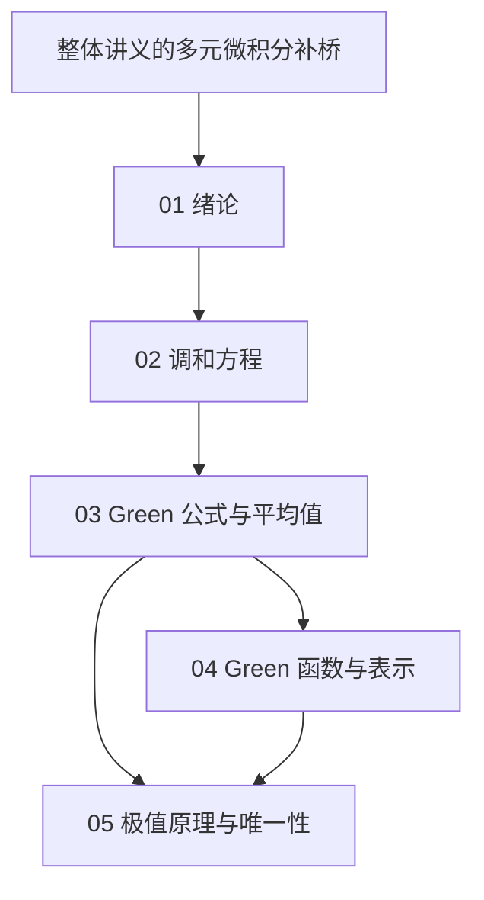
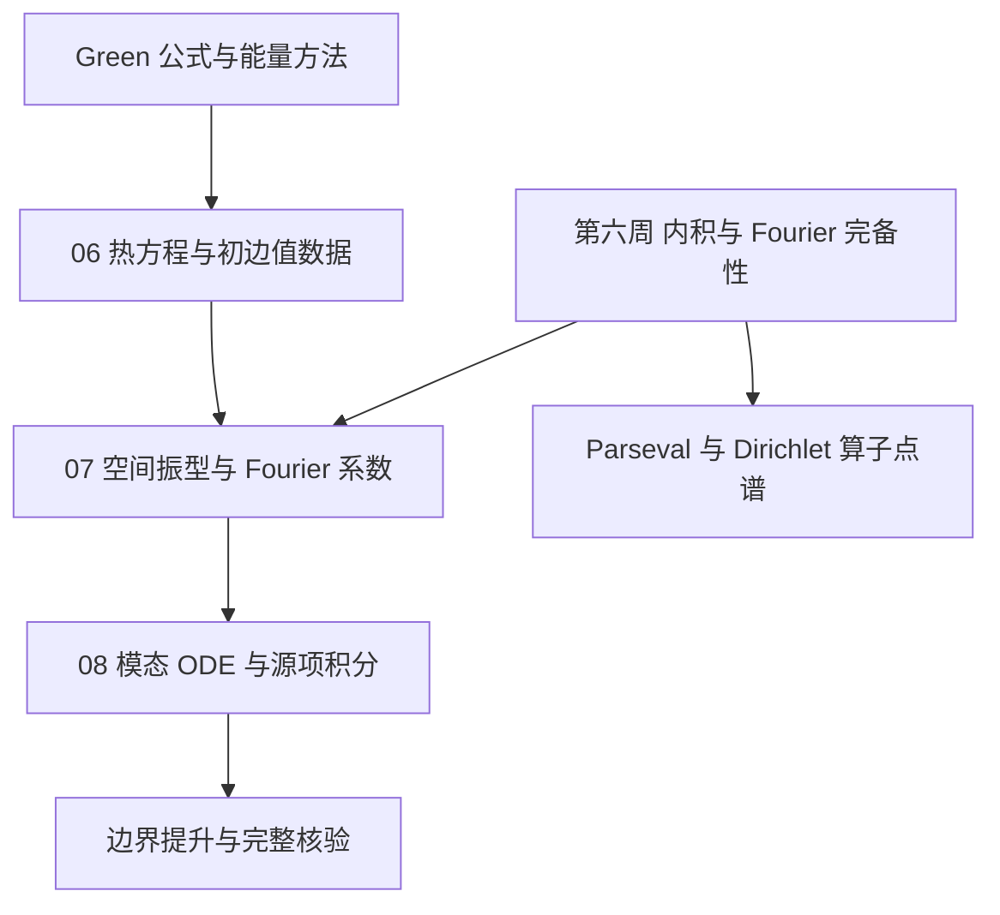

# 数学物理方程课程笔记总览

> [!abstract] 核心问题
> 这组笔记先围绕调和方程建立 Green、平均值、极值和能量方法，再进入热方程的初边值问题、分离变量与 Duhamel 原理。单元笔记按课件主题定位，独立的整体讲义持续串联数学推导。

> [!info] 内容层次
> 单元笔记依据相应课件，教学性补桥与来源修正单独标注。整体讲义沿用此前的入门解释预算：多元函数基础较弱、物理零基础，从定义和计算推进到证明；并明确区分级数表示、经典正则性与尚未证明的范围。

> [!tip] 多元函数基础薄弱时的入口
> 先读 [[数学推导主线快速入门讲义|数学推导主线整体讲义]]。原 0—16 节保留多元微积分与调和方程主线；17—20 节连接热模型、分离变量、Duhamel 和测验一；21 节补上内积、Fourier 完备性、Parseval 与算子定义域。第一至第四周 19 题、第六周 5 题、测验一 4 题与助手自测分别编号。

> [!info] 今后的双轨编写
> 每批新课件同时用于新增/更新单元笔记和续写整体讲义，不只生成相互孤立的小节。整体讲义已去掉文件名序号；单元 06—08 对应本次 2.1—2.3。[[数学物理方程课程笔记.base|课程索引]]分开列出单元、整体讲义和作业/测验。

## 1. 课件范围

本组笔记依据八份课程课件整理。表中页数为 PowerPoint 页序；标题页和结束页不作为知识正文。

| 课件 | 笔记 | 内容范围 | 总页数 | 正文页数 |
| :--- | :--- | :--- | ---: | ---: |
| 1.1 绪论 | [[01_绪论\|§1 绪论]] | 方程, 微分方程, 多重指标和向量分析记号 | 23 | 21 |
| 1.2 调和方程 | [[02_调和方程\|§2 调和方程]] | 调和方程, 泊松方程, 定解条件和变分原理 | 35 | 33 |
| 1.3 格林公式 | [[03_格林公式及其应用\|§3 格林公式及其应用]] | 格林公式, 平均值定理, 极值原理和唯一性 | 27 | 25 |
| 1.4 格林函数 | [[04_格林函数\|§4 格林函数]] | 格林函数, 静电源像法和调和函数基本性质 | 52 | 50 |
| 1.5 强极值原理 | [[05_强极值原理与第二边值问题的唯一性\|§5 强极值原理与第二边值问题的唯一性]] | Hopf 型强极值原理, Neumann 问题唯一性和能量积分 | 29 | 27 |
| 2.1 热方程导出 | [[06_热传导方程及其定解问题\|§2.1 热传导与定解条件]] | 热量收支、抛物边界、三类空间边界、扩散模型 | 29 | 27 |
| 2.2 分离变量法 | [[07_初边值问题的分离变量法\|§2.2 空间振型与 Fourier 系数]] | 零 Dirichlet 构造、级数核验、同温题面与周期问题辨析 | 25 | 23 |
| 2.3 Duhamel 原理 | [[08_Duhamel原理与非齐次热方程\|§2.3 源项、边界提升与周期复形式]] | 时间积分、正则性分层、非零边界、区间变换与共轭 | 27 | 25 |

### 1.1 为什么从调和方程开始

对初学者而言, 调和方程是观察椭圆型方程全部核心现象的最小模型:

1. 它来自平衡状态, 例如静电势, 引力势和稳态温度.
2. 它有显式基本解和 Poisson 核, 能把内部值写成边界数据的积分.
3. 它的平均值性质同时产生极值原理, 唯一性, 稳定性和 Harnack 估计.
4. 它的能量泛函简单, 可以直接看见变分法和弱解的来源.

因此学习顺序不是把几个公式并列记忆, 而是反复追踪
$$
\text{模型}
\longrightarrow
\text{方程}
\longrightarrow
\text{表示公式}
\longrightarrow
\text{先验估计}
\longrightarrow
\text{存在性与唯一性}.
$$

### 1.2 课件和 Evans 框架的关系

Evans 第 2 版的目录把 PDE 组织为引言, 重要线性方程, 表示公式, Sobolev 空间, 二阶椭圆方程和变分法等部分. 本组笔记只扩展与五份课件直接相交的内容:

| Evans 的主题 | 本组笔记中的入口 | 学习目标 |
| :--- | :--- | :--- |
| Introduction | [[01_绪论|§1 绪论]] | 会读方程, 识别阶数, 类型和边界数据 |
| Four important linear PDE | [[02_调和方程|§2 调和方程]] | 理解 Laplace, Poisson 和物理来源 |
| Representation formulas | [[03_格林公式及其应用|§3 格林公式及其应用]] 与 [[04_格林函数|§4 格林函数]] | 从基本解得到平均值与 Poisson 表示 |
| Sobolev spaces | [[02_调和方程|§2 的弱形式预览]] 与 [[05_强极值原理与第二边值问题的唯一性|§5 的能量法]] | 理解为何需要弱导数和能量空间 |
| Second-order elliptic equations | [[03_格林公式及其应用|§3]] 至 [[05_强极值原理与第二边值问题的唯一性|§5]] | 掌握椭圆性, 最大原理和唯一性 |
| Calculus of variations | [[02_调和方程|§2 的变分原理]] | 从能量极小化恢复 Poisson 方程 |

## 2. 知识依赖图

热方程分支调用前面已经建立的积分与能量方法，再把空间边界和时间源项分开处理：

## 3. 学习主线

1. 先统一区域, 边界, 法向导数, 梯度, 散度和拉普拉斯算子的记号.
2. 用物理模型理解调和方程和泊松方程, 区分方程本身与边界条件.
3. 由散度定理得到格林第一公式和第二公式.
4. 用基本解建立调和函数的积分表示, 再推出球面平均值公式和球平均值公式.
5. 由平均值性质得到极值原理, 比较原理, 稳定性和第一边值问题的唯一性.
6. 用格林函数把边界数据转化为积分表示, 并用静电源像法在特殊区域中构造它.
7. 用 Harnack 不等式控制正调和函数和单调调和函数列, 再理解可去奇点与解析性.
8. 用强极值原理处理边界极值, 用能量积分处理第一和第二边值问题的唯一性.
9. 将热量收支转成时间方程，分清初值、空间侧面和角点相容性。
10. 由边界条件筛选空间特征值，用 Fourier 系数匹配初值，并验证正时间导数和初始极限。
11. 用 ODE 积分因子得到 Duhamel 时间卷积，再做边界提升；周期形式另核查拼接条件、共轭和零模态。

## 4. 统一记号

| 记号 | 含义 |
| :--- | :--- |
| $\Omega$ | $\mathbb R^n$ 中的开区域 |
| $\Gamma=\partial\Omega$ | 区域边界 |
| $n$ | 空间维数；旧课件亦曾用同一字母表示法向 |
| $\nu$ | 新笔记统一采用的单位外法向量 |
| $\partial_\nu u$ | 外法向导数 $\nabla u\cdot\nu$ |
| $\nabla u$ | 梯度 |
| $\operatorname{div}F$ | 向量场散度 |
| $\Delta u$ | 拉普拉斯算子 $\operatorname{div}(\nabla u)$ |
| $B_R(M_0)$ | 以 $M_0$ 为中心的半径 $R$ 的球 |
| $\Gamma_R$ | 球 $B_R$ 的边界球面 |
| $r_{M_0M}$ | 点 $M_0$ 与 $M$ 的距离 |
| $\kappa=a^2>0$ | 常系数热扩散率，不与区间端点混用 |
| $m$ | 热方程空间模态编号 |

课件在二维中用 $\Gamma$ 表示边界曲线, 在三维中也用 $\Gamma$ 表示边界曲面. 本组笔记根据上下文使用 $dS$ 表示边界面积元, 使用 $ds$ 表示平面曲线弧长元.

## 5. 与习题册的对应关系

现有习题册为 [[偏微分方程习题集]]，题目来源已替换为周蜀林《偏微分方程》。本册的四个习题节是 1.4、2.5、3.4、4.3；下表按主题给出课程笔记与新题集的入口，不表示课件和新书章节逐章对应。

| 课程笔记 | 习题册入口 |
| :--- | :--- |
| [[01_绪论\|绪论]] | [[偏微分方程习题集#1.4 习题\|1.4 引言与预备公式]] |
| [[02_调和方程\|调和方程]] | [[偏微分方程习题集#2.5 习题\|2.5 位势方程习题]] |
| [[03_格林公式及其应用\|格林公式及其应用]] | [[偏微分方程习题集#1.4 习题\|1.4 Gauss–Green 公式]]；[[偏微分方程习题集#2.5 习题\|2.5 平均值公式与 Green 公式相关题]] |
| [[04_格林函数\|格林函数]] | [[偏微分方程习题集#2.5 习题\|2.5 位势方程 Green 函数]]；[[偏微分方程习题集#3.4 习题\|3.4 热方程 Green 函数]] |
| [[05_强极值原理与第二边值问题的唯一性\|强极值原理和唯一性]] | [[偏微分方程习题集#2.5 习题\|2.5 极值原理与位势方程唯一性]]；[[偏微分方程习题集#3.4 习题\|3.4 热方程极值原理与估计]] |
| [[06_热传导方程及其定解问题\|热方程及定解条件]] | [[偏微分方程习题集#3.4 习题\|3.4 热方程习题]] |
| [[07_初边值问题的分离变量法\|分离变量法]] | [[偏微分方程习题集#3.4 习题\|3.4 初边值问题与模态方法]] |
| [[08_Duhamel原理与非齐次热方程\|Duhamel 原理]] | [[偏微分方程习题集#3.4 习题\|3.4 非齐次热方程相关习题]] |

第一周课程作业：[[作业/作业一\|作业一（9 题，答案已补充）]]。

第二周课程作业：[[作业/作业二|作业二（3 题，答案已补充）]]。

第三周课程作业：[[作业/作业三|作业三（4 题，答案已补充）]]。

第四周课程作业：[[作业/作业四|作业四（3 题，答案已补充；Neumann 题注明模常数唯一性）]]。

第六周课程作业：[[作业/作业六|作业六（5 题，答案已补充；含正交基完备性与算子定义域）]]。沿用原稿周次，不因当前未收录第五周材料而重编号。

独立测验：[[作业/测验一|测验一（原稿日期 10 月 8 日，4 题，答案已补充）]]。它不改名为“作业五”，也不与四周作业合并题号。

教材习题册中的留白及既有作答继续保留。本轮整理并填充第六周五道原题，不改写原四周作业及测验一正文。

## 6. 资料边界和校核说明

- 课件中的公式按统一 LaTeX 记号重排, 不改变其数学对象和编号.
- 课件未展开的结论不直接写成课件定理. 必要的标准说明以"补充说明"标识.
- 由扫描或公式对象无法确定的符号标记为"待核对", 不用猜测替代.
- 课件页码引用指 PowerPoint 页序, 不等同于教材页码.
- 课件 2.2 后半的同温 Dirichlet 题面与周期推导不同；2.3 的零端点题面、圆周形式与共轭指数也需区分。笔记保留原题并单列纠正，不静默改变边界问题。
- Duhamel 函数值级数收敛不自动推出经典二阶导数；完整核验使用的额外充分条件明确列出。

## 7. 入门学习路线

### 7.0 本轮快速讲义的阅读方式

[[数学推导主线快速入门讲义#0. 阅读路线与约定|讲义开头]]给出三遍路线：先练计算和积分恒等式，再核验边界适配的核，最后读模型及进阶性质。[[数学推导主线快速入门讲义#14. 课件与四周作业的定位|原题索引]]保留四周题号；[[数学推导主线快速入门讲义#15. 自测：必须自己算出的十个关口|十个自测关口]]用于检验能否独立重做。讲义的编写状态不代表读者已经掌握；原作业答案与教材习题留白继续保留。

热方程按 [[数学推导主线快速入门讲义#17. 热方程：从平衡函数转向随时间变化的函数|17：模型与数据]]、[[数学推导主线快速入门讲义#18. 分离变量：用空间边界挑出时间衰减的模式|18：齐次构造]]、[[数学推导主线快速入门讲义#19. Duhamel 原理：把不断加入的源项逐时推进|19：源项与边界提升]] 顺序读。[[数学推导主线快速入门讲义#20. 测验一怎样检验前面的推导|20：测验联系]]回到基本积分、弱极值与带低阶项的能量估计。

[[数学推导主线快速入门讲义#21. Fourier 展开为什么成立：内积、完备性与算子定义域|21：Fourier 展开的函数空间依据]]配合 [[作业/作业六|第六周作业]] 阅读：先算有限投影，再证明完备性与 Parseval，最后区分微分表达式和带定义域的算子。

### 7.1 开始前的预备知识

| 预备知识 | 至少要会什么 | 在本组笔记中的用处 |
| :--- | :--- | :--- |
| 单变量微积分 | 链式法则, 分部积分, 极值 | 推导一维模型和第一变分 |
| 多元微积分 | 偏导数, Jacobian, 曲面积分, 散度定理 | 建立格林公式和通量 |
| 线性代数 | 二次型, 对称矩阵, 正定性 | 理解椭圆性和能量 |
| 常微分方程 | 初值问题, 线性方程 | 对比 PDE 的边界与初值条件 |
| 实分析基础 | 连续性, 一致收敛, 紧性 | 理解 Harnack 和极限换序 |

测度论和泛函分析不是阅读前四章的硬门槛, 但在学习弱解, Sobolev 空间和存在性理论时必须补上.

### 7.2 每章的自测问题

- §1: 能否解释 ODE 与 PDE 的区别, 写出 $\nabla$, $\operatorname{div}$ 和 $\Delta$?
- §2: 能否从物理假设说明为什么会出现 $\Delta u=0$ 或 $-\Delta u=f$?
- §3: 能否从 $\operatorname{div}(u\nabla v)$ 推出格林第一公式?
- §4: 能否说明像源为什么能把边界值变成零, 并检查 Poisson 核的积分为 $1$?
- §5: 能否区分内部强极值原理, Hopf 边界结论和能量唯一性?

### 7.3 推荐的复习循环

第一次阅读只追踪定义和物理图像; 第二次阅读补齐每个积分恒等式; 第三次阅读独立重做球, 半空间和圆盘的 Poisson 核; 最后用习题册中的题目检查符号, 法向方向和唯一性条件.

参考书目: Lawrence C. Evans, *Partial Differential Equations*, 2nd ed., Graduate Studies in Mathematics, vol. 19, American Mathematical Society, 2010. 书目信息见 [AMS 官方页面](https://bookstore.ams.org/gsm-19-r).

## 相关链接

- [[数学推导主线快速入门讲义|数学推导主线快速入门讲义]]

- [[01_绪论]]
- [[02_调和方程]]
- [[03_格林公式及其应用]]
- [[04_格林函数]]
- [[05_强极值原理与第二边值问题的唯一性]]
- [[06_热传导方程及其定解问题]]
- [[07_初边值问题的分离变量法]]
- [[08_Duhamel原理与非齐次热方程]]
- [[数学物理方程课程笔记.base]]
- [[偏微分方程习题集]]
- [[作业/作业一|第一周作业一]]
- [[作业/作业二|第二周作业二]]
- [[作业/作业三|第三周作业三]]
- [[作业/作业四|第四周作业四]]
- [[作业/作业六|第六周作业六]]
- [[作业/测验一|测验一与解答]]
