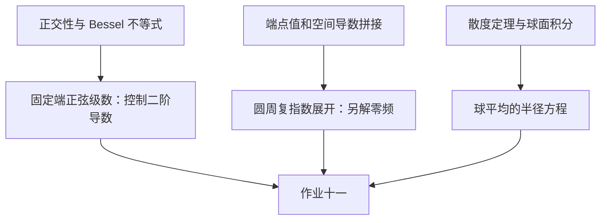

# 数学物理方程课程笔记总览

> [!abstract] 课程主线与核心问题
> 本课程笔记围绕三类典型二阶偏微分方程展开：首先以调和方程为模型，系统建立格林公式、平均值定理、极值原理与能量估计方法；随后进入热传导方程，探讨热核构造、比较原理与长时间渐近衰减特性；最后利用同一组空间本征振型对比分析波动方程的简谐振荡，并借助特征线法与球面平均法刻画波的有限速度传播机制。各单元笔记紧扣课堂讲授专题，独立的整体讲义则将这些内容串联为连贯的数学推导体系。

> [!info] 内容组织与理论深度
> 各单元笔记与课程讲义紧密对应，并在关键过渡处补充了必要的数学推导与背景说明。配套的整体讲义专为多元微积分基础尚待巩固、缺乏大学物理先修背景的读者编写，遵循“从基本定义与具体计算出发、逐步过渡到严格定理证明”的叙述脉络，同时明确区分形式级数展开、经典解的正则性条件以及有待后续泛函分析课程严格证明的结论边界。

在整体讲义的推导体系中，第 2.5—2.6 节系统梳理了曲面积分与极限换序的分析条件，第 7.6 节通过具体算例引入弱导数计算，第 18—21 节深入讨论了特征模态投影与正交系完备性，并在第 15.2 节设置了四道方法迁移自测题。学习热传导方程相关章节时，建议按照“第 17 节 $\to$ 第 18.1—18.2 节 $\to$ 第 21.1—21.3 节 $\to$ 第 18.3—18.4 节 $\to$ 第 19 节”的逻辑依赖顺序阅读，以先修概念的内在衔接为准，而不必拘泥于章节编号的表面次序。

重点计算专题的快速参阅入口如下：[[数学推导主线快速入门讲义#2.1 积分是许多小块的加总|积分区域与积分变量]]、[[数学推导主线快速入门讲义#4.5 函数还依赖角度时，怎样计算 Laplace 算子|完整极坐标 Laplace 推导]]、[[数学推导主线快速入门讲义#6.5 唯一性和稳定性用同一个差函数|源项与边界误差的控制]]、[[数学推导主线快速入门讲义#18.6 实际只算有限项时，误差怎样控制|热级数截断误差]]以及[[数学推导主线快速入门讲义#19.8 两端边界不同且随时间变化的完整算例|时变边界的完整求解]]。各专题均沿用统一的记号体系与自测练习框架。

> [!tip] 基础巩固与阅读导引
> 若读者对多元微积分与场论算子尚不熟悉，建议优先阅读 [[数学推导主线快速入门讲义|数学推导主线整体讲义]]。其中第 0—16 节涵盖多元微积分基础与调和方程的核心推导；第 17—20 节衔接热传导物理建模、分离变量法、Duhamel 原理及阶段测验解析；第 21 节补充了内积空间、Fourier 级数完备性、Parseval 恒等式与微分算子定义域；第 22—23 节讨论全空间热核表示、极值原理、能量估计与长时间衰减；第 24—27 节则从一维行波逐步推广至有界弦驻波、三维球面波与二维圆盘振动。课程配套的九份作业（共 42 题）与两份阶段测验（合计 7 题）均保持原有题号体系以便对照查阅。

> [!info] 单元笔记与整体讲义的对应关系
> 本系列文档采用“专题单元笔记”与“数学推导整体讲义”相互印证的双轨结构：其中单元 01—05 对应第 1 章椭圆型调和方程（课件 1.1—1.5），单元 06—11 对应第 2 章抛物型热传导方程（课件 2.1—2.6），单元 12—15 对应第 3 章双曲型波动方程（课件 3.1—3.4）。[[数学物理方程课程笔记.base|课程索引]]按单元笔记、整体讲义和作业测验三个模块分类归档。

## 1. 课件范围

本组笔记依据十五份课程讲义整理。下表所列页码对应原始讲义页序（不含首页标题与末页致谢）。

| 课件 | 笔记 | 内容范围 | 总页数 | 正文页数 |
| :--- | :--- | :--- | :--- | :--- |
| 1.1 绪论 | [[01_绪论\|§1 绪论]] | 偏微分方程定义、微积分预备、多重指标与向量分析算子 | 23 | 21 |
| 1.2 调和方程 | [[02_调和方程\|§2 调和方程]] | 调和方程、泊松方程、边值条件与 Dirichlet 变分原理 | 35 | 33 |
| 1.3 格林公式 | [[03_格林公式及其应用\|§3 格林公式及其应用]] | 第一与第二格林公式、平均值定理、极值原理与唯一性 | 27 | 25 |
| 1.4 格林函数 | [[04_格林函数\|§4 格林函数]] | 基本解、格林函数构造、静电源镜像法与调和函数性质 | 52 | 50 |
| 1.5 强极值原理 | [[05_强极值原理与第二边值问题的唯一性\|§5 强极值原理与第二边值问题的唯一性]] | Hopf 强极值原理、Neumann 问题唯一性与能量积分法 | 29 | 27 |
| 2.1 热传导方程 | [[06_热传导方程及其定解问题\|§6 热传导方程及其定解问题]] | 能量守恒律、热传导方程导出、初边值条件与齐次化方法 | 31 | 29 |
| 2.2 分离变量法 | [[07_初边值问题的分离变量法\|§7 初边值问题的分离变量法]] | 一维热方程初边值问题、分离变量法与 Sturm-Liouville 特征值问题 | 41 | 39 |
| 2.3 Duhamel 原理 | [[08_Duhamel原理与非齐次热方程\|§8 Duhamel 原理与非齐次热方程]] | 非齐次热传导方程、Duhamel 冲量叠加原理与级数解 | 28 | 26 |
| 2.4 柯西问题 | [[09_热方程的柯西问题\|§9 热方程的柯西问题]] | 全空间热方程、Gauss 热核、Poisson 公式与解的正则性 | 36 | 34 |
| 2.5 极值原理与稳定性 | [[10_热方程的极值原理与稳定性\|§10 热方程的极值原理与稳定性]] | 抛物型极值原理、初边值问题唯一性与最大模/能量稳定性 | 33 | 31 |
| 2.6 解的渐近性态 | [[11_热方程解的渐近性态\|§11 热方程解的渐近性态]] | 长时间渐近行为、稳态极限、指数衰减估计与谱方法 | 30 | 28 |
| 3.1 波动方程导出 | [[12_波动方程的导出与定解条件\|§12 波动方程的导出与定解条件]] | 弦与膜振动建模、双曲型方程特征及初边值定解条件 | 28 | 26 |
| 3.2 达朗贝尔公式 | [[13_达朗贝尔公式与波的传播\|§13 达朗贝尔公式与波的传播]] | 一维波动方程柯西问题、达朗贝尔公式、依赖域与影响域 | 34 | 32 |
| 3.3 波动方程分离变量 | [[14_波动方程的分离变量法\|§14 波动方程的分离变量法]] | 有界弦振动初边值问题、驻波模态分解与非齐次受迫振动 | 36 | 34 |
| 3.4 高维波动方程 | [[15_高维波动方程的柯西问题\|§15 高维波动方程的柯西问题]] | 三维与二维柯西问题、Kirchhoff 公式、降维法与 Huygens 原理 | 42 | 40 |

## 2. 单元结构

各主题单元的核心内容大纲如下：

1. [[01_绪论|§1 绪论]]
   - 偏微分方程的基本定义、阶数以及线性与非线性分类
   - 多重指标记号与多元向量分析微分算子
   - 二阶线性偏微分方程的三类典型模型：椭圆型、抛物型与双曲型
   - 定解问题（初始条件与边界条件）及 Hadamard 适定性概念
2. [[02_调和方程|§2 调和方程]]
   - Laplace 方程与 Poisson 方程的标准形式
   - 经典物理背景：静电场位势、稳态热传导与无旋不可压缩流体
   - 三类经典边值问题：Dirichlet 问题、Neumann 问题与 Robin 问题
   - Dirichlet 能量泛函与变分极小化原理
3. [[03_格林公式及其应用|§3 格林公式及其应用]]
   - 第一格林公式与第二格林公式的推导及几何意义
   - 调和函数的球面与球体平均值定理
   - 弱极值原理与最大值原理
   - 边值问题解的唯一性与对边界数据的连续依赖性
4. [[04_格林函数|§4 格林函数]]
   - Laplace 算子的径向基本解与点源位势响应
   - 格林函数的定义、对称性及边值问题解的积分表示
   - 静电源镜像法（半空间与球域/圆域的对称点构造）
   - 球域上的 Poisson 积分公式与调和函数的解析光滑性
5. [[05_强极值原理与第二边值问题的唯一性|§5 强极值原理与第二边值问题的唯一性]]
   - Hopf 边界点引理与强极值原理的严格证明
   - Neumann 边值问题解在差一常数意义下的唯一性
   - 椭圆型边值问题的能量积分证明方法
6. [[06_热传导方程及其定解问题|§6 热传导方程及其定解问题]]
   - 能量守恒律与 Fourier 热传导定律（Fick 扩散定律）的微分建模
   - 抛物型方程的基本特征：时间演化的不可逆性与能量耗散
   - 热传导初边值问题的定解条件及非齐次边界条件的齐次化技巧
7. [[07_初边值问题的分离变量法|§7 初边值问题的分离变量法]]
   - 有界区间上一维齐次热传导方程的分离变量求解流程
   - 空间本征模对应的 Sturm-Liouville 特征值问题
   - 特征函数系的正交性、广义 Fourier 级数展开与经典解的构造
8. [[08_Duhamel原理与非齐次热方程|§8 Duhamel 原理与非齐次热方程]]
   - 非齐次热源驱动下的 Duhamel 冲量叠加原理
   - 时变非齐次边界条件向内部源项问题的转化
   - 级数形式解的一致收敛性与逐项微分合法性验证
9. [[09_热方程的柯西问题|§9 热方程的柯西问题]]
   - 全空间 $\mathbb{R}^n$ 上的热传导方程初值问题
   - Gauss 热核（基本解）的尺度变换导出与积分性质
   - Poisson 卷积积分表示、解的无穷阶光滑性及扰动的无限传播速度
10. [[10_热方程的极值原理与稳定性|§10 热方程的极值原理与稳定性]]
    - 抛物型柱域上的弱极值原理与强极值原理
    - 初边值问题解的唯一性及最大模意义下的稳定性估计
    - 抛物型方程的 $L^2$ 能量估计方法
11. [[11_热方程解的渐近性态|§11 热方程解的渐近性态]]
    - 时间趋于无穷时温度场的长时间渐近行为与稳态平衡极限
    - Poincaré 不等式与扰动项的指数衰减率估计
    - 基于本征展开的谱方法在渐近分析中的应用
12. [[12_波动方程的导出与定解条件|§12 波动方程的导出与定解条件]]
    - 均匀弹性弦横向振动与平面弹性膜振动的物理建模
    - 双曲型偏微分方程的物理特征：有限波速传播与机械能守恒
    - 初值条件（初始位移与初始速度）与各类边界条件的物理意义
13. [[13_达朗贝尔公式与波的传播|§13 达朗贝尔公式与波的传播]]
    - 一维无界弦振动柯西问题的行波分解与达朗贝尔公式
    - 特征坐标变换与时空平面上的特征线网格
    - 依赖区间、决定区域与影响区域的几何刻画
14. [[14_波动方程的分离变量法|§14 波动方程的分离变量法]]
    - 有界弦振动初边值问题的分离变量法与简正驻波叠加
    - 受迫振动问题中的 Duhamel 原理与共振现象分析
    - 波动方程的能量守恒律及其在解的唯一性证明中的应用
15. [[15_高维波动方程的柯西问题|§15 高维波动方程的柯西问题]]
    - 三维波动方程柯西问题的球面平均法与 Kirchhoff 公式
    - 二维波动方程柯西问题的 Hadamard 降维法与 Poisson 公式
    - 惠更斯（Huygens）原理、二维波尾现象及奇偶空间维度的传播差异

### 波动方程的三条推导路线

## 3. 习题与练习

- [[偏微分方程习题集|偏微分方程练习题集]]
  - 汇集各章典型计算题、定解问题求解训练与基本理论证明题。

- [[作业/作业十一|第十一周三题与完整解答]]：固定端受迫波、圆周周期解与三维球平均。参见 [[数学推导主线快速入门讲义#14.8 第十一周作业的定位|整体讲义的逐题入口]]。

## 4. 相关链接

- [[数学推导主线快速入门讲义]]
- [[作业/作业一|第一周作业]]
- [[作业/作业二|第二周作业]]
- [[作业/作业三|第三周作业]]
- [[作业/作业四|第四周作业]]
- 第五周未收到独立作业材料，不另建占位作业。
- [[作业/作业六|第六周作业]]
- [[作业/作业七|第七周作业]]
- [[作业/作业八|第八周作业]]
- [[作业/作业九|第九周作业]]
- 第十周未收到独立作业材料，不另建占位作业。
- [[作业/作业十一|第十一周作业]]
- [[作业/测验一|测验一]]
- [[作业/测验二|测验二]]
