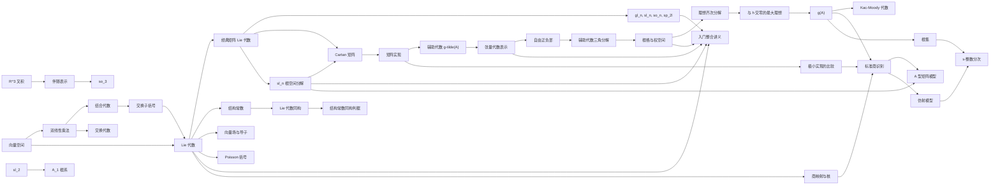
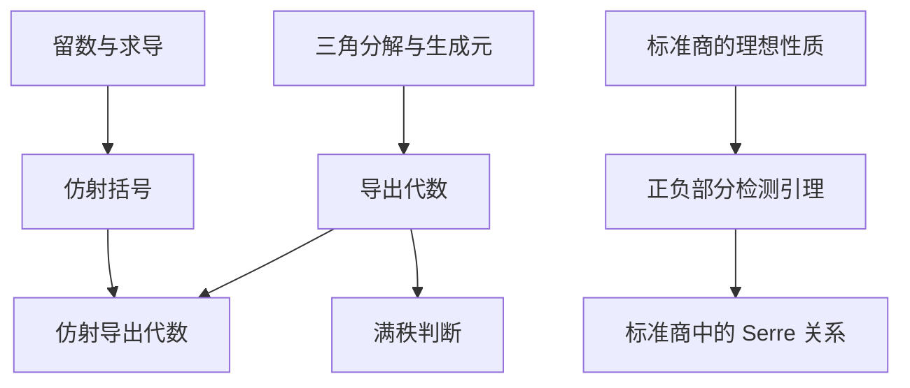
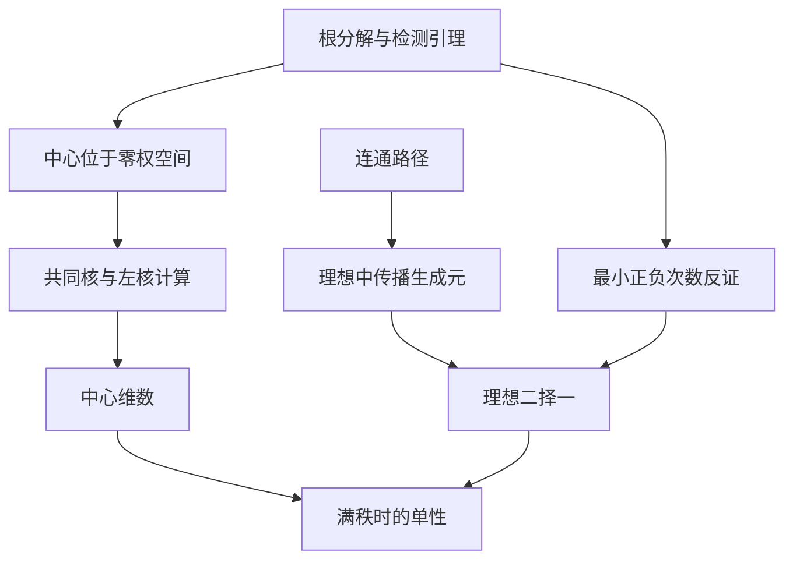
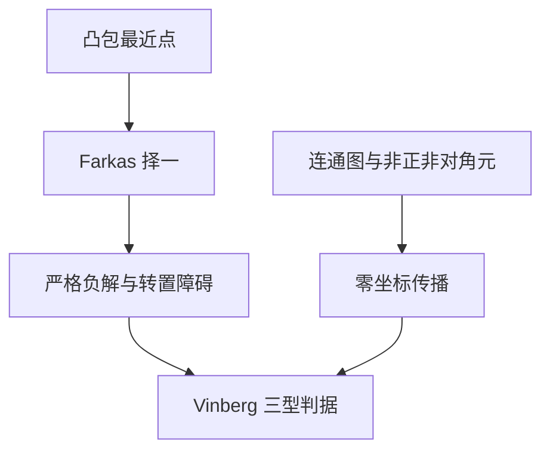
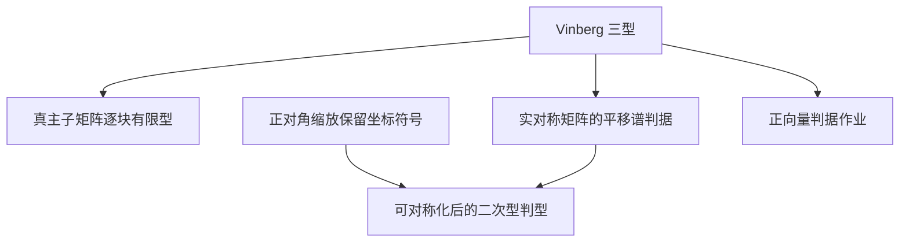
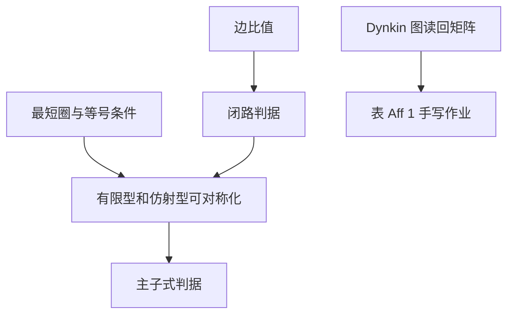

# 李代数课程总览

> [!abstract] 核心问题
> 李代数（Lie algebra）是在向量空间上配备一个满足反对称性与 Jacobi 恒等式的双线性二元运算所形成的代数结构，其核心几何与物理动机在于刻画连续变换群在单位元处的“无穷小对称性”。本课程从一般双线性代数与结合代数的交换子出发，阐明 Lie 括号自然涌现的代数机制；继而考察保持典型双线性型的经典矩阵 Lie 代数、结构常数、光滑流形上的向量场以及辛几何中的 Poisson 括号；在此基础上，通过 $\mathfrak{sl}_n(\mathbb C)$ 的根空间分解提炼出 Cartan 矩阵的组合编码，最终建立广义 Cartan 矩阵 $A$ 所定义的 Kac-Moody 代数 $\mathfrak g(A)$ 的生成元与关系理论、导出代数与中心刻画、理想结构定理以及 Vinberg 三型分类判据。

> [!info] 讲义编写体例与内容层次
> 本系列讲义在编纂上融合了以下三个相互支撑的层次：
> 1. **课堂板书主线**：系统梳理十一讲课程的核心定义、典型算例、定理框架与课后习题，包括从结合代数交换子、三维叉积到经典矩阵 Lie 代数，再到辅助 Lie 代数 $\widetilde{\mathfrak g}(A)$、标准商代数 $\mathfrak g(A)$、仿射回路代数实现以及广义 Cartan 矩阵的分类理论。
> 2. **教材理论衔接**：参照万哲先《当代数学园地 1：Kac-Moody 代数导引》第一章与第二章的理论体系，补全从有限维经典单 Lie 代数过渡到一般 Kac-Moody 代数 $\mathfrak g(A)$ 的代数与几何桥梁，包括张量代数表示、普遍性质、权空间投影以及 Farkas 择一引理等严格证明细节。
> 3. **数学动机阐释**：在定义与定理之间穿插直观的几何与代数动机说明，阐明每一概念引入的必然性及其在整体结构理论中的位置。

[[李代数入门整合讲义|李代数入门整合讲义]] 将十一讲内容融会贯通为统一的教材式文本，各分讲讲义则完整保留对应课次的专题推导与配套习题。其中第 15 节从逐坐标向量不等式与凸几何最近点原理出发，给出了广义 Cartan 矩阵 Vinberg 三型分类定理的完整证明。

初学者可沿着 [[#3. 课程学习路线|四段学习路线]] 循序渐进地展开学习。若在阅读后续章节时需要回查基础代数工具，可直接参阅 [[李代数入门整合讲义#3.5 同态怎样下降到商|商映射与核、像]] 或 [[李代数入门整合讲义#7.6 换一个极小实现，构造会改变吗|极小实现的比较]]。

## 1. 课程内容编排与各讲提要

### 1.1 各讲核心内容综述

本课程已整理十一讲，层层递进地展开有限维经典 Lie 代数与无限维 Kac-Moody 代数的结构理论：

- **第一讲（代数基础与 Lie 括号的起源）**：引入域上的双线性代数、结合代数与交换代数，对比代数与结合环的公理差异；给出 Lie 代数、Lie 子代数的定义，证明反对称运算下 Jacobi 恒等式与伴随算子 Leibniz 导子法则的等价性；通过结合代数交换子、欧氏空间 $\mathbb R^3$ 上的向量叉积以及一般线性 Lie 代数 $\mathfrak{gl}_n$、特殊线性 Lie 代数 $\mathfrak{sl}_n$ 与正交 Lie 代数 $\mathfrak{so}_n$ 展示核心实例，并布置 [[作业/作业1|作业 1]]。
- **第二讲（经典矩阵 Lie 代数、结构常数与几何实例）**：从正交群与辛群在单位元处的一参数曲线求导出发，导出保持非退化对称双线性型与交错双线性型的无穷小不变条件 $A^T G + GA = 0$，系统建立正交 Lie 代数 $\mathfrak{so}_n$ 与辛 Lie 代数 $\mathfrak{sp}_{2\ell}$ 的分块矩阵结构及维数公式；引入有限维 Lie 代数的结构常数与同构判据，通过复系数换基证明 $\mathfrak{sl}_2(\mathbb C)\cong\mathfrak{so}_3(\mathbb C)$；最后拓展至光滑流形上的向量场 Lie 括号与 Hamilton 力学中的 Poisson 括号，并布置 [[作业/作业2|作业 2]]。
- **第三讲（同构判据、$\mathfrak{sl}_n$ 的根空间分解与伴随表示）**：建立基变换矩阵下结构常数的同构方程；以 $\mathfrak{sl}_n(\mathbb C)$ 为核心模型，利用矩阵单位 $E_{ij}$ 的交换子公式导出对角 Cartan 子代数 $\mathfrak h$、上下三角幂零子代数 $\mathfrak n_\pm$ 与三角分解 $\mathfrak{sl}_n=\mathfrak n_-\oplus\mathfrak h\oplus\mathfrak n_+$，读出 $A_{n-1}$ 型根系 $\Phi=\{\varepsilon_i-\varepsilon_j\mid i\ne j\}$ 与 Cartan 矩阵；介绍一般 Lie 代数的伴随表示 $\operatorname{ad}$，并以 $\mathfrak{sl}_2(\mathbb C)$ 作为最基本的 $A_1$ 型实例，衔接万哲先教材第一章 §1.1–§1.3 中关于一般复矩阵极小实现与生成元关系的理论，配套 [[作业/作业3|作业 3]]。
- **第四讲（从矩阵实现到辅助 Lie 代数 $\widetilde{\mathfrak g}(A)$ 的三角分解）**：从一般复矩阵 $A$ 的实现 $(\mathfrak h,\Pi,\Pi^\vee)$ 出发，利用自由 Lie 代数与理想商构造仅受四组基本 Chevalley 关系约束的辅助 Lie 代数 $\widetilde{\mathfrak g}(A)$，建立交换正负生成元的 Chevalley 对合自同构 $\omega$；通过在张量代数 $T(V)$ 上构造依赖于参数 $\lambda\in\mathfrak h^*$ 的一族表示，严格证明负部 $\widetilde{\mathfrak n}_-$ 与正部 $\widetilde{\mathfrak n}_+$ 均为自由 Lie 代数，并完成辅助代数三角分解定理 $\widetilde{\mathfrak g}(A)=\widetilde{\mathfrak n}_-\oplus\mathfrak h\oplus\widetilde{\mathfrak n}_+$ 的证明，配套 [[作业/作业4|作业 4]]。
- **第五讲（根格 $Q$-分次、最大理想 $\mathfrak r$ 与标准商代数 $\mathfrak g(A)$）**：引入根格 $Q=\bigoplus_{i=1}^n\mathbb Z\alpha_i$ 与正根锥 $Q_+$，证明辅助代数 $\widetilde{\mathfrak g}(A)$ 的根空间分解及各权空间的有限维性；利用伴随算子在有限支撑上的 Lagrange 插值投影多项式，证明 $\widetilde{\mathfrak g}(A)$ 的任意理想必为 $Q$-齐次理想；由此构造与 Cartan 子代数 $\mathfrak h$ 相交为零的唯一最大理想 $\mathfrak r=\mathfrak r_-\oplus\mathfrak r_+$，将标准 Kac-Moody 代数定义为商代数 $\mathfrak g(A)=\widetilde{\mathfrak g}(A)/\mathfrak r$，配套 [[作业/作业5|作业 5]]。
- **第六讲（标准商的识别定理、$A_1$ 与 $A_2$ 模型、根集及 $\mathbf s$-整数分次）**：给出广义 Cartan 矩阵（GCM）的严格定义，建立判定具体 Lie 代数同构于标准商 $\mathfrak g(A)$ 的识别定理；在 $A_2$ 型辅助代数中通过显式降权计算证明高度至少为 $3$ 的子空间构成理想 $\mathfrak r$，从而严格证明 $\mathfrak g(A_2)\cong\mathfrak{sl}_3(\mathbb C)$ 并给出八维基向量的矩阵对应；定义根集 $\Delta=\Delta_+\sqcup\Delta_-$、根重数以及由非负整数权重向量 $\mathbf s$ 诱导的 $\mathbb Z$-分次（特别是主分次与标准分次）；最后构造回路代数中心扩张与次数导子所组成的仿射 Lie 代数模型 $\widehat{\mathfrak{sl}}_2=\mathfrak{sl}_2\otimes\mathbb C[z,z^{-1}]\oplus\mathbb C c\oplus\mathbb C d$，利用识别定理证明其同构于仿射 $A_1^{(1)}$ 型 Kac-Moody 代数，配套 [[作业/作业6|作业 6]]。
- **第七讲（仿射留数括号、导出代数 $\mathfrak g'(A)$ 与正负部检测引理）**：利用有限 Laurent 多项式的形式微分与 $z=0$ 处的留数 $\operatorname{Res}_{z=0}\operatorname{tr}(a'(z)b(z))$ 重新刻画仿射回路代数的中心扩张括号，验证其反对称性与 Jacobi 恒等式；研究 $\mathfrak g(A)$ 的导出代数 $\mathfrak g'(A)=[\mathfrak g(A),\mathfrak g(A)]$，证明其恰好由全体 Chevalley 生成元 $e_i,f_i$ 生成并具有三角分解 $\mathfrak g'(A)=\mathfrak n_-\oplus\mathfrak h'\oplus\mathfrak n_+$，从而导出完美性判据 $\mathfrak g'(A)=\mathfrak g(A)\iff\det A\ne 0$，阐明仿射模型中中心元 $c\in L'$ 而次数导子 $d\notin L'$ 的机制；最后证明判断正、负部元素为零的降权检测引理（万哲先教材引理 1.6），配套 [[作业/作业7|作业 7]]。
- **第八讲（中心刻画、不可分解矩阵的连通性与理想结构定理）**：应用正负部检测引理排除中心元素的非零根分量，证明 $\mathfrak g(A)$ 与导出代数 $\mathfrak g'(A)$ 的中心重合且等于全体单根的共同核 $\mathfrak h_0=\{h\in\mathfrak h\mid\alpha_i(h)=0,\ \forall i\}=\{\sum k_i h_i\mid kA=0\}$，通过两次秩-零度定理计算得出中心维数 $\dim Z(\mathfrak g(A))=n-\operatorname{rank}A$；引入广义 Cartan 矩阵的连通性（不可分解性），利用伴随作用在连通路径上的传播与最小主次数反证法证明理想二择一定理（任意理想要么包含导出代数 $\mathfrak g'(A)$，要么包含于中心 $Z(\mathfrak g(A))$），并给出链形矩阵对应 $\mathfrak{sl}_{n+1}$ 等典型算例，配套 [[作业/作业8|作业 8]]。
- **第九讲（线性不等式的 Farkas 择一原理与广义 Cartan 矩阵的 Vinberg 三型分类）**：从欧氏空间凸包到原点的最近点几何性质出发，建立严格齐次 Farkas 择一引理及带单位块的矩阵不等式择一性；结合连通广义 Cartan 矩阵非对角元非正所诱导的零坐标传播性质，完整证明 Vinberg 分类定理，将不可分解广义 Cartan 矩阵按正向量 $u>0$ 作用下 $Au$ 的符号特征严格划分为有限型（Finite type）、仿射型（Affine type）与不定型（Indefinite type）三大互斥类型，配套 [[作业/作业9|作业 9]]。

- **第十讲（有限型、仿射型与对称化）**：沿板书的锥分支证明回看 Vinberg 分类，逐块证明真主子矩阵的有限型性质，以平移谱方法建立实对称矩阵的正定与半正定判据，再按 $D^{-1}A$ 对称的约定介绍可对称化；配套 [[作业/作业10|作业 10]] 含教材推理 2.2 的正向证明、星号逆向及两组矩阵判断。
- **第十一讲：闭路判据与有限型、仿射型分类**：从边的比值推导闭路判据，用最短圈排除有限型的环；再由对称化证明主子式判据，并练习从 Dynkin 图读回 GCM。手写题见 [[作业/作业11|作业 11]]。

### 1.2 参考教材章节对照

本课程的核心参考书为万哲先《当代数学园地 1：Kac-Moody 代数导引》。该书相关章节与本系列讲义的对应关系如下表所示：

| 参考教材章节 | 教材 PDF 页码 | 在本系列讲义中的理论作用与对应章节 |
| :--- | :--- | :--- |
| 第一章 Lie 代数 $\mathfrak g(A)$ | 10 | 全课程主线的核心参考框架 |
| §1.1 $n\times n$ 复矩阵 $A$ 的实现 | 10 | 连接经典矩阵 Lie 代数 $\mathfrak{gl}_n,\mathfrak{sl}_n,\mathfrak{so}_n,\mathfrak{sp}_{2\ell}$ 与抽象矩阵实现 $(\mathfrak h,\Pi,\Pi^\vee)$（第一至四讲） |
| §1.2 Lie 代数 $\mathfrak g(A)$ 的构造 | 10 | 辅助 Lie 代数 $\widetilde{\mathfrak g}(A)$、张量代数表示、自由正负部与三角分解（第四、五讲） |
| §1.3 Lie 代数 $\mathfrak g(A)$ 的构造（续） | 17 | 根格 $Q$-分次、最大理想 $\mathfrak r$ 与标准商代数 $\mathfrak g(A)$ 的根空间性质（第五、六讲） |
| §1.4 Lie 代数 $\mathfrak g(A)$ 的刻画 | 19 | 标准商识别命题、$\mathbf s$-整数分次与主分次，衔接参考书习题 KM-1（第六讲） |
| §1.5 $\mathfrak g(A)$ 的导代数 $\mathfrak g'(A)$ | 22 | 导出代数的生成元刻画、三角分解、交换商空间维数与满秩完美性判据（第七讲） |
| §1.6 $\mathfrak g(A)$ 和 $\mathfrak g'(A)$ 的中心 | 25 | 正负部降权检测引理（第七讲）及中心作为左核空间的完整刻画（第八讲） |
| §1.10 几个单性命题 | 31 | 不可分解广义 Cartan 矩阵情形下的理想二择一定理与单性推论（第八讲） |
| 第二章 §2.1 线性不等式理论 | 35-36 | 凸包最近点引理、Farkas 择一引理与带单位块的向量不等式性质（第九讲） |
| 第二章 §2.2 Vinberg 的分类定理 | 37-39 | 不可分解矩阵的正向量零坐标传播、有限/仿射/不定三型互斥分类及转置同型性（第九讲） |
| 第二章 §2.2 推理 2.2 | 39 | 三型的正向量判据；作业 10 第 1 题（课用纸本第 33–34 页） |
| 第二章 §2.3 有限型和仿射型矩阵的性质 | 40–42 | 真主子矩阵、实对称判据、闭路判据与最短圈（第十、十一讲） |
| 第二章 §2.4 引理 2.4、命题 2.4A/B | 42–44 | 正有理对称化与主子式判据（第十一讲按板书证明可对称化 GCM 的情形） |
| 第二章 §2.5 Dynkin 图、定理 2.5 与表 Aff 1 | 45–46、54 | 图与 GCM 的互译；作业 11 的表见第 54 页 |

## 2. 知识结构依赖图

## 3. 课程学习路线

1. **从矩阵非交换性理解 Lie 括号与子结构**：建议从 [[李代数入门整合讲义#1. 线性空间上的新运算|整合讲义第 1--3 节]] 入手。先通过具体矩阵乘法计算 $EF$、$FE$ 与交换子 $[E,F]$，并借助 $\mathfrak{sl}_2$ 的三维基体会 Lie 子代数与理想的本质区别；关于保持对称或交错双线性型的经典矩阵 Lie 代数、三维叉积、结构常数以及流形上的向量场与 Poisson 括号，可结合 [[01_李代数基础课程记录|第一讲]] 与 [[02_李代数第二讲课程记录|第二讲]] 深入阅读。
2. **利用伴随表示为代数结构作“谱分解”**：继续阅读 [[李代数入门整合讲义#4. 把括号看成线性算子：表示、对偶与权|整合讲义第 4--5 节]] 与 [[03_李代数第三讲课程记录|第三讲]]。核心思想是将对角矩阵 $h\in\mathfrak h$ 的伴随作用 $x\mapsto [h,x]$ 视为线性算子，从共同特征值方程 $[h,E_{ij}]=(h_i-h_j)E_{ij}$ 中自然读出根、余根与 Cartan 矩阵；随后结合 [[作业/作业3|作业 3]] 中 $\mathfrak{sl}_2$ 的单性证明，体会非零理想如何通过反复取括号一步步扩张至整个代数。
3. **从自由生成元与关系构造辅助代数与标准商**：接着研读 [[李代数入门整合讲义#6. 用生成元和关系构造代数|整合讲义第 6--11 节]] 以及 [[04_李代数第四讲课程记录|第四讲]] 至 [[06_李代数第六讲课程记录|第六讲]]。先借助第四讲在张量代数 $T(V)$ 上构造的表示族 $\rho_\lambda$，理解辅助代数 $\widetilde{\mathfrak g}(A)$ 的正、负部为何是自由 Lie 代数且与 $\mathfrak h$ 构成向量空间直和；再利用第五讲的有限支撑权投影多项式，理解模去与 $\mathfrak h$ 交零的最大理想 $\mathfrak r$ 为何能在完好保留 Cartan 子代数与简单根空间的同时，恰好商掉多余的高次自由方向；第六讲对 $A_2$ 型代数的完整剖析则是首次从抽象生成元关系严格还原出八维矩阵代数 $\mathfrak{sl}_3(\mathbb C)$ 的典范训练。
4. **运用分次、降权引理与线性不等式研究代数结构与分类**：最后阅读 [[李代数入门整合讲义#12. 从根集到整数次数：有限型与仿射例子|整合讲义第 12--14 节]] 与 [[07_李代数第七讲课程记录|第七讲]] 至 [[09_李代数第九讲课程记录|第九讲]]。先在仿射模型 $\widehat{\mathfrak{sl}}_2$ 中对比主分次与 Laurent 幂次分次，明确中心元 $c$ 与次数导子 $d$ 在导出代数中的不同地位（参见 [[李代数入门整合讲义#^ex-c17|自测 C.17]]）；继而利用左核方程 $kA=0$ 确定中心，利用降权引理与矩阵连通路径证明理想二择一定理；最后阅读 [[李代数入门整合讲义#15. 用正向量判断 Cartan 矩阵的类型|整合讲义第 15 节]] 与 [[09_李代数第九讲课程记录|第九讲]]，掌握如何利用正向量测试将不可分解广义 Cartan 矩阵划分为有限型、仿射型与不定型。随后进入 [[李代数入门整合讲义#16. 从 Vinberg 分类到对称化|第 16 节]] 与 [[10_李代数第十讲课程记录|第十讲]]，衔接真主子矩阵、实对称二次型与可对称化。接着读 [[李代数入门整合讲义#17. 从闭路判据到有限型与仿射型分类|第 17 节]]，看边上的比值怎样约束整张图。

其中，第七讲建立的两项核心工具分别回答了“哪些方向可由 Lie 括号生成”以及“如何判定正、负部中的元素为零”：

第八讲进一步将上述两项工具结合起来，完整刻画了 Kac-Moody 代数的中心与理想结构：

第九讲则将矩阵图的连通性与凸几何中的 Farkas 择一引理相结合，建立广义 Cartan 矩阵的分类判据：

第十讲将分类与主子矩阵、二次型和正对角缩放联系起来：

第十一讲的两条推导在对称化处汇合：

## 4. 讲义与习题文件导航

| 文件 | 核心内容概述 |
| :--- | :--- |
| [[李代数入门整合讲义\|李代数入门整合讲义]] | 第 1–17 节贯通十一讲；第 15–17 节从 Vinberg 分类推进到真主子矩阵、闭路判据及 Dynkin 图 |
| [[01_李代数基础课程记录\|李代数基础课程记录]] | 双线性代数、Lie 代数定义、Jacobi 恒等式与 Leibniz 形式、交换子、三维叉积及经典矩阵 Lie 代数 $\mathfrak{gl}_n,\mathfrak{sl}_n,\mathfrak{so}_n$ |
| [[02_李代数第二讲课程记录\|李代数第二讲课程记录]] | 正交与辛双线性型的无穷小不变条件、$\mathfrak{so}_n$ 与 $\mathfrak{sp}_{2\ell}$、结构常数与同构判据、向量场 Lie 括号与 Poisson 括号 |
| [[03_李代数第三讲课程记录\|李代数第三讲课程记录]] | 结构常数同构方程、$\mathfrak{sl}_n(\mathbb C)$ 的根空间分解与 $A_{n-1}$ 型 Cartan 矩阵、伴随表示，以及极小实现与生成元关系导引 |
| [[04_李代数第四讲课程记录\|李代数第四讲课程记录]] | 矩阵实现 $(\mathfrak h,\Pi,\Pi^\vee)$、辅助 Lie 代数 $\widetilde{\mathfrak g}(A)$、Chevalley 对合、张量代数表示族 $\rho_\lambda$、自由正负部与三角分解 |
| [[05_李代数第五讲课程记录\|李代数第五讲课程记录]] | 根格 $Q$-分次、根空间有限维性、理想的权空间齐次分解、与 $\mathfrak h$ 交零的最大理想 $\mathfrak r$ 及标准商代数 $\mathfrak g(A)$ |
| [[06_李代数第六讲课程记录\|李代数第六讲课程记录]] | 广义 Cartan 矩阵（GCM）、标准商识别定理、$A_1$ 与 $A_2\cong\mathfrak{sl}_3(\mathbb C)$ 的完整理想分析、根集 $\Delta$、$\mathbf s$-分次及仿射 $\widehat{\mathfrak{sl}}_2$ 模型 |
| [[07_李代数第七讲课程记录\|李代数第七讲课程记录]] | 主分次、仿射留数括号与生成元对应、导出代数 $\mathfrak g'(A)$ 的三角分解、满秩完美性判据及正负部降权检测引理 |
| [[08_李代数第八讲课程记录\|李代数第八讲课程记录]] | 中心 $Z(\mathfrak g(A))$ 的共同核与左核计算、不可分解矩阵的连通性、理想二择一定理及 $A_n$ 型链形矩阵模型 |
| [[09_李代数第九讲课程记录\|李代数第九讲课程记录]] | 凸包最近点引理、严格齐次 Farkas 择一原理、连通矩阵的零坐标传播与广义 Cartan 矩阵的 Vinberg 三型分类判据 |
| [[10_李代数第十讲课程记录\|第十讲：有限型、仿射型与对称化]] | 锥分支证明、真主子矩阵逐块有限型、实对称谱判据与正对角对称化 |
| [[11_李代数第十一讲课程记录\|第十一讲：闭路判据与有限型、仿射型分类]] | 正有理对称化、最短圈、主子式判据与 Dynkin 图 |
| [[作业/作业1\|李代数基础作业 1]] | 第一讲配套习题（共 3 题，含完整解答）：结合代数交换子 Jacobi 恒等式、$\mathbb R^3$ 叉积 Jacobi 恒等式、Leibniz 等价形式 |
| [[作业/作业2\|李代数基础作业 2]] | 第二讲配套习题（共 3 题，含完整解答）：矩阵指数行列式恒等式、辛 Lie 代数括号封闭性、$\mathfrak{sl}_2$ 与三维叉积代数的同构 |
| [[作业/作业3\|李代数基础作业 3]] | 第三讲配套习题：$\mathfrak{sl}_2(\mathbb C)$ 的单性证明（含完整解答），并附结构常数判据、$\mathfrak{sl}_n$ 根分解与低维算例 3 道补充练习 |
| [[作业/作业4\|李代数基础作业 4]] | 第四讲配套习题：验证张量代数表示中 $[h,e_i]$ 在齐次张量字 $w=v_{i_1}\otimes\cdots\otimes v_{i_s}$ 上的作用公式 |
| [[作业/作业5\|李代数基础作业 5]] | 第五讲配套习题：证明辅助 Lie 代数 $\widetilde{\mathfrak g}(A)$ 的任意理想 $I$ 均具有根空间直和分解 $I=\bigoplus_{\alpha\in Q}(I\cap\widetilde{\mathfrak g}_\alpha)$ |
| [[作业/作业6\|李代数基础作业 6]] | 第六讲配套习题：证明 $A_2$ 型标准商代数 $\mathfrak g(A_2)\cong\mathfrak{sl}_3(\mathbb C)$，并显式写出各基向量对应的三阶迹零矩阵 |
| [[作业/作业7\|李代数基础作业 7]] | 第七讲配套习题：验证仿射回路代数中心扩张的留数括号与导子运算满足 Jacobi 恒等式 |
| [[03_当代数学园地1 Kac-Moody代数导引习题集\|参考书习题集]] | 万哲先《当代数学园地 1：Kac-Moody 代数导引》第一章配套习题集（KM-1 至 KM-6） |
| [[作业/作业8\|李代数基础作业 8]] | 第八讲配套习题（共 2 题）：计算 $A_n$ 型链形 Cartan 矩阵的行列式，以及求 $\widetilde A_{n-1}$ 型环形矩阵对应 Kac-Moody 代数的中心 |
| [[作业/作业9\|李代数作业 9]] | 第九讲配套习题（一题四问）：运用 Vinberg 分类判据判定给定四组广义 Cartan 矩阵（含无穷维参数族）的所属类型 |
| [[作业/作业10\|李代数作业 10]] | 教材推理 2.2 三项的正向与星号逆向证明；两个矩阵的可对称化判断，作答区留空 |
| [[作业/作业11\|李代数作业 11]] | 手写表 Aff 1 的 Dynkin 图和对应 GCM，作答区留空 |
| [[李代数课程笔记.base\|李代数课程 Base]] | 课程讲义与习题的 Obsidian 数据库索引视图 |

## 5. 各讲配套习题概览

- **第一讲（[[作业/作业1|作业 1]]）**：共设三道基础证明题：（1）验证任意结合代数上的交换子括号 $[a,b]=ab-ba$ 满足 Jacobi 恒等式；（2）验证三维欧氏空间 $\mathbb R^3$ 上的向量叉积满足 Jacobi 恒等式；（3）在双线性反对称运算的前提下，证明循环形式的 Jacobi 恒等式与伴随算子的 Leibniz 导子形式 $[a,[b,c]]=[[a,b],c]+[b,[a,c]]$ 相互等价。至于经典矩阵代数 $\mathfrak{gl}_n,\mathfrak{sl}_n,\mathfrak{so}_n$ 的括号封闭性，则已作为正文的课堂例题详细展开；教材中的习题 KM-1 至 KM-6 统一收录于 [[03_当代数学园地1 Kac-Moody代数导引习题集|参考书习题集]]。
- **第二讲（[[作业/作业2|作业 2]]）**：共设三道习题：（1）利用矩阵的 Jordan 标准形证明行列式指数恒等式 $\det(e^{tA})=e^{t\operatorname{tr}A}$；（2）证明辛 Lie 代数 $\mathfrak{sp}_{2\ell}(\mathbb F)=\{A\in M_{2\ell}(\mathbb F)\mid A^T J+JA=0\}$ 对矩阵交换子运算封闭；（3）通过显式复线性换基证明三维复 Lie 代数同构 $\mathfrak{sl}_2(\mathbb C)\cong\mathfrak{so}_3(\mathbb C)\cong(\mathbb C^3,\times)$，并辨析底域取实数 $\mathbb R$ 与复数 $\mathbb C$ 时的非同构差异。光滑流形上的向量场括号与 Hamilton 力学中的 Poisson 括号则作为讲义第 3、4 节的几何专题详加阐述。
- **第三讲（[[作业/作业3|作业 3]]）**：核心习题为利用根空间分解与伴随作用证明 $\mathfrak{sl}_2(\mathbb C)$ 是单 Lie 代数。此外，为帮助读者巩固本讲的重要计算技巧，[[作业/作业3|作业 3]] 另附三道补充复习题，分别涵盖结构常数同构判据的矩阵表述、$\mathfrak{sl}_n(\mathbb C)$ 的根空间分解计算以及三维叉积伴随表示的低秩算例。
- **第四讲（[[作业/作业4|作业 4]]）**：针对辅助 Lie 代数 $\widetilde{\mathfrak g}(A)$ 在张量代数 $T(V)$ 上的表示 $\rho_\lambda$，要求对任意齐次张量字 $w=v_{i_1}\otimes\cdots\otimes v_{i_s}$ 严格验证对易关系 $[H_h,E_i]w=\alpha_i(h)E_iw$。该验证是保证生成元算子能够由自由 Lie 代数的泛性质下降为 $\widetilde{\mathfrak g}(A)$-表示的关键一环，而自由正负部定理与三角分解定理则已在第四讲正文中给出完整证明。
- **第五讲（[[作业/作业5|作业 5]]）**：要求严格证明辅助 Lie 代数 $\widetilde{\mathfrak g}(A)$ 的任意理想 $I$ 都允许根空间直和分解 $I=\bigoplus_{\alpha\in Q}(I\cap\widetilde{\mathfrak g}_\alpha)$。这一齐次性引理是第五讲构造与 $\mathfrak h$ 交零的最大理想 $\mathfrak r=\sum_{I\cap\mathfrak h=0}I$ 并定义标准商代数 $\mathfrak g(A)=\widetilde{\mathfrak g}(A)/\mathfrak r$ 的理论基石。
- **第六讲（[[作业/作业6|作业 6]]）**：围绕二阶 Cartan 矩阵 $A_2=\begin{pmatrix}2&-1\\-1&2\end{pmatrix}$，要求证明标准商代数同构 $\mathfrak g(A_2)\cong\mathfrak{sl}_3(\mathbb C)$，并显式写出 $\mathfrak g(A_2)$ 的八个基向量 $h_1,h_2,e_1,e_2,[e_1,e_2],f_1,f_2,[f_1,f_2]$ 在 $\mathfrak{sl}_3(\mathbb C)$ 中所对应的三阶迹零矩阵。
- **第七讲（[[作业/作业7|作业 7]]）**：针对仿射 Lie 代数模型 $\widehat L=(\mathfrak{sl}_2\otimes\mathbb C[z,z^{-1}])\oplus\mathbb C c\oplus\mathbb C d$ 上由留数双线性型 $\psi(a,b)=\operatorname{Res}_{z=0}\operatorname{tr}(a'(z)b(z))$ 与微分算子 $Da=za'(z)$ 定义的李括号，要求完整展开并验证其满足 Jacobi 恒等式。
- **第八讲（[[作业/作业8|作业 8]]）**：包含两道典型结构计算题：（1）利用递推关系计算 $n$ 阶链形（$A_n$ 型）Cartan 矩阵的行列式；（2）利用左核方程 $kA=0$ 求出 $n$ 阶环形（仿射 $\widetilde A_{n-1}$ 型，$n\ge 3$）广义 Cartan 矩阵所对应的 Kac-Moody 代数中心 $Z(\mathfrak g(A))$ 的维数与一组显式基。
- **第九讲（[[作业/作业9|作业 9]]）**：包含一题四问的综合分类练习，要求运用第九讲建立的 Vinberg 三型分类判据（寻找正向量 $u>0$ 并考察 $Au$ 的各坐标符号，或结合行列式与主子式特征），逐一判定给定的两个具体广义 Cartan 矩阵与两族高维含参矩阵分别属于有限型、仿射型还是不定型。

- **第十讲（[[作业/作业10|作业 10]]）**：教材推理 2.2 中有限型、仿射型与不定型三项的“⇒”证明及带星号的“⇐”证明；判断四阶矩阵和两端带不对称条目的链形矩阵是否可对称化。

- **第十一讲（[[作业/作业11|作业 11]]）**：手写表 Aff 1 的图，并写出对应的 GCM。

## 相关链接

- [[李代数入门整合讲义|李代数入门整合讲义]]
- [[01_李代数基础课程记录]]
- [[02_李代数第二讲课程记录]]
- [[03_李代数第三讲课程记录]]
- [[04_李代数第四讲课程记录]]
- [[05_李代数第五讲课程记录]]
- [[06_李代数第六讲课程记录]]
- [[07_李代数第七讲课程记录]]
- [[08_李代数第八讲课程记录]]
- [[09_李代数第九讲课程记录]]
- [[10_李代数第十讲课程记录]]
- [[11_李代数第十一讲课程记录]]
- [[作业/作业1|李代数基础作业 1]]
- [[作业/作业2|李代数基础作业 2]]
- [[作业/作业3|李代数基础作业 3]]
- [[作业/作业4|李代数基础作业 4]]
- [[作业/作业5|李代数基础作业 5]]
- [[作业/作业6|李代数基础作业 6]]
- [[作业/作业7|李代数基础作业 7]]
- [[作业/作业8|李代数基础作业 8]]
- [[作业/作业9|李代数作业 9]]
- [[作业/作业10|李代数作业 10]]
- [[作业/作业11|李代数作业 11]]
- [[03_当代数学园地1 Kac-Moody代数导引习题集]]
