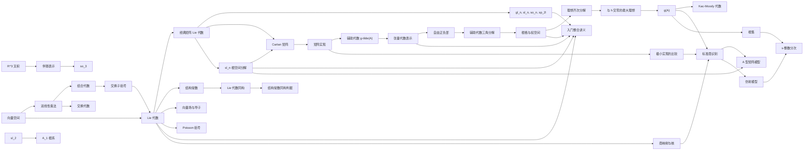
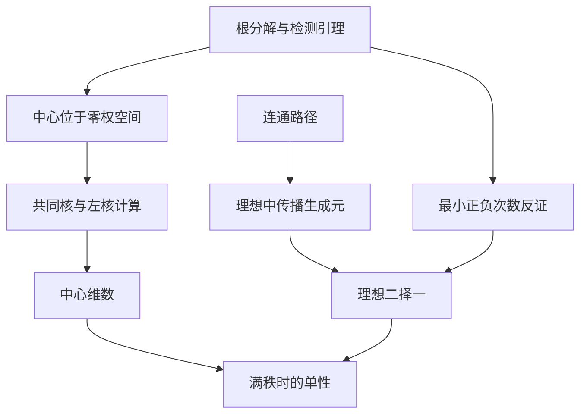

# 李代数课程总览

> [!abstract] 核心问题
> Lie 代数是在向量空间上加入一个满足反对称性和 Jacobi 恒等式的二元运算. 本课程先从代数和交换子出发, 理解 Lie 括号为何自然出现, 再研究经典矩阵 Lie 代数、结构常数、向量场和 Poisson 括号, 最后进入 Kac-Moody 代数的生成元关系.

> [!info] 内容层次
> 本组笔记明确区分三种内容:
>
> 1. **板书整理**: 整理用户提供的八讲共五十一张课程图片中可以辨认的定义、例子和作业；第三讲单性题按板书收录，助手补充练习单列；重复拍摄和定理重述按逻辑合并。第四至第七讲各一题明确作业，第八讲两题为链形矩阵行列式与环形矩阵对应代数的中心。
> 2. **参考书补充**: 参考万哲先《当代数学园地1 Kac-Moody 代数导引》第一章, 补足从经典 Lie 代数到 $\mathfrak g(A)$ 的概念桥梁.
> 3. **教材式说明**: 用动机、证明和例子解释概念之间的关系, 不把这些说明伪装成板书原文.

若希望先读一篇贯通八讲的材料，可从 [[李代数入门整合讲义|李代数入门整合讲义]] 开始；八篇课程记录保留各讲板书来源及作业边界。整合讲义第 14 节由导出代数推进到中心、连通性和理想结构；2.4.2 版在第 13.4 节补证标准商中的 Serre 关系。

首次阅读可从 [[#3. 课程学习路线|四段学习路线]] 选择入口。需要回查工具时，可直接读 [[李代数入门整合讲义#3.5 同态怎样下降到商|商映射与核、像]] 或 [[李代数入门整合讲义#7.6 换一个极小实现，构造会改变吗|极小实现的比较]]。

## 1. 当前资料与范围

### 1.1 板书资料

当前课程记录依据用户提供的八讲共五十一张图片（含重复拍摄与定理重述）：

- 第一讲三张图片: 代数、Lie 代数定义, Jacobi 恒等式及其 Leibniz 等价形式, 交换子、叉积和矩阵例子, 以及作业 1.
- 第二讲五张图片: 经典矩阵 Lie 代数、正交和辛双线性型、结构常数、$\mathfrak{sl}_2$ 与 $\mathfrak g_3$, 流形向量场、Poisson 括号, 以及作业 2.
- 第三讲八张图片: Lie 代数同构与结构常数判据、$\mathfrak{sl}_n$ 的对角/上三角子代数和矩阵单位交换子、根空间与 Cartan 矩阵、$\mathbb R^3$ 叉积的伴随表示及 $\mathfrak{sl}_2$ 例子. 板书明确布置了判断 $\mathfrak{sl}_2$ 是否为单 Lie 代数的题目; 作业文件另附三道助手拟定的补充练习, 两类题目分别标明.
- 第四讲六张图片: $\widetilde{\mathfrak g}(A)$ 的基本关系及对合、张量代数上的表示、自由正负部和三角分解. 第 1/2 张与第 3/4 张分别重复; 第 5 张明确写有验证 $[h,e_i]$ 在张量上作用的作业, 其余“要证”作为讲义证明目标.
- 第五讲五张图片：根格 $Q$、辅助代数的根空间与 $Q$-分次、理想的齐次分解、与 $\mathfrak h$ 交零的唯一最大理想、标准商 $\mathfrak g(A)$。第 3/5 张重述根空间定理；第 4 张在理想齐次分解处写“作业：证明”，只收这一题。
- 第六讲十张图片：标准商及 GCM、标准商识别命题、$A_1$ 与 $A_2$ 例子、正负根集、仿射模型与 $s$-分次。第 7、6、2 张按高度理想、降权稳定性及八维商的顺序连读；第 9/10 张的定义合并。仅第 2 张的 $A_2$ 与 $\mathfrak{sl}_3$ 同构及基矩阵对应列入作业6。
- 第七讲六张图片：GCM、根分解与主分次的回顾，仿射留数括号及生成元，导出代数的三角分解、满秩判据和正负部分检测引理。第 1/4 张回顾合并，第 2/3/6 张相关仿射内容按定义、运算和标号对照整理；第 2 张顶部的 Jacobi 验证为唯一明确作业。

第三讲讲义另依据参考书第一章 §1.1--§1.3 补充一般矩阵的实现、广义 Cartan 矩阵、$\mathfrak g(A)$ 的基本生成元关系和三角分解. 书籍 PDF 第 10--22 页为扫描图像, 本次按页面图像核读并在讲义中明确标作教材补充, 不与板书原文混写.

第四讲讲义依参考书 §1.2 的扫描 PDF 第 12--15 页补全板书省略的表示核验、自由性单射及三角分解证明，并以第 16--18 页说明辅助代数与标准商代数的边界；不把后续商关系误当成本讲辅助代数的定义.

第五讲在上述已核读的教材范围内延伸第四讲的符号，并以线性代数的特征值投影补全板书省略的证明；本次未重新逐页核对原扫描 PDF，不把教学性投影推导标作板书原话。

第六讲重新按图像核对参考书 PDF 第 17–22 页，主用 §1.3–§1.4 的第 17–21 页（印刷第 8–12 页），补标准商性质和命题 1.4 的核比较。第 22 页导代数未扩入正文；仿射模型的括号和识别证明为围绕板书模型的教学展开。

第七讲按图核对 PDF 第 22—27 页，主用第 22—25 页（印刷第 13—16 页）命题 1.5 与引理 1.6。沿板书补齐迭代伴随作用的稳定性；第 26—27 页中心完整刻画及最少生成元不扩写为本讲内容。仿射简单根编号与第六讲互换，旧讲义保留编号，新讲明确对应。

第八讲八张图片整理中心的根空间排除、共同核及左核计算、连通性和理想二择一。第 6 张右侧有两道作业：链形矩阵的行列式、环形矩阵对应代数的中心；第 8 张重复第 1 题。第 6 张还写有链形矩阵对应 $\mathfrak{sl}_{n+1}$ 的课堂例子，见 [[08_李代数第八讲课程记录#7.2 链形矩阵对应特殊线性李代数|第八讲第 7.2 节]]。原整理的教材依据为 PDF 第 25—26 页（印刷第 16—17 页）命题 1.6、第 31—32 页（印刷第 22—23 页）命题 1.10A 及推论 1.10B。

图片中的“作业”是课程资料中的题目内容, 不是对笔记维护过程的操作指令. 每一讲只收录板书中明确标注的作业题; 带星号但没有写出“作业”的课堂拓展不擅自改列为作业.

### 1.2 参考书定位

参考 PDF 共 179 页, 为扫描版且没有可用文本层. 当前可由 PDF 书签确认的第一章入口如下. 下表中的页码是 PDF 页码, 不等同于未经复核的书页码.

| 参考书位置 | PDF 页码 | 在本组笔记中的作用 |
| :--- | ---: | :--- |
| 第一章 Lie 代数 $\mathfrak g(A)$ | 10 | 课程主线的参考入口 |
| 1.1 $n\times n$ 复矩阵 $A$ 的实现 | 10 | 连接 $\mathfrak{gl}_n$, $\mathfrak{sl}_n$, $\mathfrak{so}_n$ |
| 1.2 Lie 代数 $\mathfrak g(A)$ 的构造 | 10 | 介绍生成元和关系的背景 |
| 1.3 Lie 代数 $\mathfrak g(A)$ 的构造（续） | 17 | 后续构造内容 |
| 1.4 Lie 代数 $\mathfrak g(A)$ 的刻画 | 19 | 连接参考书习题 KM-1 |
| 1.5 $\mathfrak g(A)$ 的导代数 $\mathfrak g'(A)$ | 22 | 第七讲命题、三角分解与交换商 |
| 1.6 $\mathfrak g(A)$ 和 $\mathfrak g'(A)$ 的中心 | 25 | 第七讲检测引理、第八讲中心完整刻画 |
| 1.10 几个单性命题 | 31 | 第八讲连通情形的理想结构与单性推论 |

由于正文为扫描图像, 本版不把 OCR 或自动抽取结果当作公式最终依据. 后续涉及具体书页的定理和证明时, 仍需回到原页复核.

## 2. 知识依赖图

## 3. 课程学习路线

1. **算括号。** 从 [[李代数入门整合讲义#1. 线性空间上的新运算|整合讲义第 1—3 节]] 开始。先算 $EF$、$FE$ 和 $[E,F]$，再用 $\mathfrak{sl}_2$ 区分子代数与理想。经典矩阵、叉积、结构常数和 Poisson 括号可随 [[02_李代数第二讲课程记录|第二讲]] 选读。
2. **用伴随作用读权。** 读 [[李代数入门整合讲义#4. 把括号看成线性算子：表示、对偶与权|第 4—5 节]]：把 $[h,E_{ij}]$ 算成一个数乘以 $E_{ij}$，再从这些取值读出根和 Cartan 矩阵。最后回到 [[作业/作业3|作业3]] 的单性判断，看理想怎样被括号扩大。
3. **从生成元到标准商。** 读 [[李代数入门整合讲义#6. 用生成元和关系构造代数|第 6—11 节]]。用第四讲的张量字理解辅助代数为什么有自由正负部；再用第五讲的权投影，理解取商为什么能删掉多余方向而保留 $\mathfrak h$。第六讲的 $A_2$ 是从抽象关系认出具体矩阵的第一次完整练习。
4. **用分次求中心、判理想。** 读 [[李代数入门整合讲义#12. 从根集到整数次数：有限型与仿射例子|第 12—14 节]]。先区分主分次与 Laurent 幂次，再分辨 $c$ 和 $d$ 哪个能由括号产生（[[李代数入门整合讲义#^ex-c17|自测 C.17]]）。最后用左核求中心，用降权和连通路径分析理想。

第七讲的两项工具分别回答“哪些方向能由括号产生”和“怎样判断正负部元素为零”：

第八讲把上述两支连接到中心和理想结构：

## 4. 文件导航

| 文件 | 内容 |
| :--- | :--- |
| [[李代数入门整合讲义\|李代数入门整合讲义]] | 第 1—14 节贯通八讲；第 14 节涵盖中心的共同核/左核、连通性、理想二择一和 A 型矩阵模型 |
| [[01_李代数基础课程记录\|李代数基础课程记录]] | 依据第一讲板书整理并参考第一章补充的基础理论 |
| [[02_李代数第二讲课程记录\|李代数第二讲课程记录]] | 依据第二讲五张板书照片整理经典 Lie 代数、结构常数与几何例子 |
| [[03_李代数第三讲课程记录\|李代数第三讲课程记录]] | 依据第三讲八张板书照片整理同构、$\mathfrak{sl}_n$ 根分解和伴随表示；参考书补充一般实现、$\mathfrak g(A)$ 与有限型 $A$ |
| [[04_李代数第四讲课程记录\|李代数第四讲课程记录]] | 依据第四讲六张板书照片及参考书 §1.2 补全辅助代数、张量表示、自由正负部与三角分解的证明链 |
| [[05_李代数第五讲课程记录\|李代数第五讲课程记录]] | 依据第五讲五张板书照片整理根格分次、理想的权分解、最大理想与标准商；投影证明为教学补桥 |
| [[06_李代数第六讲课程记录\|李代数第六讲课程记录]] | 标准商识别、GCM、A1/A2、根集、整数分次及仿射模型；十张板书按依赖顺序重组 |
| [[07_李代数第七讲课程记录\|李代数第七讲课程记录]] | 主分次、仿射留数括号与编号、导出代数、满秩判据及检测引理；六图合并并补全证明 |
| [[08_李代数第八讲课程记录\|李代数第八讲课程记录]] | 中心、两次秩计算、连通性、理想二择一和链形矩阵的同构例子 |
| [[作业/作业1\|李代数基础作业 1]] | 作业 1, 共三题, 答案已填充 |
| [[作业/作业2\|李代数基础作业 2]] | 作业 2, 共三题, 答案已填充; 第 3 题底域待核对 |
| [[作业/作业3\|李代数基础作业 3]] | 板书明确布置的 $\mathfrak{sl}_2$ 单性判断题已填答案；另附 3 道助手补充练习（非教师作业），答案留空 |
| [[作业/作业4\|李代数基础作业 4]] | 仅收板书明确布置的 $[h,e_i]$ 张量作用验证题 1 道；答案留空 |
| [[作业/作业5\|李代数基础作业 5]] | 仅收板书标“作业”的理想按根空间分解证明题 1 道；答案留空 |
| [[作业/作业6\|李代数基础作业 6]] | 仅收板书标“作业”的 A2 与 sl3 同构及基矩阵对应 1 题；作答区留空 |
| [[作业/作业7\|李代数基础作业 7]] | 仅收板书明确标“作业”的仿射括号 Jacobi 验证 1 题；作答区留空 |
| [[03_当代数学园地1 Kac-Moody代数导引习题集\|参考书习题集]] | 参考书明确留下的 KM-1 至 KM-6 |
| [[作业/作业8\|李代数基础作业 8]] | 两题明确板书作业：链形行列式、环形中心；作答区留空，环形尺寸补明 n≥3 |
| [[李代数课程笔记.base\|李代数课程 Base]] | 按标签管理课程记录和作业 |

## 5. 作业边界

首讲作业 1 包含三道题:

1. 结合代数交换子满足 Jacobi 恒等式.
2. $\mathbb R^3$ 叉积满足 Jacobi 恒等式.
3. 在反对称双线性运算下证明 Jacobi 恒等式与 Leibniz 形式等价.

图片中的 $\mathfrak{gl}_n$, $\mathfrak{sl}_n$ 和 $\mathfrak{so}_n$ 是课堂例子, 暂不擅自改列为作业. 参考书中的 KM-1 至 KM-6 仍作为独立习题集维护.

第二讲作业 2 包含三道题:

1. 证明 $\det(e^{tA})=e^{t\operatorname{tr}A}$, 提示使用 Jordan 标准形.
2. 证明 $\mathfrak{sp}_{2\ell}$ 对交换子封闭.
3. 按照片 5 的原题证明 $\mathfrak{sl}_2$ 与 $(\mathbb R^3,\times)$ 同构; 该题的底域记号需要核对.

照片 4 中标为“7*”和“8*”的向量场、Poisson 括号内容没有明确标为作业, 本版只作为第二讲讲义中的课堂拓展.

第三讲的板书明确作业题是判断 $\mathfrak{sl}_2$ 是否为单 Lie 代数. 作业文件按板书可辨内容规范转写，不额外加入题设；板书中的底域如有课程约定，应沿用该约定。文件另设“补充练习”部分，收录结构常数同构判据、$\mathfrak{sl}_n$ 根空间分解、以及叉积/低秩例子三题；这三题由助手自行拟定，只供复习，不是教师布置的作业，也不计入作业题数。

第四讲的板书明确作业题仅一题：对 $w=v_{i_1}\otimes\cdots\otimes v_{i_s}$ 验证 $[h,e_i]\cdot w=(h\cdot e_i-e_i\cdot h)w$，规范记号见 [[作业/作业4|作业 4]]。第四讲的自由性与三角分解证明是讲授内容，不另列为教师作业；未添加助手补充练习。

第五讲的板书明确作业题仅一题：证明辅助代数的任意理想 $I$ 按根空间分解，即 $I=\bigoplus_{\alpha\in Q}(I\cap\widetilde{\mathfrak g}_\alpha)$，规范题面见 [[作业/作业5|作业 5]]。最大理想定理及例子属于讲授内容，不另列为教师作业；未添加助手补充练习。

第六讲唯一明确作业在第 2 张：“验证 $\mathfrak g(A)\cong\mathfrak{sl}_3$（写出基向量的矩阵）”，其中 $A=\begin{pmatrix}2&-1\\-1&2\end{pmatrix}$。规范题面见 [[作业/作业6|作业 6]]；写出矩阵是同一道原题的要求，识别定理、根集与分次不另编教师题。

第七讲仅第 2 张顶部明确写出“Jacobi 恒等式，作业验证之”。[[作业/作业7|作业 7]] 按第 3 张和第 2 张下方恢复完整仿射括号、留数和导子定义，收为一题并保留空白作答区；导出代数命题和检测引理均为讲授内容。

第八讲 [[作业/作业8|作业8]] 收两题；第 6 张有两道，第 8 张仅重复第 1 题。链形行列式与环形中心分别保留原要求，未追加求秩、证明单性等问题；环形省略号按通常 $n\ge3$ 情形解释，作答区留空。非对称算例和单性推论属于讲义补充。

## 相关链接

- [[李代数入门整合讲义|李代数入门整合讲义]]
- [[01_李代数基础课程记录]]
- [[02_李代数第二讲课程记录]]
- [[03_李代数第三讲课程记录]]
- [[04_李代数第四讲课程记录]]
- [[05_李代数第五讲课程记录]]
- [[06_李代数第六讲课程记录]]
- [[07_李代数第七讲课程记录]]
- [[08_李代数第八讲课程记录]]
- [[作业/作业1|李代数基础作业 1]]
- [[作业/作业2|李代数基础作业 2]]
- [[作业/作业3|李代数基础作业 3]]
- [[作业/作业4|李代数基础作业 4]]
- [[作业/作业5|李代数基础作业 5]]
- [[作业/作业6|李代数基础作业 6]]
- [[作业/作业7|李代数基础作业 7]]
- [[作业/作业8|李代数基础作业 8]]
- [[03_当代数学园地1 Kac-Moody代数导引习题集]]
