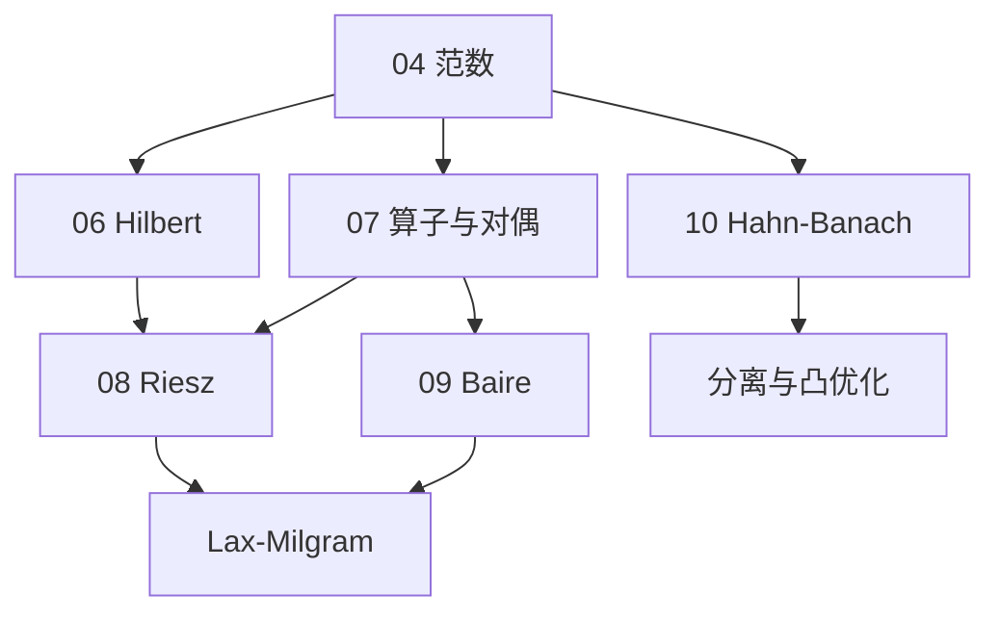

# 泛函分析学习总览

泛函分析的核心思想，是将有限维空间中“解方程、作逼近、求极值”的代数与几何方法推广到无限维函数空间中。从有限维走向无限维时，困难不仅在于维数的增长，更在于拓扑结构与代数结构的深刻交织：基本列未必收敛，有界闭集未必紧致，连续双射的逆算子未必连续，极小化序列也未必能取到极小元。本系列讲义正是围绕如何刻画并克服这些核心障碍而展开。

> [!abstract] 两条贯穿全书的理论主线
> **分析主线：** 距离 $\longrightarrow$ 基本列 $\longrightarrow$ 完备性 $\longrightarrow$ 紧性或 Baire 纲 $\longrightarrow$ 解的存在性与稳定性。
>
> **几何主线：** 线性结构与凸性 $\longrightarrow$ 范数或内积 $\longrightarrow$ 对偶泛函 $\longrightarrow$ 凸集分离、正交投影与变分方法。
>
> 在学习每一个核心定理时，都应当紧扣三个基本问题：定理在怎样的空间结构中讨论？哪一个关键假设保证了极限或解不会跑出原空间？一旦去掉这一假设，会出现怎样的反例？

## 1. 专题导航

1. [[泛函分析/01_度量空间及其完备化/00_专题总览|01 度量空间及其完备化]]：抽象距离、开闭集拓扑、连续映射、基本列与度量空间的完备化构造。
2. [[泛函分析/02_压缩映象原理/00_专题总览|02 压缩映射原理]]：Picard 迭代、先验与后验误差估计、Banach 空间隐函数定理、常微分方程存在唯一性及参数稳定性。
3. [[泛函分析/03_紧性与函数族/00_专题总览|03 紧性与函数族]]：列紧性、完全有界性、Ascoli-Arzelà 定理以及无限维空间的有限网近似思想。
4. [[泛函分析/04_赋范空间与Banach空间/00_专题总览|04 赋范空间与 Banach 空间]]：典型序列与函数空间的完备性、范数等价性、有限维空间的特征、商空间与最佳逼近问题。
5. [[泛函分析/05_凸集与不动点/00_专题总览|05 凸集与不动点]]：凸集几何、Minkowski 泛函、有限维 Brouwer 不动点定理与无限维 Schauder 不动点定理。
6. [[泛函分析/06_Hilbert空间与正交方法/00_专题总览|06 Hilbert 空间与正交方法]]：内积与中线公式、正交级数展开、闭凸集投影定理与最小二乘逼近。
7. [[泛函分析/07_有界算子与对偶空间/00_专题总览|07 有界算子与对偶空间]]：连续线性算子、算子范数、Neumann 级数、对偶空间结构及其典型反例。
8. [[泛函分析/08_Riesz表示与变分问题/00_专题总览|08 Riesz 表示与变分问题]]：Hilbert 空间连续线性泛函的表示、椭圆方程弱解、变分不等式与 Radon-Nikodym 定理的 Hilbert 空间证明。
9. [[泛函分析/09_Baire纲与基本定理/00_专题总览|09 Baire 纲与基本定理]]：Baire 纲定理、开映射定理、闭图像定理、一致有界原理（共鸣定理）以及 Lax-Milgram 定理。
10. [[泛函分析/10_Hahn-Banach与凸分离/00_专题总览|10 Hahn-Banach 与凸分离]]：次线性控制与保范延拓定理、凸集分离定理、支撑泛函、向量值中值不等式与凸优化 KKT 条件。

[[泛函分析/泛函分析笔记.base|全专题 Base]] · [[泛函分析/01_资料索引与编写约定|资料索引与编写约定]] · [[泛函分析讲义上册习题册|原书习题册]]

## 2. 逻辑依赖

第一阶段聚焦于度量结构、紧性与不动点方法：

第二阶段在此基础上展开线性泛函分析的三条核心分支：

上述两幅图展示了各专题之间的核心逻辑依赖关系。读者在学习时可根据具体问题灵活切入：例如，Baire 纲定理本身仅依赖于度量空间的完备性，直至第 09 专题讨论开映射、闭图像与一致有界原理时才与线性算子结构结合；又如，隐函数定理的压缩映射证明仅需用到完备空间上的压缩映射原理以及基本的 Fréchet 微分与 Neumann 级数性质，可作为压缩映射原理的直接深化。

## 3. 统一记号与术语约定

- **标量域：** 记为 $\mathbb K=\mathbb R$ 或 $\mathbb C$。涉及序结构的凸集分离定理在实线性空间中讨论；对于复空间，通常先借由连续复线性泛函的实部转化为实空间情形处理。
- **基本列与证明范式：** “基本列”与“Cauchy 序列”同义。分析类存在性证明通常遵循“构造近似序列 $\to$ 利用一致估计验证基本列性质 $\to$ 借助空间完备性取极限 $\to$ 利用连续性或闭性验证极限满足方程”的标准流程。
- **算子与对偶空间：** $\mathcal L(X,Y)$ 表示从赋范空间 $X$ 到 $Y$ 的全体有界线性算子构成的空间；对偶空间记作 $X^*=\mathcal L(X,\mathbb K)$。
- **内积约定：** 内积 $(x,y)$ 约定对第一个变量线性，对第二个变量共轭线性。在此约定下，$f(x)=(x,y_f)$ 定义了一个连续线性泛函，而从泛函 $f$ 到其 Riesz 表示元 $y_f$ 的对应在复空间中是共轭线性的。
- **球与闭包：** $\overline B(x,r)=\{y:d(x,y)\leq r\}$ 表示闭球，而 $\overline{B(x,r)}$ 表示开球 $B(x,r)$ 的闭包；在一般度量空间中，这两者未必相等。
- **紧性术语：** 讲义中统一用“相对紧”表示集合的闭包在环境空间中紧致，用“紧”表示集合自身紧致。关于传统教材中“列紧”与“自列紧”术语的对照与辨析，详见第 03 专题。

## 4. 习题分析与证明检验要领

在结合 [[泛函分析讲义上册习题册|原书习题册]] 进行练习时，建议先明确题目所考察的目标究竟是存在性、唯一性、连续性还是定量估计，再对照相应专题中的定理机制展开推导。在审视或撰写无限维空间中的分析证明时，应重点核查以下五个关键环节：

1. **从逐点收敛到整体收敛：** 坐标收敛或逐点收敛如何提升为范数收敛？是否具备一致的尾项控制或等度连续性？
2. **不变集验证：** 应用不动点定理时，映射是否严格将所选定的闭集（或闭球）映入其自身？
3. **压缩条件辨析：** 是否将“距离逐点严格变小”（$d(Tx,Ty)<d(x,y)$）误认为存在统一的压缩常数 $q<1$？
4. **极限的归属：** 取极限操作是在哪一种范数或度量下进行的？所得极限元素是否依然留在所讨论的空间或子集中？
5. **极值的可达性：** 距离的下确界或算子范数的上确界是否真正能够被空间中的某个元素取到？

## 5. 参考资料与选材说明

本系列讲义以张恭庆、林源渠《泛函分析讲义（上册）》的章节体系为主干，结合分专题课堂解读讲义进行理论重构，并引入汪林《泛函分析中的反例》中的经典构造来剖析各核心定理的适用边界。各专题文献出处、符号对照及重要数学细节的辨析详见 [[泛函分析/01_资料索引与编写约定|资料索引与编写约定]]。

## 6. 跨主题参照

- [[00_跨主题阅读索引|跨主题阅读索引]]：按核心定义、证明思想与典型应用，关联实变函数、拓扑学、常微分方程、谱理论及高等概率论中的对应专题。
