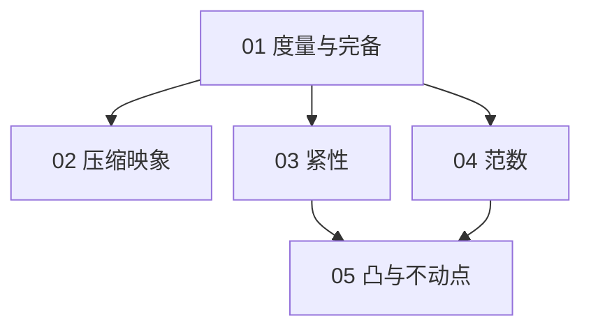
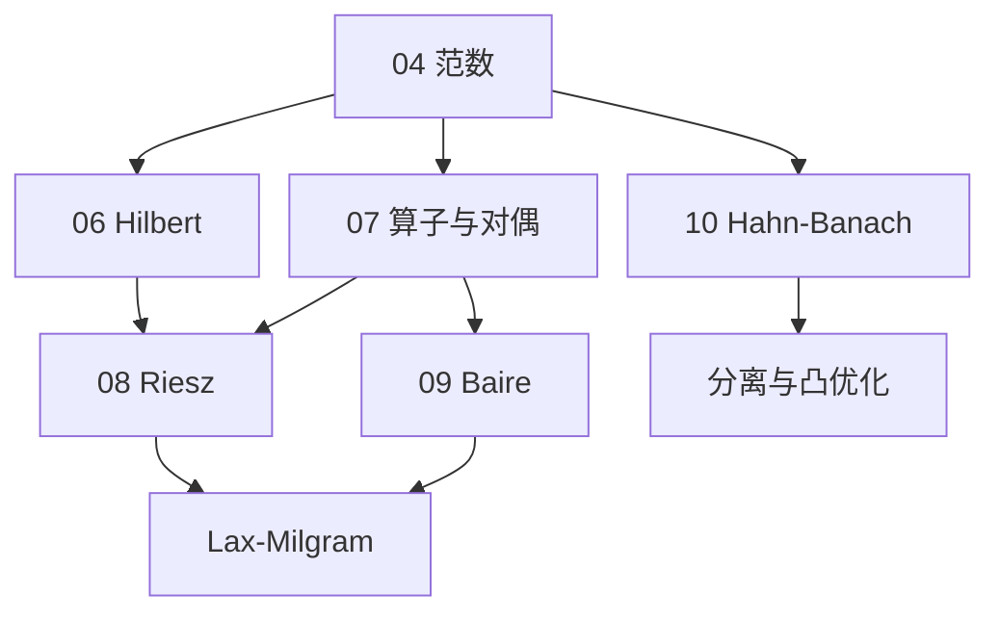

# 泛函分析学习总览

泛函分析把有限维的“解方程、作逼近、找极值”放到函数空间中。困难不只在维数变大：基本列可能没有极限，闭有界集可能不紧，连续算子的逆可能不连续，最小化序列也可能找不到极小元。下面的专题围绕这些具体障碍组织。

> [!abstract] 两条贯穿全书的主线
> **分析主线：** 距离 → 基本列 → 完备性 → 紧性或 Baire 纲 → 存在性与稳定性。
>
> **几何主线：** 线性与凸性 → 范数或内积 → 对偶泛函 → 分离、投影与变分方法。
>
> 每个定理都要回答三个问题：在哪个空间中讨论？哪个条件保证极限或解仍在空间内？去掉这个条件会发生什么？

## 1. 专题导航

1. [[泛函分析/01_度量空间及其完备化/00_专题总览|01 度量空间及其完备化]]：保留原有专题边界，只讨论距离、连续、基本列与完备化。
2. [[泛函分析/02_压缩映象原理/00_专题总览|02 压缩映象原理]]：迭代、误差估计、隐函数、微分方程与参数稳定性。
3. [[泛函分析/03_紧性与函数族/00_专题总览|03 紧性与函数族]]：列紧、完全有界、Ascoli 定理与有限维近似。
4. [[泛函分析/04_赋范空间与Banach空间/00_专题总览|04 赋范空间与 Banach 空间]]：典型空间、范数比较、有限维性、商空间与最佳逼近。
5. [[泛函分析/05_凸集与不动点/00_专题总览|05 凸集与不动点]]：凸组合、Minkowski 泛函、Brouwer–Schauder 方法。
6. [[泛函分析/06_Hilbert空间与正交方法/00_专题总览|06 Hilbert 空间与正交方法]]：内积、正交展开、投影与最小二乘。
7. [[泛函分析/07_有界算子与对偶空间/00_专题总览|07 有界算子与对偶空间]]：连续线性算子、算子范数、对偶与延拓边界。
8. [[泛函分析/08_Riesz表示与变分问题/00_专题总览|08 Riesz 表示与变分问题]]：表示泛函、弱解、变分不等式与 Radon–Nikodym 定理。
9. [[泛函分析/09_Baire纲与基本定理/00_专题总览|09 Baire 纲与基本定理]]：开映射、闭图像、一致有界与 Lax–Milgram。
10. [[泛函分析/10_Hahn-Banach与凸分离/00_专题总览|10 Hahn–Banach 与凸分离]]：受控延拓、支撑泛函、中值不等式与凸优化。

[[泛函分析/泛函分析笔记.base|全专题 Base]] · [[泛函分析/01_资料索引与编写约定|资料索引与编写约定]] · [[泛函分析讲义上册习题册|原书习题册]]

## 2. 逻辑依赖

先看基础结构与不动点方法：

再看线性工具的三条分支：

两图标出本组笔记的主要阅读依赖，不要求机械地依次读完所有文件；Baire 定理本身只需要完备度量空间，09 中的算子基本定理才接到线性工具。例如隐函数笔记只需要压缩定理和其中补出的微分、Neumann 级数准备；不必先学习全部算子理论。

## 3. 统一记号与语言

- 标量域为 $\mathbb K=\mathbb R$ 或 $\mathbb C$；需要实数顺序的凸分离在实空间中讨论，复空间先实化。
- “基本列”与“Cauchy 列”同义。证明按“先构造，再说明满足条件，随后取极限，最后验证结论”推进。
- $\mathcal L(X,Y)$ 表示全定义的有界线性算子，$X^*=\mathcal L(X,\mathbb K)$。
- 内积 $(x,y)$ 对第一个变量线性，对第二个变量共轭线性。由此 $f(x)=(x,y_f)$ 表示线性泛函，而 $y_f$ 对 $f$ 的对应在复数情形是共轭线性的。
- $\overline B(x,r)=\{y:d(x,y)\leq r\}$ 表示闭球；$\overline{B(x,r)}$ 表示开球的闭包。一般度量空间中两者不必相等。
- 新笔记用“相对紧”表示闭包在环境空间中紧，用“紧”表示集合本身紧。原书“列紧／自列紧”的区别见紧性专题。

## 4. 怎样使用习题册

先确定题目要求的是存在、唯一、连续还是定量估计，再找对应的理论笔记。习题册保留原题号、已有作答与空白区域；本次补编不替用户改写草稿，也不把理论中的补充例子登记成原书习题。

阅读已有证明时，尤其检查：

1. 坐标收敛如何提升为整体收敛，是否有统一尾项控制；
2. 映象是否确实把所选闭集送入自身；
3. “逐点严格变小”是否被误当作存在统一压缩常数；
4. 取极限时用的是哪一种范数，极限属于哪个空间；
5. 最小值或范数的上确界是否真的能够取到。

## 5. 资料与可信边界

本组笔记综合用户提供的 12 份分节解读 PDF，依照张恭庆、林源渠教材的章节主线重组，并用汪林《泛函分析中的反例》中已核对的条目说明定理的适用边界。PDF 解读中的启发性表达不自动成为正确的数学结论；重要修正、借用结果与补充推导均在对应文件说明。

本次是这些章节的专题化深读与补编，不是对 492 页解读材料或汪林全书每一条结论的逐字审定。原始 PDF 不复制进仓库。具体页码、反例编号与未覆盖部分见 [[泛函分析/01_资料索引与编写约定|资料索引]]。
