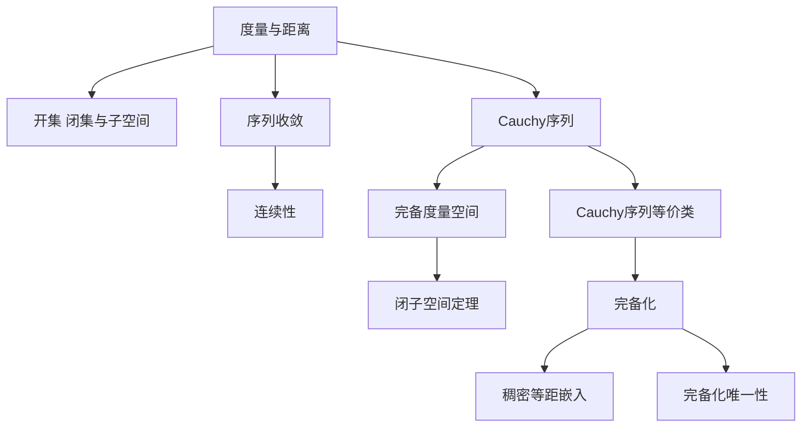

# 度量空间及其完备化理论

> [!abstract] 专题范围
> 本专题将度量空间的基本结构和完备化理论组织为一个连续的知识单元。内容包括度量、开闭集、子空间、序列收敛、连续性、Cauchy 序列、完备性、完备子空间以及完备化的构造和唯一性。
>
> 本专题不编写压缩映射原理及其应用。原习题册中的 1.1.2--1.1.7 不属于本次处理范围。

## 1. 学习主线

度量 rho 先给出点之间的距离, 再由距离定义收敛和连续性。Cauchy 序列只使用点与点之间的距离来判断自身是否趋于稳定, 不预先要求极限属于原空间。完备性正是补足这一缺口的条件, 而完备化则把所有在距离意义下应该存在的极限补进一个更大的空间。

## 2. 文件导航

- [[01_度量空间基本概念|01 度量空间基本概念]]
- [[02_序列收敛与连续性|02 序列收敛与连续性]]
- [[03_Cauchy序列与完备性|03 Cauchy 序列与完备性]]
- [[04_闭子空间与完备性判别|04 闭子空间与完备性判别]]
- [[05_完备化的构造|05 完备化的构造]]
- [[06_完备化的唯一性与泛性质|06 完备化的唯一性与泛性质]]
- [[07_典型完备化例子|07 典型完备化例子]]
- [[01_度量空间及其完备化.base|专题 Base]]

## 3. 原书习题对应

本专题理论笔记与 [[泛函分析讲义上册习题册|《泛函分析讲义（上册）》习题册]] 中下列题目互相链接:

- [[泛函分析讲义上册习题册#1.1.1|习题 1.1.1]]: 完备空间的闭子集和完备子空间的闭性.
- [[泛函分析讲义上册习题册#1.2.1|习题 1.2.1]]: 全体标量数列空间的完备性.
- [[泛函分析讲义上册习题册#1.2.2|习题 1.2.2]]: 基本序列和收敛子列.
- [[泛函分析讲义上册习题册#1.2.3|习题 1.2.3]]: 有限支撑数列空间的完备化.
- [[泛函分析讲义上册习题册#1.2.4|习题 1.2.4]]: 多项式空间的完备化.
- [[泛函分析讲义上册习题册#1.2.5|习题 1.2.5]]: 近似基本序列推出收敛.

## 4. 记号约定

- 度量空间记为 $(\mathcal X,\rho)$.
- 开球记为 $B_\rho(x,r)$ 或 $B(x,r)$.
- 闭球记为 $\overline B_\rho(x,r)$.
- 序列通常记为 $\{x_n\}$.
- Cauchy 序列在原书语境中也称基本序列.
- 完备化记为 $(\widehat{\mathcal X},\widehat\rho)$.
- 原空间到完备化的自然嵌入记为 $\iota:\mathcal X\to\widehat{\mathcal X}$.

## 5. 阅读说明

本专题以张恭庆、林源渠《泛函分析讲义（上册）》第一章 1.1--1.2 为主要来源, 对扫描版中的定义和定理进行整理, 并补充必要的证明细节。书中原有习题编号保持不变, 习题册中的答案区域保持留空。

> [!important] 范围边界
> 本文件夹只处理度量空间及其完备化。压缩映射、不动点迭代、Newton 迭代和积分方程不在本次笔记中出现。

## 相关链接

- [[泛函分析讲义上册习题册|《泛函分析（上册）》习题册]]
- [[README|数学笔记仓库首页]]
