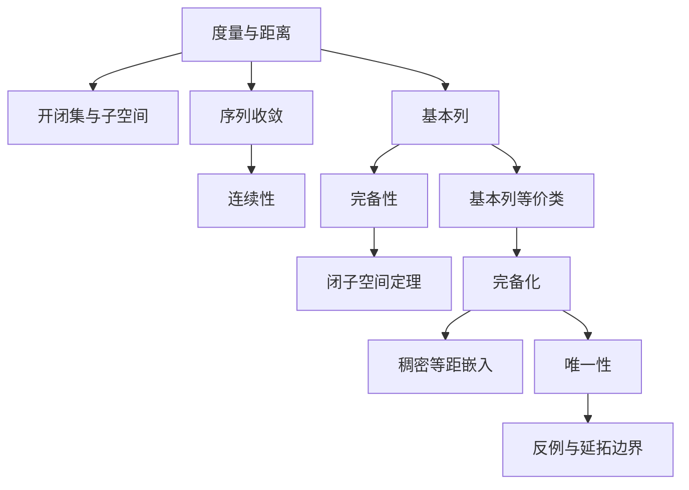

# 度量空间及其完备化理论

> [!abstract] 专题导读
> 度量空间是泛函分析中最基础的几何与拓扑框架。本专题将抽象距离、开闭集拓扑、序列收敛、连续映射、Cauchy 序列（基本列）、完备性以及度量空间的完备化定理组织为一个完整的理论单元，旨在阐明如何仅凭“点与点之间的距离”建立极限理论，并为不完备空间构造唯一的完备化扩充。

## 1. 学习主线

在脱离线性运算的纯粹度量空间中，度量 $\rho$ 给出了衡量点间远近的标尺，进而诱导出开集、闭集、序列收敛与映射连续性等拓扑概念。其中，Cauchy 序列仅通过序列后项彼此之间的距离趋于零来刻画“内部凝聚性”，而不依赖于预先给定的极限点。空间的**完备性**正是保证这种内部稳定序列必有极限的关键性质；而当原空间存在“极限缺失”时，**完备化构造**则通过 Cauchy 序列的等价类将这些缺失的极限点严密地增补进来，形成一个包含原空间作为稠密等距子空间的完备度量空间。

## 2. 文件导航

- [[01_度量空间基本概念|01 度量空间基本概念]]
- [[02_序列收敛与连续性|02 序列收敛与连续性]]
- [[03_Cauchy序列与完备性|03 Cauchy 序列与完备性]]
- [[04_闭子空间与完备性判别|04 闭子空间与完备性判别]]
- [[05_完备化的构造|05 完备化的构造]]
- [[06_完备化的唯一性与泛性质|06 完备化的唯一性与泛性质]]
- [[07_典型完备化例子|07 典型完备化例子]]
- [[08_度量空间的反例与辨析|08 度量空间的反例与辨析]]
- [[01_度量空间及其完备化.base|专题 Base]]

## 3. 原书习题对应

本专题的理论内容与 [[泛函分析讲义上册习题册|《泛函分析讲义（上册）》习题册]] 中的下列习题紧密对应：

- [[泛函分析讲义上册习题册#1.1.1|习题 1.1.1]]：完备空间的闭子集必完备，以及完备子空间必为闭集。
- [[泛函分析讲义上册习题册#1.2.1|习题 1.2.1]]：全体标量数列空间 $s$ 在乘积度量下的完备性。
- [[泛函分析讲义上册习题册#1.2.2|习题 1.2.2]]：基本序列通过收敛子列判定整体收敛。
- [[泛函分析讲义上册习题册#1.2.3|习题 1.2.3]]：有限支撑数列空间 $c_{00}$ 在上确界度量下的完备化。
- [[泛函分析讲义上册习题册#1.2.4|习题 1.2.4]]：多项式空间在积分度量下的完备化。
- [[泛函分析讲义上册习题册#1.2.5|习题 1.2.5]]：由近似基本序列逼近推出序列收敛。

## 4. 记号约定

- 度量空间记为 $(\mathcal X,\rho)$。
- 开球记为 $B_\rho(x,r)$ 或 $B(x,r)$；闭球记为 $\overline B_\rho(x,r)$。
- 自然数集约定为 $\mathbb N=\{1,2,\ldots\}$，序列通常记为 $\{x_n\}$。
- Cauchy 序列在教材语境中亦称基本序列（或基本列）。
- 度量空间 $\mathcal X$ 的完备化空间记为 $(\widehat{\mathcal X},\widehat\rho)$，从原空间到完备化空间的自然等距嵌入映射记为 $\iota:\mathcal X\to\widehat{\mathcal X}$。

## 5. 课程内容衔接

本专题对应张恭庆、林源渠《泛函分析讲义（上册）》第一章 1.1 节与 1.2 节中关于度量空间基础与完备化理论的内容，并结合课堂解读讲义与《泛函分析中的反例》第一章补充了关键证明细节与反例剖析。关于完备度量空间上的压缩映射原理、Newton 迭代及微分与积分方程应用，将在 [[泛函分析/02_压缩映象原理/00_专题总览|02 压缩映射原理]] 专题中专门展开。

## 相关链接

- [[泛函分析讲义上册习题册|《泛函分析讲义（上册）》习题册]]
- [[README|数学笔记仓库首页]]
- [[泛函分析/00_泛函分析学习总览|泛函分析学习总览]]
