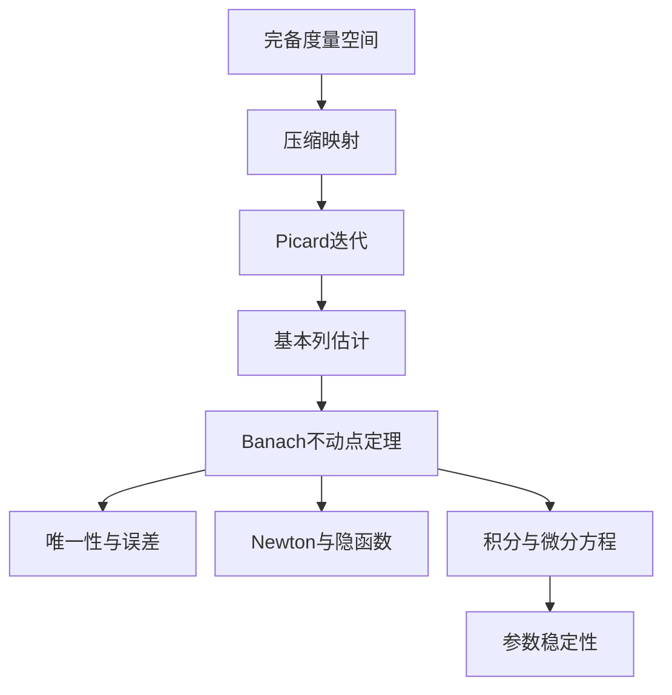

# 压缩映射原理专题

> [!abstract] 专题导读
> 本专题系统阐述张恭庆、林源渠《泛函分析讲义（上册）》第一章 1.1 节的压缩映射原理（Banach 不动点定理）及其在分析学中的核心应用。原书亦使用“压缩印象”这一经典译名，它与现代通用的“压缩映射”完全同义。
>
> 本专题的理论主线为：完备度量空间 $\longrightarrow$ 压缩映射 $\longrightarrow$ Picard 迭代序列 $\longrightarrow$ 唯一不动点的存在性 $\longrightarrow$ 先验/后验误差估计与各类非线性方程求解。

## 1. 学习主线

在利用度量条件讨论不动点问题时，应当清晰区分以下两条不同的存在性证明路线：

1. **完备空间上的统一压缩路线（Banach 不动点定理）：** 要求存在与点无关的统一压缩常数 $q\in[0,1)$，使得距离按几何级数衰减，从而直接利用 Picard 迭代构造出 Cauchy 序列，并借助完备性获得唯一不动点及定量收敛速率。
2. **紧空间上的严格距离递减路线：** 若映射仅满足逐点严格距离递减（即当 $x\neq y$ 时 $d(Tx,Ty)<d(x,y)$），这一条件本身只足以保证不动点的**唯一性**，并不能保证迭代序列成为 Cauchy 序列；此时必须借助空间的**紧性**，通过极小化位移函数 $x\mapsto d(x,Tx)$ 来确立不动点的存在性（详见习题 1.1.6 的剖析）。

## 2. 文件导航

- [[01_Banach不动点定理|01 Banach 不动点定理]]
- [[02_压缩映射证明隐函数定理|02 压缩映射证明隐函数定理]]
- [[03_压缩映射的应用与反例|03 压缩映射的应用与反例]]
- [[04_微分方程与参数不动点|04 微分方程与参数不动点]]
- [[02_压缩映象原理.base|专题 Base]]

## 3. 原书习题对应

本专题各篇讲义与 [[泛函分析讲义上册习题册|《泛函分析讲义（上册）》习题册]] 第一章 1.1 节习题的对应关系如下：

- [[泛函分析讲义上册习题册#1.1.1|习题 1.1.1]]：完备空间闭子集的完备性，详见 [[泛函分析/01_度量空间及其完备化/04_闭子空间与完备性判别|闭子空间与完备性判别]]。
- [[泛函分析讲义上册习题册#1.1.2|习题 1.1.2]]：Newton 迭代法的局部收敛性分析，详见 [[03_压缩映射的应用与反例|压缩映射的应用与反例]]。
- [[泛函分析讲义上册习题册#1.1.3|习题 1.1.3]]：严格距离递减映射的不动点唯一性，详见 [[03_压缩映射的应用与反例|压缩映射的应用与反例]]。
- [[泛函分析讲义上册习题册#1.1.4|习题 1.1.4]]：压缩映射的 Lipschitz 连续性，详见 [[01_Banach不动点定理|Banach 不动点定理]]。
- [[泛函分析讲义上册习题册#1.1.5|习题 1.1.5]]：复合迭代映射 $T^n$ 为压缩映射的条件下不动点的存在唯一性，详见 [[01_Banach不动点定理|Banach 不动点定理]]。
- [[泛函分析讲义上册习题册#1.1.6|习题 1.1.6]]：紧集上严格距离递减映射的不动点存在唯一性，详见 [[03_压缩映射的应用与反例|压缩映射的应用与反例]]。
- [[泛函分析讲义上册习题册#1.1.7|习题 1.1.7]]：利用加权等价范数求解 Fredholm 积分方程，详见 [[03_压缩映射的应用与反例|压缩映射的应用与反例]]。

## 4. 专题结构与拓展说明

本专题除完整涵盖原书 1.1 节的压缩映射原理、迭代幂次定理、积分方程与常微分方程 Picard-Lindelöf 定理外，还在第 02 篇讲义中专门引入了**Banach 空间中隐函数定理的无坐标压缩映射证明**，展示了如何通过构造局部闭球上的参数化压缩映射族来求解非线性算子方程。而关于不依赖压缩条件、改用紧性与凸性证明存在性的 Brouwer 与 Schauder 不动点定理，则将在 [[泛函分析/05_凸集与不动点/00_专题总览|05 凸集与不动点]] 专题中讨论。

## 5. 统一记号

- 度量空间记为 $(X,d)$，Banach 空间的范数记为 $\|\cdot\|$。
- 压缩常数记为 $q$，始终满足 $0\leq q<1$。
- Picard 迭代序列定义为 $x_{n+1}=Tx_n$（$n\geq 0$）。
- 不动点记为 $x^*$，满足方程 $Tx^*=x^*$。
- 在隐函数定理中，自变量（未知量）所在空间记为 $X$，参数空间记为 $Y$，方程取值空间记为 $Z$，三者均为 Banach 空间。

## 相关链接

- [[泛函分析讲义上册习题册|《泛函分析讲义（上册）》习题册]]
- [[泛函分析/01_度量空间及其完备化/00_专题总览|度量空间及其完备化专题]]
- [[README|数学笔记仓库首页]]
- [[泛函分析/00_泛函分析学习总览|泛函分析学习总览]]
