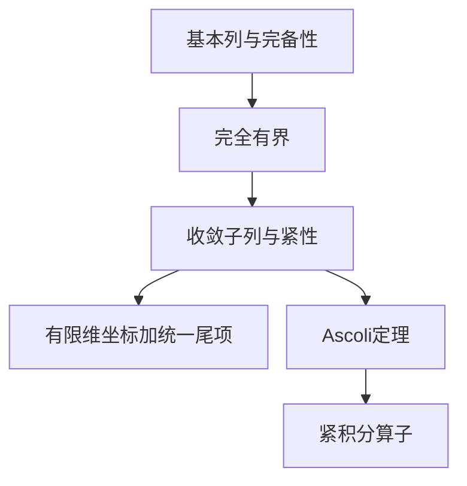

# 紧性与函数族

在度量空间中，**完备性**仅保证已知内部稳定的**基本列（Cauchy 序列）**存在极限；而**紧性**则要强大得多——它保证从集合的**任意点列**中都能够抽取出收敛子列。连接完备性与紧性的核心桥梁是**完全有界性（有限 $\varepsilon$-网性质）**：在任意给定的正精度 $\varepsilon>0$ 下，整个无限集合都可以由有限多个半径为 $\varepsilon$ 的小球所覆盖，从而可以用有限维对象在任意精度上近似无限维集合。

## 导航与依赖

- [[01_列紧与完全有界|01 列紧与完全有界]]
- [[02_Ascoli定理与紧性判别|02 Ascoli 定理与紧性判别]]
- [[03_紧性反例与习题方法|03 紧性反例与习题方法]]
- [[03_紧性与函数族.base|专题 Base]]

## 核心思想与术语说明

1. **有限维部分与无限尾部的协同控制：** 在无限维空间中，仅仅“有界”或“每个坐标有界”远不足以保证紧性（例如标准正交基 $\{e_n\}$ 有界闭却离散不紧）。要使一个无限维集合相对紧，必须将空间分解为“有限维主体”与“无限维尾部”：有限维部分利用 Heine-Borel 定理获得完全有界性，而无限维尾部则必须具有**一致趋于零**的控制（在序列空间 $\ell^p$ 中表现为一致小尾项，在连续函数空间 $C(K)$ 中表现为通过等度连续性将有限采样点的控制延伸到整个定义域）。
2. **紧性术语的精确化：** 在国内早期教材（包括张恭庆教材）中，常将“闭包紧（任意序列有收敛于环境空间的某个子列）”称为“列紧”，而将“集合自身紧（收敛子列的极限仍在集合内）”称为“自列紧”；而在现代泛函分析与拓扑学文献中，“列紧（Sequentially Compact）”通常直接指集合自身序列紧。为避免不同文献间的术语混淆，本专题统一采用含义明确的**“相对紧（闭包紧）”**与**“紧 / 序列紧（自身紧）”**进行表述。

## 相关链接

- [[泛函分析/00_泛函分析学习总览|学习总览]]
- [[泛函分析/01_度量空间及其完备化/00_专题总览|距离与完备性]]
- [[泛函分析/04_赋范空间与Banach空间/03_范数等价与有限维性|有限维中的闭有界与紧]]
- [[泛函分析讲义上册习题册#1.3 紧性|原书 1.3 节]]
