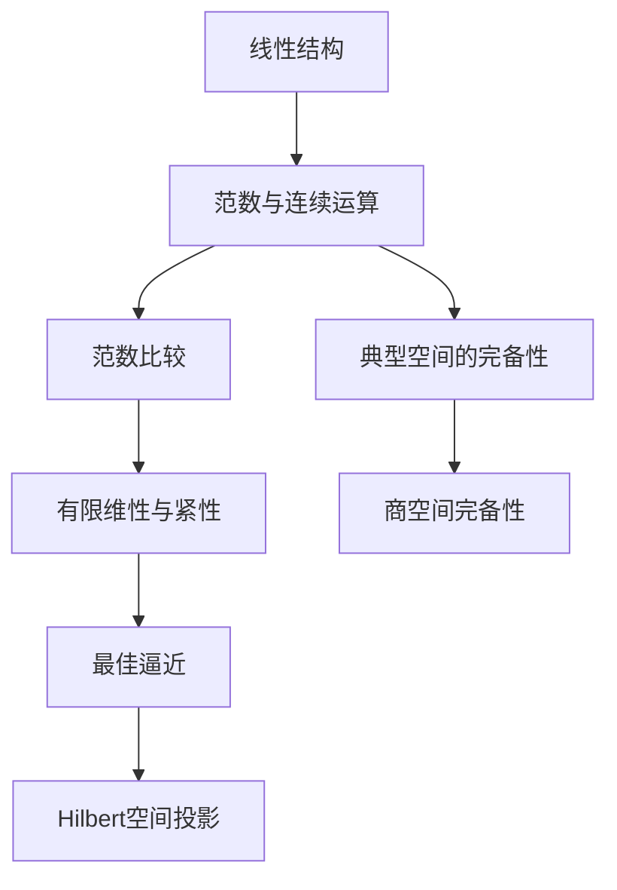

# 赋范空间与 Banach 空间

在纯粹的度量空间中，距离只能衡量两个点“是否接近”；而在线性空间中，我们可以对向量作加减、数乘与线性组合。**范数（Norm）**作为“向量长度”的抽象，将代数线性结构与度量拓扑结构相容地融为一体；当诱导的度量完备时，便构成了现代分析学的核心舞台——**Banach 空间**。

## 导航

- [[01_线性结构与范数|01 线性结构与范数]]
- [[02_典型Banach空间与完备性|02 典型 Banach 空间与完备性]]
- [[03_范数等价与有限维性|03 范数等价与有限维性]]
- [[04_商空间与最佳逼近|04 商空间与最佳逼近]]
- [[04_赋范空间与Banach空间.base|专题 Base]]

## 三个核心理论界限

在学习赋范空间与 Banach 空间时，必须牢牢把握以下三个从有限维迈向无限维的分水岭：

1. **完备性对范数选取的敏感性：** 在同一个无限维线性空间上（例如连续函数空间 $C[0,1]$），赋予不同的范数（如上确界范数 $\|\cdot\|_\infty$ 与积分范数 $\|\cdot\|_1$）会导出截然不同的基本列与完备性；只有**等价范数**才能保持相同的基本列、相同的收敛性以及相同的完备性。
2. **有限维与无限维的拓扑特征（Riesz 引理）：** 有限维线性空间上的任意两个范数必然等价，故有限维赋范空间必然完备，其在任意环境赋范空间中必为闭子空间，且单位闭球必紧；反之，由 Riesz 引理可知，任何无限维赋范空间的单位闭球绝不紧致，且无限维空间中普遍存在非闭的稠密线性子空间。
3. **商空间范数与最佳逼近的可达性：** 闭子空间 $M\subseteq X$ 保证了商范数 $\|x+M\|_{X/M}=\inf_{m\in M}\|x-m\|$ 非退化（且当 $X$ 完备时商空间 $X/M$ 亦完备），但距离下确界的存在并不意味着在一般 Banach 空间的闭子空间 $M$ 中一定能取到达到该下确界的**最佳逼近元（最近点）**。

## 相关链接

- [[泛函分析/00_泛函分析学习总览|学习总览]]
- [[泛函分析/03_紧性与函数族/00_专题总览|紧性专题]]
- [[泛函分析/06_Hilbert空间与正交方法/03_投影定理与最小二乘|内积几何下的最佳逼近]]
- [[泛函分析讲义上册习题册#1.4 赋范空间与 Banach 空间|原书 1.4 节]]
