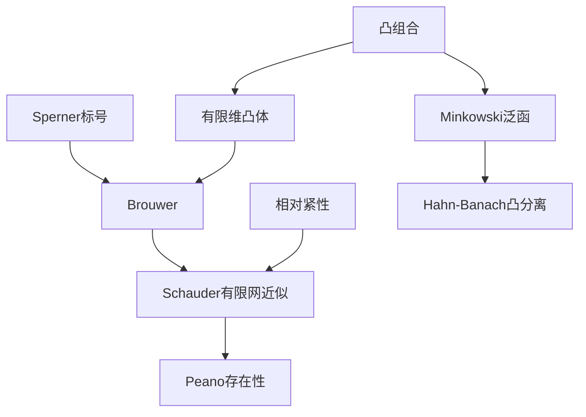

# 凸集与不动点

在非线性泛函分析中，若映射 $T$ 不再满足距离按固定比例 $q<1$ 衰减的压缩条件，而仅仅是一个**连续映射**，我们还能否保证不动点的存在性？**Brouwer 不动点定理**（有限维）与 **Schauder 不动点定理**（无限维）给出了肯定的回答：它们放弃了对映射收缩性的要求，转而依靠**凸性（Convexity）**与**紧性（Compactness）**的结合——**凸性**保证了有限个网心向量的加权平均（凸组合）仍然留在定义域内，从而允许构造有限维连续近似映射；**紧性**则保证从有限维近似不动点序列中能够抽取出收敛于真不动点的子列。

## 导航

- [[01_凸集与Minkowski泛函|01 凸集与 Minkowski 泛函]]
- [[02_Brouwer与Schauder不动点定理|02 Brouwer 与 Schauder 不动点定理]]
- [[05_凸集与不动点.base|专题 Base]]

## 专题内容脉络

1. **凸集的解析化（Minkowski 泛函）：** 通过射线尺度函数 $p_C(x)=\inf\{t>0:x\in tC\}$，将几何上的凸集转化为分析上的次线性泛函。这一工具一方面在有限维中确立了紧凸集与欧氏闭球的拓扑同胚，另一方面在第 10 专题中直接成为 Hahn-Banach 凸集分离定理的桥梁。
2. **从组合拓扑到无限维逼近：** 本专题先通过组合拓扑中的 **Sperner 引理** 给出有限维单纯形（进而任意有限维非空紧凸集）上 Brouwer 不动点定理的严格证明；随后利用完全有界集的 **Schauder 投影（重心权函数凸组合近似）** 将问题化归为有限维凸多面体上的 Brouwer 定理，最终借助相对紧性取极限完成 Schauder 不动点定理的证明。
3. **微分方程中的 Peano 存在定理：** 作为 Schauder 定理与 Ascoli-Arzelà 定理的联合应用，证明当有限维常微分方程的右端向量场 $f(t,u)$ 仅连续而不满足 Lipschitz 条件时，初值问题的局部解依然存在（但唯一性可能不再成立）。

## 相关链接

- [[泛函分析/00_泛函分析学习总览|学习总览]]
- [[泛函分析/02_压缩映象原理/00_专题总览|压缩映射的另一条存在性路线]]
- [[泛函分析/03_紧性与函数族/02_Ascoli定理与紧性判别|Ascoli 定理]]
- [[泛函分析/10_Hahn-Banach与凸分离/02_凸集分离与支撑泛函|凸分离]]
- [[泛函分析讲义上册习题册#1.5 凸集与不动点|原书 1.5 节]]
