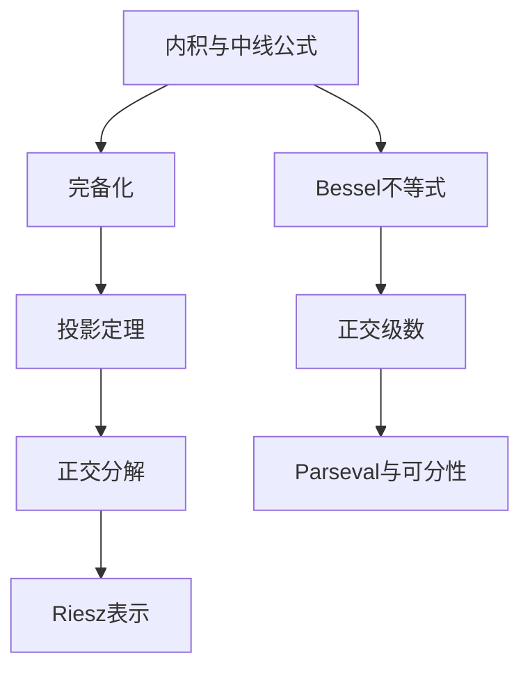

# Hilbert 空间与正交方法

在一般的赋范空间中，我们只有衡量向量长短的“范数”，却没有衡量两个向量夹角与垂直关系的“内积”。**内积空间**将欧氏空间中的角度与正交性引入无限维线性空间；其中最核心的代数恒等式是**平行四边形法则（中线公式）**——它使我们能够不依赖紧性，直接将闭凸集上的极小化序列转化为 Cauchy 序列，再由空间的**完备性**获得唯一的最佳逼近元（最近点）。完备的内积空间即为 **Hilbert 空间**，它是所有无限维空间中几何性质最完美、与有限维欧氏空间最接近的典范。

## 导航与依赖

- [[01_内积与Hilbert空间|01 内积与 Hilbert 空间]]
- [[02_正交展开与可分性|02 正交展开与可分性]]
- [[03_投影定理与最小二乘|03 投影定理与最小二乘]]
- [[06_Hilbert空间与正交方法.base|专题 Base]]

## 记号与术语约定

1. **复内积的线性性约定：** 本系列讲义遵循数学分析与算子理论的主流约定，规定复内积 $(x,y)$ **对第一个变量线性，对第二个变量共轭线性**（即 $(x,\lambda y)=\overline\lambda(x,y)$）。
2. **完备正交系的清晰表述：** 关于标准正交系 $\{e_\alpha\}$，早期文献中常混用“完备（Complete）”、“完全（Total）”或“封闭（Closed）”等不同词汇来分别指代“正交补为零（$E^\perp=\{0\}$）”与“线性张成稠密（$\overline{\operatorname{span}}E=H$）”。在完备的 Hilbert 空间中这两者完全等价，但在不完备的内积空间中则并不等价（详见第 02 篇讲义第 5 节的反例）。为避免歧义，讲义中在区分不完备情形时均直接写明“正交补为零”或“线性张成稠密”的具体数学含义。

## 相关链接

- [[泛函分析/00_泛函分析学习总览|学习总览]]
- [[泛函分析/04_赋范空间与Banach空间/04_商空间与最佳逼近|一般 Banach 空间中的逼近障碍]]
- [[泛函分析/08_Riesz表示与变分问题/01_Riesz表示定理|Riesz 表示]]
- [[泛函分析讲义上册习题册#1.6 Hilbert 空间|原书 1.6 节]]
