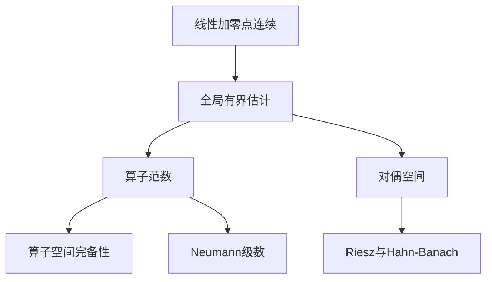

# 有界算子与对偶空间

从第二章开始，泛函分析的研究重心由静态的向量空间转向动态的**线性算子（Linear Operators）**与**线性泛函（Linear Functionals）**。得益于算子的线性结构，“在某一点处连续”这一局部拓扑性质会自动升级为全空间上的全局范数估计 $\|Tx\|\leq C\|x\|$；而**算子范数**则将无穷多个方向上的放缩比例压缩为一个统一的上确界常数。特别地，取值于标量域 $\mathbb K$ 的全体连续线性泛函构成了空间的**对偶空间 $X^*$**，它是后续 Riesz 表示定理、Hahn-Banach 分离定理以及弱收敛与变分方法的共同入口。

## 导航

- [[01_连续线性算子与算子范数|01 连续线性算子与算子范数]]
- [[02_对偶空间与算子反例|02 对偶空间与算子反例]]
- [[07_有界算子与对偶空间.base|专题 Base]]

## 重要概念提醒

“**有界线性算子**”特指算子将**有界集**映射为有界集（等价于存在常数 $C\geq 0$ 使得 $\|Tx\|\leq C\|x\|$ 对一切 $x\in X$ 成立），而绝不是指数学分析中“在整个空间上函数值有界”！事实上，由齐次性 $\|T(\lambda x)\|=|\lambda|\cdot\|Tx\|$ 可知，任何非零线性算子在整个空间 $X$ 上的像集必定是无界的（反过来，若一个线性算子在全空间上有界，则它只能是恒等于零的零算子）。

## 相关链接

- [[泛函分析/00_泛函分析学习总览|学习总览]]
- [[泛函分析/08_Riesz表示与变分问题/00_专题总览|Riesz 表示]]
- [[泛函分析/09_Baire纲与基本定理/00_专题总览|逆、闭图像与一致有界]]
- [[泛函分析/10_Hahn-Banach与凸分离/00_专题总览|泛函延拓与分离]]
- [[泛函分析讲义上册习题册#2.1 有界线性算子|原书 2.1 节]]
