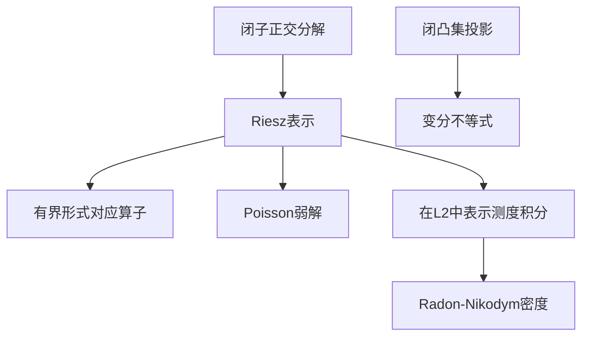

# Riesz 表示与变分问题

在一般赋范空间中，对偶空间 $X^*$ 的结构往往远比原空间 $X$ 复杂；而在 **Hilbert 空间 $H$** 中，得益于正交直和分解定理，**Riesz 表示定理**指出每一个连续线性泛函 $f\in H^*$ 都可以唯一地表示为与空间中某个固定向量 $y_f\in H$ 的内积：$f(x)=(x,y_f)$。这一深刻定理不仅确立了 $H^*$ 与 $H$ 之间的等距（共轭线性）同构，而且将偏微分方程与测度论中形如“对所有测试函数 $v\in H$ 成立积分恒等式”的变分问题，直接转化为 Hilbert 空间中唯一解向量 $y_f$ 的存在性定理。

## 导航

- [[01_Riesz表示定理|01 Riesz 表示定理]]
- [[02_弱解与变分不等式|02 弱解与变分不等式]]
- [[03_Radon-Nikodym定理的Hilbert空间证明|03 Radon-Nikodym 定理的 Hilbert 空间证明]]
- [[08_Riesz表示与变分问题.base|专题 Base]]

## 理论脉络与定理区分

1. **两个“Riesz 表示定理”的区分：** 在泛函分析与实分析中，有两个著名定理都冠以“Riesz 表示定理”之名——其一是本专题讨论的 **Hilbert 空间 $H^*$ 的内积表示定理（Fréchet-Riesz 定理）**；其二是连续函数空间 $C(K)$（或 $C_c(X)$）上的连续线性泛函由正则 Borel 测度（或有界变差函数 Stieltjes 积分）表示的 **Riesz-Markov-Kakutani 表示定理**。学习时切勿将两者的作用空间混淆。
2. **选定合适 Hilbert 空间的艺术：** 应用 Riesz 表示定理求解具体分析问题时，最核心的设计步骤是**构造恰当的 Hilbert 空间与内积**，使得原方程左端恰好成为内积 $(v,u)_H$，而右端关于测试向量 $v$ 是该内积范数下的连续线性泛函。例如，第 02 篇讲义利用 Poincaré 不等式在 Sobolev 空间 $H_0^1(\Omega)$ 上引入梯度能量内积 $(\nabla v,\nabla u)_{L^2}$ 从而一步解出椭圆方程弱解；第 03 篇讲义则效仿 von Neumann 的经典妙法，在合成测度空间 $L^2(\mu+\nu)$ 上应用 Riesz 表示定理，极其优美地构造出测度的 Radon-Nikodym 导数。

## 相关链接

- [[泛函分析/00_泛函分析学习总览|学习总览]]
- [[泛函分析/06_Hilbert空间与正交方法/00_专题总览|正交方法]]
- [[泛函分析/09_Baire纲与基本定理/04_Lax-Milgram与稳定性|一般强制形式]]
- [[泛函分析讲义上册习题册#2.2 Hilbert 空间中的投影与核|原书 2.2 节]]
