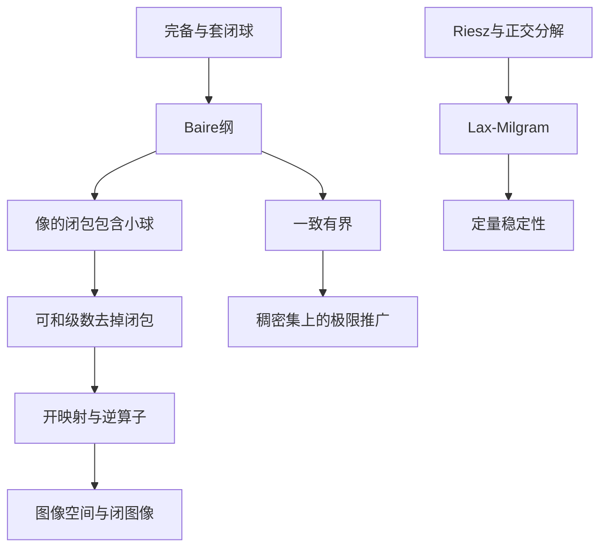

# Baire 纲与基本定理

本专题聚焦于线性泛函分析中最具标志性的三大基本定理——**开映射定理（及逆算子定理）**、**闭图像定理**与**一致有界原理（共鸣定理）**，以及作为偏微分方程核心工具的 **Lax-Milgram 定理**。前三项基本定理的共同特征，是精妙地将**度量空间的完备性（通过 Baire 纲定理）**与**算子的线性结构**结合起来：先将空间分解为按范数界分层的一列可数闭集的并集 $X=\bigcup_{n=1}^\infty F_n$，利用 **Baire 纲定理** 断言其中必有一层 $F_N$ 含有非空开球（局部内点），再借助线性算子的平移与缩放不变性，将该局部开球上的控制一举放大为全空间上的统一范数估计。

## 导航

- [[01_Baire纲定理|01 Baire 纲定理]]
- [[02_开映射与闭图像定理|02 开映射与闭图像定理]]
- [[03_一致有界原理与极限交换|03 一致有界原理与极限交换]]
- [[04_Lax-Milgram与稳定性|04 Lax-Milgram 与稳定性]]
- [[09_Baire纲与基本定理.base|专题 Base]]

## 逻辑架构说明

本专题除系统建立 Baire 纲工具箱外，还在第 04 篇讲义中收录了同一章节下的 **Lax-Milgram 定理** 与算子逼近稳定性理论。需要注意，Lax-Milgram 定理本身并不依赖于非构造性的 Baire 纲定理，而是直接依托 Hilbert 空间的 Riesz 表示定理、强制性下界估计与正交补空间分解给出解的存在唯一性及定量范数上界 $\|A^{-1}\|\leq 1/\delta$；将其置于此处，便于与逆算子定理及一致有界原理在算子方程稳定性分析中的作用进行对比。

## 相关链接

- [[泛函分析/00_泛函分析学习总览|学习总览]]
- [[泛函分析/07_有界算子与对偶空间/00_专题总览|算子基础]]
- [[泛函分析/08_Riesz表示与变分问题/00_专题总览|表示与变分]]
- [[泛函分析讲义上册习题册#2.3 开映射、闭图像与共鸣定理|原书 2.3 节]]
