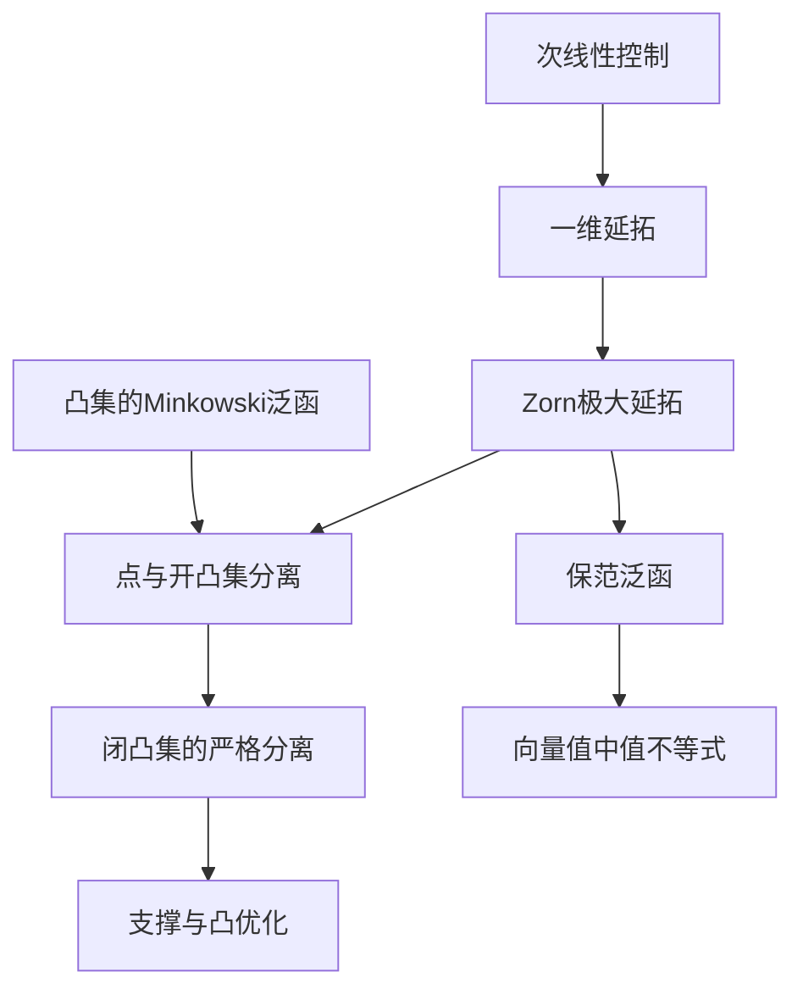

# Hahn–Banach 与凸分离

在一般的赋范线性空间 $X$ 中，如果没有内积与正交投影，我们如何证明对偶空间 $X^*$ 中存在足够丰富的非零连续线性泛函来区分不同的点与闭子集？**Hahn–Banach 延拓定理**从纯粹的代数与凸性出发给出了答案：只要子空间上的线性泛函受到某个次线性泛函（如范数或 Minkowski 泛函）的控制，就可以先向子空间外扩张一个新维数，再借助 **Zorn 引理** 无损地延拓到整个空间上。而当我们将凸集的 **Minkowski 泛函** 选作控制函数时，解析形式的 Hahn–Banach 延拓定理便立即化身为几何形式的**凸集分离定理**与**支撑超平面定理**，成为现代凸分析、最优化理论与弱拓扑理论的共同基石。

## 导航

- [[01_Hahn-Banach延拓定理|01 Hahn–Banach 延拓定理]]
- [[02_凸集分离与支撑泛函|02 凸集分离与支撑泛函]]
- [[03_中值不等式与凸优化|03 中值不等式与凸优化]]
- [[10_Hahn-Banach与凸分离.base|专题 Base]]

## 理论特征与注意事项

1. **不依赖完备性，仅依赖线性与凸性：** 与第 09 专题中必须假设空间完备的 Baire 纲工具箱不同，Hahn–Banach 延拓定理及凸集分离定理**完全不需要假设环境空间完备**，它们揭示的是线性结构与凸结构在对偶层面的本质对应。
2. **“存在达到距离的支撑泛函”不等于“存在最近点”：** 利用 Hahn–Banach 定理，对任意闭子空间 $M\subseteq X$ 及外部点 $x_0\notin M$，总能找到一个范数为 $1$ 的连续线性泛函 $F\in X^*$ 使得 $\F|_M=0$ 且 $F(x_0)=d(x_0,M)$。但请注意，这是在对偶空间 $X^*$ 中找到了**检测距离的泛函**，而绝不意味着在原空间的子空间 $M$ 中一定存在达到该距离的**最近点** $m^*\in M$（回顾 [[泛函分析/04_赋范空间与Banach空间/04_商空间与最佳逼近#4.2 无限维 Banach 空间的闭超平面上最佳逼近元不存在|04 专题第 4 节 $c_0$ 的反例]]）。

## 相关链接

- [[泛函分析/00_泛函分析学习总览|学习总览]]
- [[泛函分析/05_凸集与不动点/01_凸集与Minkowski泛函|凸集与尺度函数]]
- [[泛函分析/07_有界算子与对偶空间/02_对偶空间与算子反例|对偶与延拓边界]]
- [[泛函分析讲义上册习题册#2.4 Hahn-Banach 定理及其应用|原书 2.4 节]]
