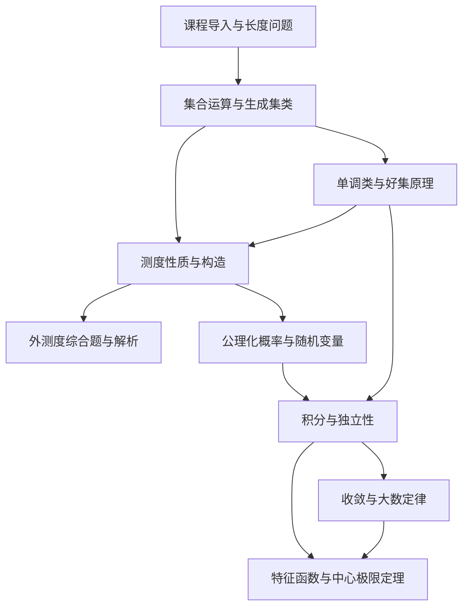

# 概率论学业辅导讲义总览

本套讲义专为概率论学业辅导课程的教师备课、课堂讲授与学生课后研习而编写。讲义以任佳刚、刘继成《概率论教程》为主教材，同时参考袁德美、王学军《测度论基础与高等概率论》（上册）以补充测度构造的直观动机与证明方法。正文严格按照数学概念的内在逻辑与理论依赖关系渐次展开，并在核心定理与关键方法处配套典型例题与专题训练。

## 本次成稿

- [[01_课程总导入|课程总导入]]：提供可直接用于课堂讲授的开篇导引，串联课程四大核心主题并设计课堂互动提问。
- [[02_第一篇_集类与测度|第一篇：集类与测度]]：涵盖集类结构、好集原理与测度构造的完整讲义正文、核心定理证明及贯穿始终的典型算例。
- [[03_第一篇_例题与练习解答|第一篇例题与练习解答]]：收录与第一篇配套的 17 组典型例题与练习，包含完整题面、解题思路、详细解答及教学讲评。
- [[04_第一篇_授课安排与来源核对|授课安排与来源核对]]：提供两次 120 分钟辅导课的课堂时间规划、板书取舍建议以及与主教材章节和习题的对应关系表。
- [[05_外测度与Lebesgue外测度_综合题与解析|外测度与Lebesgue外测度综合题与解析]]：围绕外测度公理与 Lebesgue 外测度的构造设置三部分共 8 个递进主问，后附完整解答与方法剖析，系统比较一般外测度与 Lebesgue 外测度在可加性、可测包络及单调连续性上的本质差异。

![[概率论学业辅导讲义.base]]

## 整体路线

上图中的有向箭头刻画了各专题之间的教学先后顺序与理论依赖关系。全套辅导讲义规划为四篇，对应八次辅导课的教学进程：

| 课次 | 主要内容 | 本次状态 |
|---|---|---|
| 1–2 | 集类、好集原理、测度性质与构造 | 正文与解答已编写 |
| 3–4 | 公理化概率、条件概率、随机变量与分布 | 待后续编写 |
| 5–6 | 积分、矩、独立性、特征函数 | 待后续编写 |
| 7–8 | 收敛、大数定律、简单中心极限定理 | 待后续编写 |

为便于教师深入备课与学生课后查阅，讲义正文完整保留了各项定义、定理条件及技术性证明，其篇幅略多于两次课堂的现场板书容量。任课教师在课堂讲授时，可根据学情并参照授课安排灵活取舍现场板演的证明细节。第一篇所涵盖的教材章节范围及与后续篇章的衔接边界，详见来源核对表。

## 阅读与使用

建议教师备课时先阅读《课程总导入》以把握全课程的问题意识，随后通读《第一篇：集类与测度》正文，并结合《授课安排与来源核对》规划课堂板书与随堂练习。

为方便布置课后作业，例题与练习解答独立成篇（即《第一篇例题与练习解答》），与仓库中的原书习题册分别维护。讲义中的例题采用独立编号（E1–E17），每道题目均在题首标明其在原教材中的对应节次或题号。此外，《外测度与 Lebesgue 外测度综合题与解析》采用“题面与提示在前、完整解析在后”的编排方式，适合作为学完第一篇后的进阶专题训练。

## 相关链接

- [[高等概率论/笔记/00_高等概率论总览|袁书笔记总览]]
- [[README|数学笔记仓库首页]]
