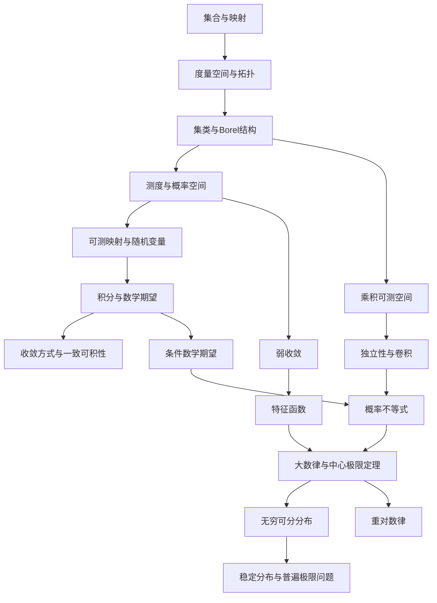

# 高等概率论总览

> [!abstract] 笔记目标
> 本套课程讲义与读书笔记以袁德美、王学军《测度论基础与高等概率论》（上、下册）为主要蓝本，围绕现代概率论的公理化体系与极限理论，将原书的定义、核心定理、严格证明与典型例题梳理为一条逻辑连贯、便于教学与自学的理论主线。

## 1. 全书范围与关联讲义

本专题同时配套建设了面向本科高年级与研究生阶段课堂教学的[[高等概率论/学业辅导讲义/00_讲义总览|概率论学业辅导讲义]]（以任佳刚、刘继成《概率论教程》为主教材，袁德美、王学军《测度论基础与高等概率论》为测度论补充），涵盖课程总导入、第一篇“集类与测度”完整备课讲义、好集原理专题、17 组典型例题与练习解答、外测度递进综合题以及两次 120 分钟授课安排，可与本套章节理论笔记互为参照。

按照《测度论基础与高等概率论》全书的理论架构，全部 25 章内容划分为以下四个递进模块：

- **第 1–2 章（基础预备知识）**：梳理集合论初步（集合运算、映射、上下限集与基数）与点集拓扑初步（度量空间、紧致性与 Borel 结构）。
- **第 3–12 章（测度论基础）**：系统建立集类与生成 $\sigma$-代数、测度扩张与完备化、可测映射与随机变量、函数序列的收敛方式、Lebesgue 积分与数学期望、符号测度与 Radon-Nikodym 定理、$L^p$ 空间与一致可积性、乘积测度与 Fubini 定理、局部紧空间上的 Riesz 表示以及测度的弱收敛理论。
- **第 13–18 章（高等概率论基本工具）**：在测度论框架下深入展开独立性、零一律、概率与矩不等式、条件数学期望、母函数与多维特征函数等现代概率分析工具。
- **第 19–25 章（概率极限理论）**：系统研究独立随机变量和的收敛性、强大数定律、中心极限定理、无穷可分分布、稳定分布、普遍极限问题以及重对数律。

与本套理论笔记相配套，仓库中还按原书章节结构整理了完整的上下册习题集（涵盖第 1–25 章、92 个小节，共收录 763 道习题，其中上册 433 题、下册 330 题）。各章理论笔记均在文末通过小节锚点链接与相应习题直接对应，便于读者在完成理论学习后即时开展针对性训练。

## 2. 知识依赖主线

在贯穿全书的理论演进中，有以下五条核心逻辑纽带需要反复体会：

1. **生成集类与好集原理**：第 3 章建立的 $\pi$-$\lambda$ 定理与单调类定理，是后续证明测度扩张唯一性、乘积测度构造以及独立性推广的共同方法论基础。
2. **符号测度与条件期望**：第 8 章的 Radon-Nikodym 定理从抽象测度绝度连续性的高度，为第 15 章一般条件数学期望的存在唯一性提供了严格的数学根基。
3. **乘积空间与独立性模型**：第 10 章的乘积可测空间、乘积测度与 Fubini 定理，为刻画随机向量的联合分布、独立性以及分布卷积提供了统一的几何与积分模型。
4. **弱收敛与特征函数方法**：第 12 章建立的度量空间测度弱收敛理论，与第 17 章的特征函数逆转公式及 Lévy 连续性定理相结合，共同构成了证明中心极限定理与弱极限理论的标准分析框架。
5. **概率不等式与极限估计**：第 14 章的各类概率与矩不等式以及第 15 章的条件期望工具，分别为大数定律、级数收敛以及中心极限定理的误差控制提供了定量估计手段。

## 3. 笔记目录

### 上册：测度论基础

- [[01_上册_测度论基础/00_上册总览|上册总览]]
- [[01_上册_测度论基础/01_集合论初步|第 1 章 集合论初步]]
- [[01_上册_测度论基础/02_点集拓扑学初步|第 2 章 点集拓扑初步]]
- [[01_上册_测度论基础/03_集类|第 3 章 集类]]
- [[01_上册_测度论基础/04_测度与概率测度|第 4 章 测度与概率测度]]
- [[01_上册_测度论基础/05_可测映射与随机变量|第 5 章 可测映射与随机变量]]
- [[01_上册_测度论基础/06_几乎处处收敛与依测度收敛|第 6 章 几乎处处收敛与依测度收敛]]
- [[01_上册_测度论基础/07_Lebesgue积分与数学期望|第 7 章 Lebesgue 积分与数学期望]]
- [[01_上册_测度论基础/08_符号测度与Radon-Nikodym定理|第 8 章 不定积分和符号测度]]
- [[01_上册_测度论基础/09_Lebesgue空间与一致可积性|第 9 章 Lebesgue 空间与一致可积性]]
- [[01_上册_测度论基础/10_乘积空间上的测度与积分|第 10 章 乘积空间上的测度与积分]]
- [[01_上册_测度论基础/11_局部紧空间上的测度与Riesz表示|第 11 章 局部紧 Hausdorff 空间上的测度]]
- [[01_上册_测度论基础/12_弱收敛|第 12 章 弱收敛]]

目前上册第 1–12 章的理论讲义均已完成体系化梳理，涵盖了从集类、测度构造到 Lebesgue 积分、乘积空间及弱收敛的完整内容。

### 下册：高等概率论与极限理论

下册第 13–25 章围绕现代概率论的核心专题展开，按内容结构划分为“独立性与条件数学期望”、“多维分布与特征函数”、“经典概率极限定理”以及“无穷可分分布与高级极限理论”四大模块。
